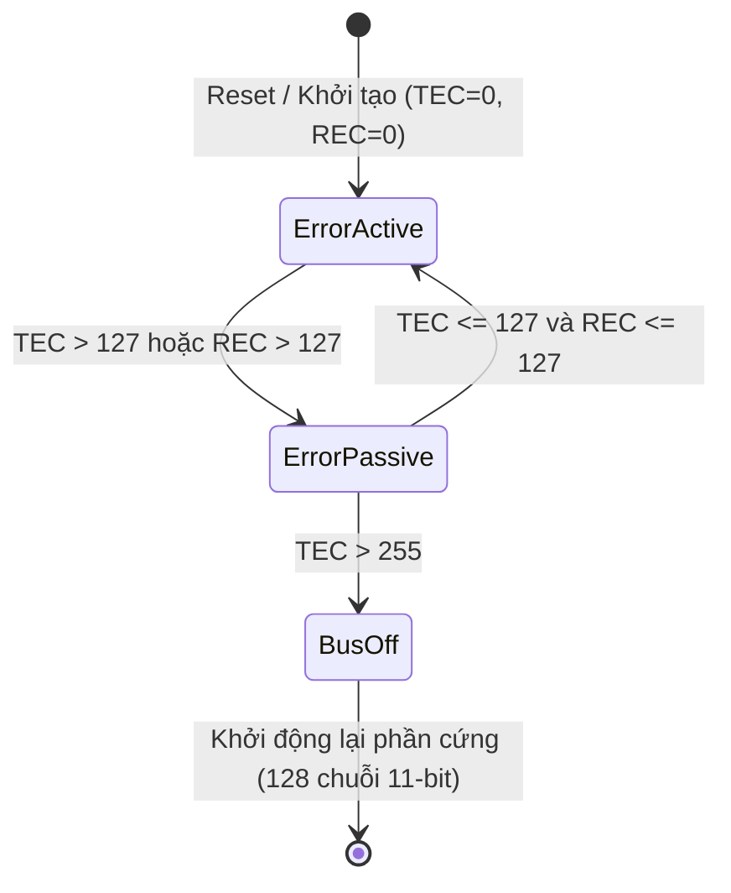
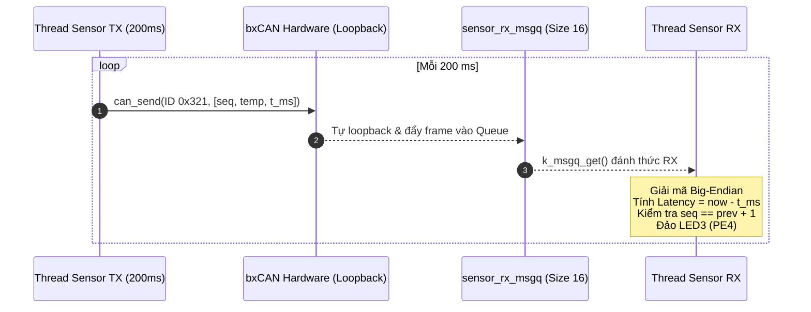
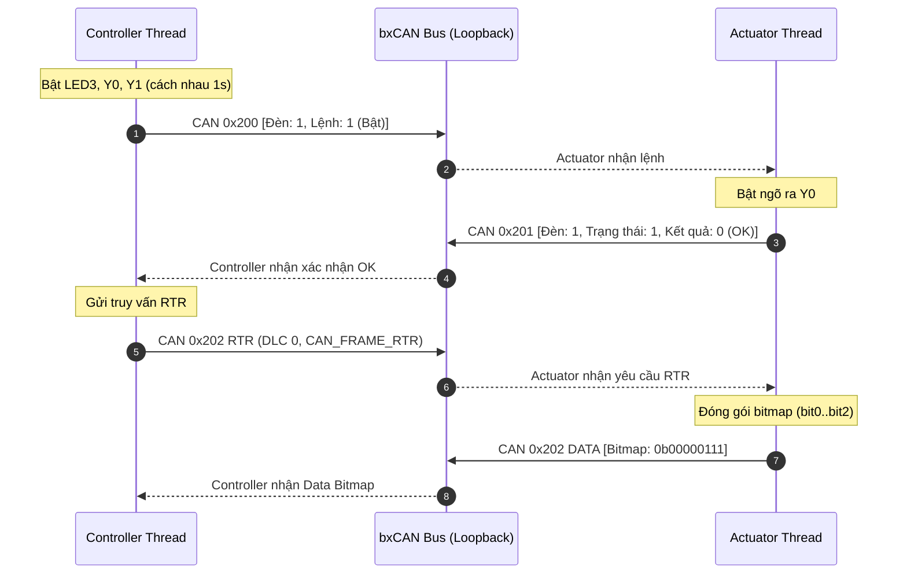
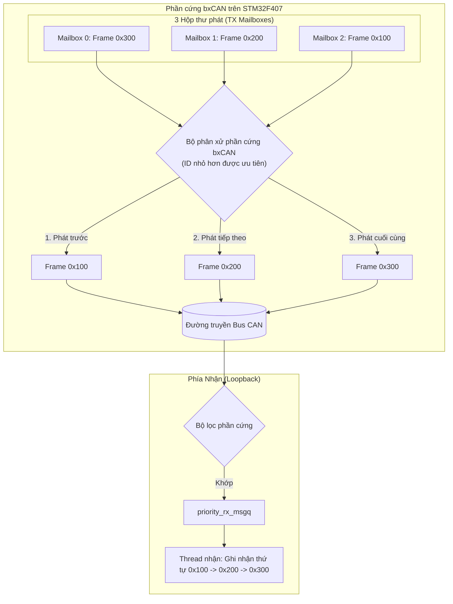
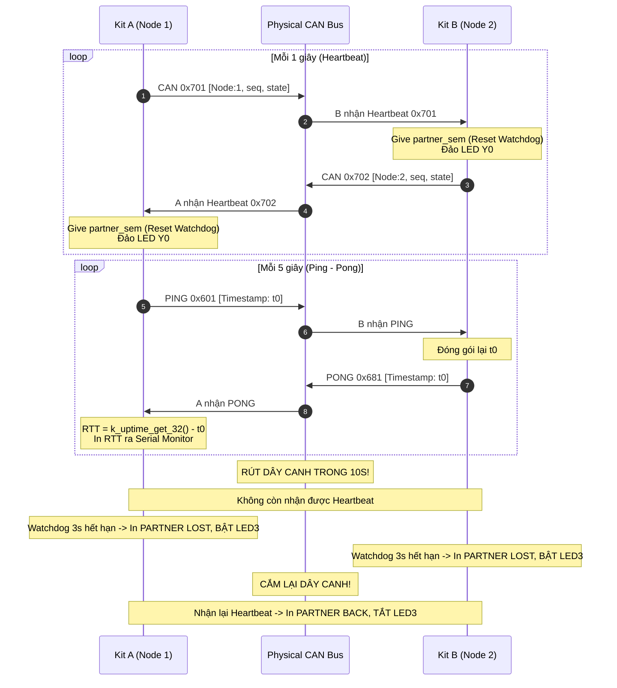
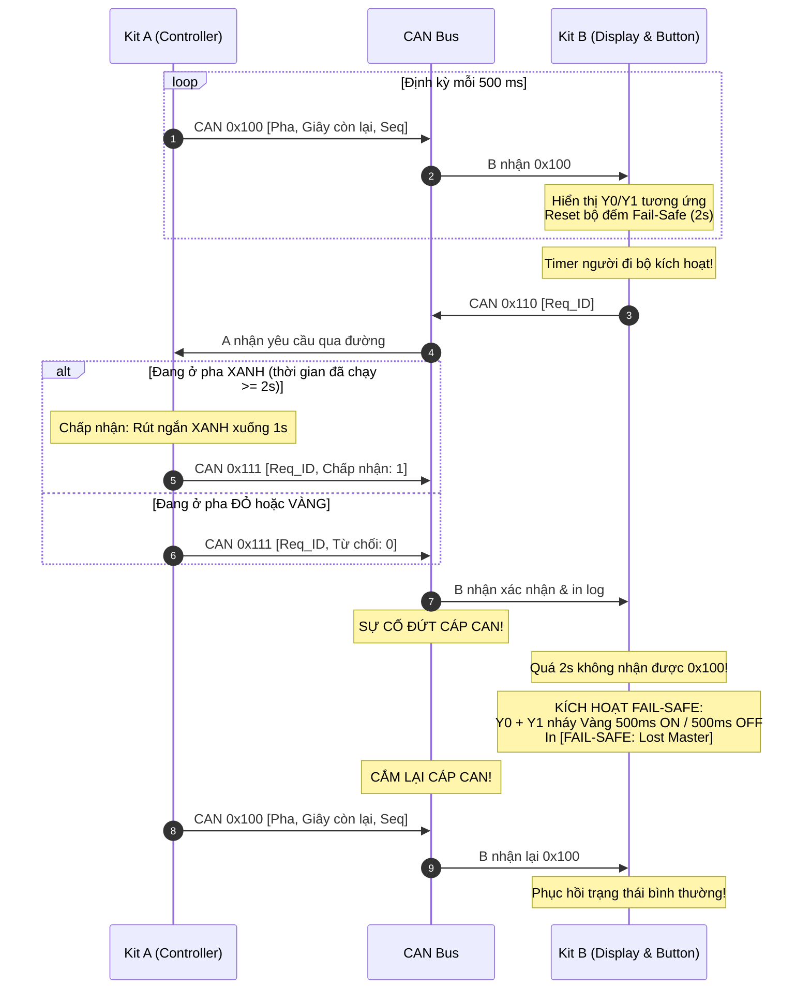

# 🚗 LAB 3: MẠNG TRUYỀN THÔNG CAN BUS VÀ HỆ THỐNG PHÂN TÁN TRONG ZEPHYR RTOS
### Lý thuyết chuyên sâu về Giao thức CAN, So sánh UART - SPI - I2C - CAN, Bộ điều khiển bxCAN, Bộ lọc ID/Mask & Hệ thống 3 Demo + 5 Exercise

> **Trường Đại học Bách Khoa - ĐHQG-HCM**  
> **Khoa Khoa học và Kỹ thuật Máy tính**  
> **Môn học:** Hệ thống nhúng (Embedded Systems)  
> **Sinh viên thực hiện:** Võ Phạm (MSSV: 2313946)  
> **Nhánh Git:** `lab3_canbus` | **Nền tảng:** Kit BKIT ARM4 (STM32F407ZGT6 + Transceiver TJA1050)  
> **Hệ điều hành:** Zephyr RTOS v4.4.0 (Công cụ quản trị: `west`)

---

## 📖 Mục lục
- [1. Mục tiêu thí nghiệm](#1-mục-tiêu-thí-nghiệm)
- [2. Chuẩn bị phần cứng CAN trên Kit BKIT ARM4](#2-chuẩn-bị-phần-cứng-can-trên-kit-bkit-arm4)
- [3. Kiến thức nền tảng toàn diện về CAN Bus](#3-kiến-thức-nền-tảng-toàn-diện-về-can-bus)
  - [3.1. Tầng vật lý: Tín hiệu vi sai & Đặc tính Dominant / Recessive](#31-tầng-vật-lý-tín-hiệu-vi-sai--đặc-tính-dominant--recessive)
  - [3.2. Điện trở kết cuối 120 Ohm và Dây GND chung](#32-điện-trở-kết-cuối-120-ohm-và-dây-gnd-chung)
  - [3.3. So sánh chuyên sâu: UART vs SPI vs I2C vs CAN](#33-so-sánh-chuyên-sâu-uart-vs-spi-vs-i2c-vs-can)
  - [3.4. Cấu trúc Khung tin CAN (Data Frame & Remote Frame RTR)](#34-cấu-trúc-khung-tin-can-data-frame--remote-frame-rtr)
  - [3.5. Cơ chế Phân xử bus không phá hủy (Non-destructive Bitwise Arbitration)](#35-cơ-chế-phân-xử-bus-không-phá-hủy-non-destructive-bitwise-arbitration)
  - [3.6. Định thời bit (Bit Timing) & Điểm lấy mẫu](#36-định-thời-bit-bit-timing--điểm-lấy-mẫu)
  - [3.7. ACK và Vòng đời xử lý lỗi Bus (Error Confinement & State Machine)](#37-ack-và-vòng-đời-xử-lý-lỗi-bus-error-confinement--state-machine)
  - [3.8. Bộ lọc nhận phần cứng bxCAN (Hardware Acceptance Filter ID & Mask)](#38-bộ-lọc-nhận-phần-cứng-bxcan-hardware-acceptance-filter-id--mask)
  - [3.9. Hệ thống API CAN của Zephyr RTOS](#39-hệ-thống-api-can-của-zephyr-rtos)
  - [3.10. Đối chiếu cú pháp: Zephyr RTOS vs STM32 HAL (STM32CubeIDE)](#310-đối-chiếu-cú-pháp-zephyr-rtos-vs-stm32-hal-stm32cubeide)
- [4. Cấu hình Project CAN trong Zephyr (Devicetree & Kconfig)](#4-cấu-hình-project-can-trong-zephyr-devicetree--kconfig)
- [5. Cấu trúc thư mục dự án](#5-cấu-trúc-thư-mục-dự-án)
- [6. Danh mục 3 bài Demo nền tảng (demos/)](#6-danh-mục-3-bài-demo-nền-tảng-demos)
  - [Demo 1: lab3_demo1_loopback - Gửi nhận CAN chế độ Loopback nội bộ](#demo-1-lab3_demo1_loopback---gửi-nhận-can-chế-độ-loopback-nội-bộ)
  - [Demo 2: lab3_demo2_filters - Kiểm nghiệm bộ lọc phần cứng ID/Mask và RTR](#demo-2-lab3_demo2_filters---kiểm-nghiệm-bộ-lọc-phần-cứng-idmask-và-rtr)
  - [Demo 3: lab3_demo3_two_nodes - Giao tiếp giữa 2 Node trên Bus thật & Giám sát lỗi](#demo-3-lab3_demo3_two_nodes---giao-tiếp-giữa-2-node-trên-bus-thật--giám-sát-lỗi)
- [7. Danh mục 5 bài tập thực hành ứng dụng (lab3_ex*)](#7-danh-mục-5-bài-tập-thực-hành-ứng-dụng-lab3_ex)
  - [Bài 1: lab3_ex1_can_sensor_loopback - Đóng gói dữ liệu cảm biến đa byte Big-Endian](#bài-1-lab3_ex1_can_sensor_loopback---đóng-gói-dữ-liệu-cảm-biến-đa-byte-big-endian)
  - [Bài 2: lab3_ex2_can_command_rtr - Khung yêu cầu từ xa RTR và Điều khiển thiết bị](#bài-2-lab3_ex2_can_command_rtr---khung-yêu-cầu-từ-xa-rtr-và-điều-khiển-thiết-bị)
  - [Bài 3: lab3_ex3_can_filter_priority - Lọc phần cứng và Phân xử ưu tiên Mailbox](#bài-3-lab3_ex3_can_filter_priority---lọc-phần-cứng-và-phân-xử-ưu-tiên-mailbox)
  - [Bài 4: lab3_ex4_can_heartbeat_ping - Giám sát sống còn Node và Giao thức Ping-Pong](#bài-4-lab3_ex4_can_heartbeat_ping---giám-sát-sống-còn-node-và-giao-thức-ping-pong)
  - [Bài 5: lab3_ex5_distributed_traffic_light - Đèn giao thông phân tán Master - Slave](#bài-5-lab3_ex5_distributed_traffic_light---đèn-giao-thông-phân-tán-master---slave)
- [8. Hướng dẫn biên dịch, Nạp chương trình & Đấu dây thực nghiệm](#8-hướng-dẫn-biên-dịch-nạp-chương-trình--đấu-dây-thực-nghiệm)
- [9. Tổng kết các lỗi kỹ thuật thường gặp & Bảng Cheat-sheet](#9-tổng-kết-các-lỗi-kỹ-thuật-thường-gặp--bảng-cheat-sheet)

---

## 🎯 1. Mục tiêu thí nghiệm

Sau bài thực hành này, người học có thể:
1. **Làm chủ tầng vật lý và giao thức CAN:** Giải thích cặn kẽ nguyên lý tín hiệu vi sai, đặc tính Dominant/Recessive, cơ chế "AND dây" (Wired-AND), vai trò triệt tiêu sóng phản xạ của điện trở kết cuối 120 Ω và cấu trúc chi tiết từng trường của khung tin CAN.
2. **So sánh bản chất lập trình giữa các chuẩn giao tiếp:** Phân biệt rõ sự khác nhau về mô hình dữ liệu (Data Paradigm), cơ chế địa chỉ và xử lý thời gian thực giữa **UART, SPI, I2C và CAN**.
3. **Cấu hình ngoại vi bxCAN trên Zephyr RTOS:** Tích hợp bộ điều khiển `can1` của Kit BKIT ARM4 thông qua Devicetree (`app.overlay`) và Kconfig (`prj.conf`).
4. **Thành thạo hệ thống API CAN của Zephyr RTOS:**
   - Khởi tạo theo đúng quy trình chuẩn: `can_set_mode()` → Thêm bộ lọc → `can_start()`.
   - Gửi frame an toàn ở chế độ Loopback và Bus thật (sử dụng callback bất đồng bộ kèm timeout để chống treo luồng).
   - Thiết lập bộ lọc phần cứng (Hardware Acceptance Filter) theo cơ chế ID & Mask để phân luồng trực tiếp vào Message Queue (`CAN_MSGQ_DEFINE`).
5. **Xây dựng hệ thống nhúng phân tán đa vi điều khiển:** Triển khai các giao thức thời gian thực như Command/Response, Heartbeat giám sát sống còn với Watchdog Semaphore, đo độ trễ RTT (Ping-Pong) và máy trạng thái đèn giao thông phân tán có cơ chế bảo an Fail-Safe khi đứt đường truyền.

---

## 🔌 2. Chuẩn bị phần cứng CAN trên Kit BKIT ARM4

* **Vi điều khiển & Bộ điều khiển CAN:** STM32F407ZGT6 (ARM Cortex-M4 @ 168 MHz) tích hợp bộ điều khiển **bxCAN (Basic Extended CAN)** gồm CAN1 và CAN2.
* **Transceiver CAN:** Chip **TJA1050** trên bo mạch, chuyển đổi tín hiệu mức logic số 3.3V từ STM32 sang tín hiệu điện áp vi sai chuẩn ISO 11898 trên đường truyền `CANH` và `CANL`.
* **Ánh xạ chân ngoại vi CAN1:**
  * Chân nhận dữ liệu: **PB8** (`CAN1_RX`)
  * Chân phát dữ liệu: **PB9** (`CAN1_TX`)
* **Cầu đấu dây tín hiệu CAN:** Khối 3 cọc vít đấu dây gồm `CAN_H`, `CAN_L` và `GND`.
* **Công tắc điện trở kết cuối SW13:**
  * Vị trí **ON**: Kích hoạt điện trở kết cuối 120 Ω trên bo mạch.
  * Vị trí **OFF**: Ngắt điện trở kết cuối.
  *(Quy tắc: Khi nối 2 kit thành bus vật lý, gạt SW13 = ON trên cả 2 kit).*
* **Đèn LED hiển thị trạng thái:**
  * **LED3 (PE4):** Đèn LED debug người dùng, đảo trạng thái khi nhận frame hoặc báo mất kết nối.
  * **Ngõ ra công suất Y0 (PE5):** Đèn Đỏ trong máy trạng thái đèn giao thông / Đèn báo mất frame.
  * **Ngõ ra công suất Y1 (PE6):** Đèn Xanh trong máy trạng thái đèn giao thông (cả Y0 và Y1 cùng bật là màu Vàng).
---

## 📘 3. Kiến thức nền tảng toàn diện về CAN Bus

### 3.1. Tầng vật lý: Tín hiệu vi sai & Đặc tính Dominant / Recessive

Mạng CAN sử dụng cặp dây xoắn đôi **CANH** và **CANL** để truyền tín hiệu vi sai. Mức logic trên bus được quyết định bởi hiệu điện thế giữa hai dây:
$$V_{\text{diff}} = V_{\text{CANH}} - V_{\text{CANL}}$$

```
  Trạng thái RECESSIVE (Bit 1 - Lặn)       Trạng thái DOMINANT (Bit 0 - Trội)
  
  CANH  ────── 2.5V ──────                 CANH  ────── 3.5V ──────  ▲
                                                                     │ Vdiff ≈ 2.0V
  CANL  ────── 2.5V ──────                 CANL  ────── 1.5V ──────  ▼
  Vdiff ≈ 0V                               Vdiff ≈ 2.0V
```

* **Trạng thái Recessive (Bit 1 - Lặn):** 
  Transceiver thả nổi đường truyền. Cả hai dây đều ở điện áp nghỉ khoảng 2.5V. Hiệu điện thế V_diff ≈ 0V (nằm trong dải an toàn $-0.5\,\text{V} → +0.5\,\text{V}$).
* **Trạng thái Dominant (Bit 0 - Trội):** 
  Transceiver tích cực lái dòng điện, kéo `CANH` lên khoảng 3.5V và dìm `CANL` xuống khoảng 1.5V. Hiệu điện thế V_diff ≈ 2.0V (nằm trong dải $1.5\,\text{V} → 3.0\,\text{V}$).

> [!IMPORTANT]
> **Nguyên lý "Wired-AND" (AND dây):**
> Vì trạng thái Dominant (0) được kích hoạt chủ động bằng dòng điện, nếu trên bus có nhiều node cùng truyền tại một thời điểm, chỉ cần **MỘT node phát mức Dominant (0)** thì hiệu điện thế V_diff lập tức nhảy lên 2.0V, ép toàn bộ bus về mức Dominant (0). 
> **Dominant (0) luôn luôn thắng và đè bẹp Recessive (1)!** Đây chính là nền tảng cốt lõi của cơ chế phân xử tranh chấp không phá hủy và cơ chế gửi ACK.

---

### 3.2. Điện trở kết cuối 120 Ohm và Dây GND chung

1. **Điện trở kết cuối 120 Ω (Termination Resistor):**
   * Tín hiệu điện từ truyền trên dây cáp đồng với tốc độ xấp xỉ 200.000 km/s. Khi tín hiệu gặp đầu mút hở mạch, năng lượng sóng bị dội ngược lại (hiện tượng sóng phản xạ - Wave Reflection), gây giao thoa phá hủy và làm méo dạng sườn xung của các bit tiếp theo.
   * Để hấp thụ hoàn toàn sóng phản xạ, mạng CAN bắt buộc phải có **đúng 2 điện trở 120 Ω ở hai đầu mút xa nhất** của đường bus. Điện trở tương đương toàn bus đo giữa CANH và CANL là:
     $$R_{\text{bus}} = 120\,\Omega \parallel 120\,\Omega = 60\,\Omega$$
   * *Trên Kit BKIT ARM4:* Tích hợp sẵn công tắc gạt **SW13**. Gạt sang **ON** để đóng điện trở 120 Ω vào mạng.
2. **Dây nối đất chung (Common GND):**
   * Dù CAN là truyền thông vi sai, bộ thu TJA1050 chỉ hoạt động đúng khi điện áp của mỗi dây so với đất của transceiver nằm trong dải điện áp Common-mode cho phép ($-12\,\text{V} → +12\,\text{V}$).
   * Nếu 2 kit cắm vào 2 nguồn điện khác nhau (2 laptop hoặc 2 adapter), điện thế đất của chúng có thể lệch nhau hàng chục vôn → Làm cháy transceiver hoặc sai lệch bit hoàn toàn. **Do đó, bắt buộc phải nối dây GND giữa các kit!**

---

### 3.3. So sánh chuyên sâu: UART vs SPI vs I2C vs CAN

Trong lập trình hệ thống nhúng, việc hiểu rõ sự khác biệt giữa các giao tiếp ngoại vi giúp kỹ sư đưa ra quyết định kiến trúc chuẩn xác nhất:

#### Bảng so sánh 10 tiêu chí kỹ thuật:

| Tiêu chí | UART / RS-232 | SPI | I2C | CAN (Controller Area Network) |
| :--- | :--- | :--- | :--- | :--- |
| **Kiến trúc mạng** | Điểm - Điểm (Point-to-Point) | Master - Multi-Slave | Master - Multi-Slave | **Đa chủ phân tán (Multi-Master / Peer)** |
| **Số lượng dây dẫn** | 2 dây (`TX`, `RX`) + `GND` | 4 dây (`MOSI`, `MISO`, `SCK`, `CS`) | 2 dây (`SDA`, `SCL`) + `GND` | **2 dây vi sai (`CANH`, `CANL`) + `GND`** |
| **Tầng vật lý** | Single-ended (0V / 3.3V) | Single-ended (0V / 3.3V) | Open-drain (kéo trở pull-up) | **Tín hiệu vi sai (V_diff = 2.0V)** |
| **Khoảng cách truyền** | Ngắn (< 2m với TTL) | Rất ngắn (< 30cm) | Ngắn (< 1m trên cùng PCB) | **Rất xa (lên tới 1km @ 50kbps, 40m @ 1Mbps)** |
| **Đơn vị truyền nhận** | Byte stream (dòng byte thô) | Shift register byte-by-byte | Byte thanh ghi (`reg_addr` + `data`) | **Frame hoàn chỉnh (ID + DLC + Data[8])** |
| **Cơ chế định danh** | Không có | Chọn chân phần cứng Chip Select (`CS`) | Địa chỉ Slave 7-bit hoặc 10-bit | **ID gói tin (11-bit hoặc 29-bit) chỉ nội dung** |
| **Khái niệm Master/Slave** | Không | Bắt buộc (Slave không tự gửi được) | Bắt buộc (Slave không tự gửi được) | **Không có Master/Slave (Mọi node đều bình đẳng)** |
| **Xử lý va chạm (Collision)**| Gây hỏng dữ liệu (không có) | Không xảy ra (Master quyết định) | Phân xử trên Start bit (Multi-master) | **Phân xử từng bit không phá hủy (ID nhỏ thắng)** |
| **Bộ lọc tin nhận** | Phần mềm tự đọc và parse chuỗi | Không cần lọc (phụ thuộc chân CS) | Phần cứng so khớp địa chỉ Slave | **Bộ lọc phần cứng (Hardware ID/Mask Filter)** |
| **Tự động gửi lại lỗi** | Không (phần mềm tự xử lý) | Không | Không | **Phần cứng tự động truyền lại (Auto-retransmit)** |

#### So sánh tư duy lập trình (Data Paradigm) qua mã nguồn Zephyr RTOS:

```c
/* 1. UART: Dòng byte thô - Phải ngắt từng byte, gom buffer, dò ký tự kết thúc '
' */
uart_poll_out(uart_dev, 'A');
// Bên nhận: Bắt ISR từng byte -> Ring Buffer -> Parse string

/* 2. SPI: Thanh ghi dịch đồng bộ - Phải quản lý chân CS và xung nhịp SCK */
struct spi_buf tx_b = {.buf = tx_buf, .len = 2};
struct spi_buf rx_b = {.buf = rx_buf, .len = 2};
spi_transceive_dt(&spi_spec, &tx_set, &rx_set);

/* 3. I2C: Đọc/ghi theo địa chỉ thiết bị và thanh ghi nội bộ */
uint8_t reg_addr = 0x01;
i2c_write_read_dt(&i2c_spec, &reg_addr, 1, rx_buf, 2);

/* 4. CAN: Truyền nhận Gói tin hoàn chỉnh (Message Frame) có ID và Bộ lọc phần cứng */
struct can_frame frame = {
    .id = 0x321,    // Ý nghĩa gói tin (ví dụ: Nhiệt độ cảm biến)
    .dlc = 8,       // Số byte tải hữu ích (0 - 8 byte)
    .data = {0x01, 0x02, 0x00, 0xFA, 0x00, 0x01, 0xE2, 0x40}
};
can_send(can_dev, &frame, K_MSEC(100), tx_cb, NULL);
```

> [!TIP]
> **4 điểm "ăn tiền" của CAN mà lập trình viên cần nhớ:**
> 1. **Không có địa chỉ thiết bị:** CAN không gửi cho một Node cụ thể, nó broadcast gói tin có gắn nhãn ID nội dung. Bất kỳ node nào trên bus cần dữ liệu đó thì tự lọc lấy về dùng.
> 2. **Bộ lọc phần cứng giải phóng CPU:** Bộ điều khiển `bxCAN` tự so khớp ID bằng Mask ngay tại thanh ghi phần cứng. Frame không liên quan bị vứt bỏ lập tức, **CPU không bị ngắt, không tốn 1 chu kỳ lệnh!**
> 3. **Phân xử ưu tiên tự động:** Node có ID nhỏ hơn sẽ thắng phân xử và chiếm bus mà không làm gián đoạn hay mất mát bit dữ liệu nào.
> 4. **Tích hợp Message Queue cực sâu trong RTOS:** Dùng `can_add_rx_filter_msgq()` đẩy frame an toàn từ ISR vào Thread mà không cần viết mã bảo vệ Race Condition.

---

### 3.4. Cấu trúc Khung tin CAN (Data Frame & Remote Frame RTR)

Khung dữ liệu chuẩn (CAN 2.0A - Standard 11-bit ID) có cấu trúc vật lý như sau:

```
┌─────┬───────────────────┬──────┬─────────┬──────────────┬────────┬────────┬─────┐
│ SOF │ Arbitration Field │ Ctrl │   DLC   │  Data Field  │  CRC   │  ACK   │ EOF │
│(1b) │ ID(11b) + RTR(1b) │ (2b) │ (4 bit) │ (0 - 8 byte) │ (15+1) │ (1+1b) │(7b) │
└─────┴───────────────────┴──────┴─────────┴──────────────┴────────┴────────┴─────┘
```

1. **SOF (Start of Frame - 1 bit Dominant):** Đồng bộ hóa bộ đếm thời gian của các node trên bus khi chuyển từ trạng thái nghỉ (Bus Idle) sang truyền dữ liệu.
2. **Arbitration Field (Trường phân xử - 12 bit):**
   * **Base ID (11 bit):** Định danh gói tin (từ `0x000` đến `0x7FF`).
   * **RTR (Remote Transmission Request - 1 bit):**
     * Trong **Data Frame**: RTR = Dominant (0).
     * Trong **Remote Frame (RTR)**: RTR = Recessive (1).
     * *Hệ quả:* Nếu một node phát Data Frame và một node phát Remote Frame có cùng ID, **Data Frame luôn luôn thắng phân xử!**
3. **Control Field (2 bit):** Chứa bit `IDE` (Identifier Extension: 0 = Standard 11-bit, 1 = Extended 29-bit) và bit dự trữ `r0`.
4. **DLC (Data Length Code - 4 bit):** Mã hóa số byte dữ liệu (0 → 8 byte).
5. **Data Field (0 đến 8 byte):** Dữ liệu payload hữu ích.
6. **CRC Field (16 bit):** Mã kiểm tra dư thừa tuần hoàn CRC 15 bit + 1 bit phân cách CRC Delimiter (Recessive).
7. **ACK Field (2 bit):**
   * **ACK Slot:** Node phát gửi 1 bit Recessive (1). Mọi node nhận được đúng mã CRC sẽ **kéo đè 1 bit Dominant (0)** vào khe này để xác nhận.
   * **ACK Delimiter:** 1 bit Recessive (1).
8. **EOF (End of Frame - 7 bit Recessive):** Đánh dấu kết thúc khung tin.

---

### 3.5. Cơ chế Phân xử bus không phá hủy (Non-destructive Bitwise Arbitration)

Khi đường bus đang rảnh (Bus Idle), nếu hai hoặc nhiều node cùng bắt đầu gửi khung tin cùng một lúc:
* Mỗi node vừa phát từng bit của trường Arbitration Field, vừa đồng thời **đọc ngược lại điện áp thực tế trên bus**.
* Vì tính chất "Wired-AND": Dominant (0) đè bẹp Recessive (1).
* Nếu một node phát bit 1 (Recessive) nhưng đọc về thấy bus mang giá trị 0 (Dominant) → Node đó hiểu rằng có một node khác có độ ưu tiên cao hơn đang phát → **Lập tức dừng phát ngay trong chu kỳ bit đó, chuyển sang chế độ nhận mà KHÔNG làm gián đoạn gói tin của node thắng!**

```
           Bit 10 9 8 7 6 5 4 3 2   Bit 1    Bit 0
  Node A:    0  0 1 0 0 1 0 0 0     0 (Dom)    1    --> THẮNG (tiếp tục phát)
  Node B:    0  0 1 0 0 1 0 0 0     1 (Rec)    -    --> THUA (dừng phát, chuyển sang nhận)
  Bus CAN:   0  0 1 0 0 1 0 0 0     0 (Dom)
```

> [!IMPORTANT]
> **Quy tắc vàng:** **ID CÓ GIÁ TRỊ SỐ CÀNG NHỎ THÌ CÓ ĐỘ ƯU TIÊN TRUYỀN CÀNG CAO!**

---

### 3.6. Định thời bit (Bit Timing) & Điểm lấy mẫu

Mỗi bit CAN được chia thành nhiều khoảng thời gian cơ sở gọi là **Time Quantum (`t_q`)**. Một chu kỳ bit danh định gồm 4 phân đoạn:
1. **Sync_Seg (1 `t_q`):** Đoạn đồng bộ cạnh xuống của tín hiệu.
2. **Prop_Seg (1 → 8 `t_q`):** Bù trễ truyền dẫn vật lý trên đường cáp và qua transceiver.
3. **Phase_Seg1 (1 → 8 `t_q`):** Bù trừ sai lệch pha của bộ dao động.
4. **Phase_Seg2 (2 → 8 `t_q`):** Phân đoạn pha thứ hai kết thúc bit.

* **Điểm lấy mẫu (Sample Point):** Nằm giữa Phase_Seg1 và Phase_Seg2, thường được cấu hình từ **75% đến 87.5%** chiều dài bit.
* Trong Zephyr RTOS, bạn chỉ cần khai báo `bitrate = <500000>;` trong Devicetree, driver CAN của Zephyr sẽ tự động tính toán prescaler và các tham số phân đoạn bit tối ưu.

---

### 3.7. ACK và Vòng đời xử lý lỗi Bus (Error Confinement & State Machine)

bxCAN tích hợp 2 bộ đếm lỗi phần cứng:
* **TEC (Transmit Error Counter):** Tăng khi lỗi truyền (lỗi bit, lỗi ACK, lỗi stuff).
* **REC (Receive Error Counter):** Tăng khi lỗi nhận (lỗi CRC, lỗi định dạng).



1. **ERROR-ACTIVE (Bình thường):** TEC < 96, REC < 96. Được quyền phát Active Error Flag (6 bit dominant) khi thấy lỗi.
2. **ERROR-WARNING:** TEC ≥ 96 hoặc REC ≥ 96. Cảnh báo đường truyền bắt đầu xấu.
3. **ERROR-PASSIVE (Lỗi nghiêm trọng):** TEC > 127 hoặc REC > 127. Chỉ được phát Passive Error Flag (6 bit recessive) và phải đợi thêm 8 bit Suspend Transmission trước khi được gửi gói tin mới.
4. **BUS-OFF (Tự ngắt bảo vệ):** TEC > 255. Node tự động ngắt hoàn toàn khỏi mạng để bảo vệ hệ thống.

> [!NOTE]
> **Hiện tượng đặc thù khi 1 Kit đứng một mình:**
> Khi chỉ có 1 kit phát trên bus thật (không có kit thứ 2 ACK), lỗi ACK Error xảy ra liên tục → TEC tăng mỗi lần +8 lên tới 128 → Chuyển sang `ERROR-PASSIVE`.
> **Quy chuẩn ISO 11898 quy định:** Khi node đã ở trạng thái Error-Passive, lỗi thiếu ACK sẽ **KHÔNG làm tăng TEC nữa**. Do đó node không bao giờ bị rơi vào `BUS-OFF` chỉ vì đối tác tắt nguồn!

---

### 3.8. Bộ lọc nhận phần cứng bxCAN (Hardware Acceptance Filter ID & Mask)

bxCAN trên STM32F407 có 28 Filter Banks dùng cơ chế **ID** và **Mask**:
`Match = ((Received_ID ^ Filter_ID) & Mask) == 0`
Tương đương: **`(Received_ID & Mask) == (Filter_ID & Mask)`**

* **Ý nghĩa Bit Mask:**
  * Bit Mask = 1: Bắt buộc bit tương ứng của ID nhận được phải **GIỐNG HỆT** bit của `Filter_ID`.
  * Bit Mask = 0: **Don't care** (Chấp nhận bất kể là 0 hay 1).

* **Các trường hợp kinh điển:**
  * **Nhận chính xác 1 ID duy nhất `0x080`:**
    * `Filter_ID = 0x080`, `Mask = 0x7FF` (`CAN_STD_ID_MASK`).
  * **Nhận dải 16 ID liên tiếp từ `0x4A0` đến `0x4AF`:**
    * `0x4A0` = `0100 1010 0000_2`, `0x4AF` = `0100 1010 1111_2`.
    * 7 bit đầu cố định, 4 bit cuối tùy biến → `Filter_ID = 0x4A0`, `Mask = 0x7F0`.
  * **Nhận cả 2 ID `0x200` và `0x201` (loại `0x202` và `0x203`):**
    * `Filter_ID = 0x200`, `Mask = 0x7FE` (bỏ qua bit 0, kiểm tra bit 1 phải bằng 0).

---

### 3.9. Hệ thống API CAN của Zephyr RTOS

1. **Chu trình khởi tạo bắt buộc:**
   ```c
   /* 1. Lấy device */
   const struct device *can_dev = DEVICE_DT_GET(DT_CHOSEN(zephyr_canbus));

   /* 2. Cấu hình mode (KHI ĐANG STOPPED) */
   can_set_mode(can_dev, CAN_MODE_LOOPBACK); // hoặc CAN_MODE_NORMAL

   /* 3. Thêm bộ lọc phần cứng */
   can_add_rx_filter_msgq(can_dev, &my_msgq, &my_filter);

   /* 4. Bắt đầu chạy */
   can_start(can_dev);
   ```

2. **Gửi dữ liệu an toàn:**
   * Trên Loopback: Có thể dùng `can_send(can_dev, &frame, K_MSEC(100), NULL, NULL);`
   * Trên Bus thật: **BẮT BUỘC** dùng callback `can_send(can_dev, &frame, K_MSEC(100), tx_cb, NULL);` kèm timeout để tránh bị treo luồng khi mất ACK.

---

### 3.10. Đối chiếu cú pháp: Zephyr RTOS vs STM32 HAL (STM32CubeIDE)

| Chức năng | Zephyr RTOS v4.4.0 | STM32 HAL (CubeIDE) |
| :--- | :--- | :--- |
| **Lấy ngoại vi** | `DEVICE_DT_GET(DT_CHOSEN(zephyr_canbus))` | `hcan1` (con trỏ `CAN_HandleTypeDef`) |
| **Cài đặt chế độ** | `can_set_mode(dev, CAN_MODE_LOOPBACK)` | `hcan1.Init.Mode = CAN_MODE_LOOPBACK;` |
| **Cấu hình bộ lọc** | `can_add_rx_filter_msgq(dev, &msgq, &filter)` | `HAL_CAN_ConfigFilter(&hcan1, &sFilterConfig)` |
| **Khởi động CAN** | `can_start(dev)` | `HAL_CAN_Start(&hcan1)` |
| **Gửi frame** | `can_send(dev, &frame, timeout, cb, NULL)` | `HAL_CAN_AddTxMessage(&hcan1, &pHeader, pData, &TxMailbox)` |
| **Nhận frame** | `k_msgq_get(&msgq, &frame, timeout)` | `HAL_CAN_GetRxMessage(&hcan1, CAN_RX_FIFO0, &pHeader, pData)` |
---

## ⚙️ 4. Cấu hình Project CAN trong Zephyr (Devicetree & Kconfig)

### 4.1. Cấu hình Devicetree (`app.overlay`)
File `app.overlay` kích hoạt bộ điều khiển `can1` trên STM32F407 và gán chân ngoại vi:
```dts
/ {
    chosen {
        zephyr,canbus = &can1;
    };
};

&can1 {
    status = "okay";
    pinctrl-0 = <&can1_rx_pb8 &can1_tx_pb9>;
    pinctrl-names = "default";
    bus-speed = <500000>; // 500 kbit/s
    sample-point = <875>; // 87.5%
};
```

### 4.2. Cấu hình Kernel (`prj.conf`)
File `prj.conf` bật driver CAN và các tính năng nâng cao:
```ini
CONFIG_CAN=y
CONFIG_CAN_INIT_PRIORITY=80
CONFIG_CAN_MAX_FILTER=5
CONFIG_CAN_ACCEPT_RTR=y
CONFIG_CAN_STATS=y
CONFIG_PRINTK=y
```

---

## 📂 5. Cấu trúc thư mục dự án

```
lab3_canbus/
├── .gitignore
├── LAB3_EXERCISE_Zephyr_BKIT_ARM4.docx     # Phiếu bài tập chính thức
├── LAB3_MANUAL_Zephyr_BKIT_ARM4.docx       # Tài liệu hướng dẫn thực hành
├── README.md                              # Tài liệu kỹ thuật chi tiết này
├── demos/                                 # 3 Bài Demo nền tảng
│   ├── lab3_demo1_loopback/               # Demo 1: CAN Loopback nội bộ
│   ├── lab3_demo2_filters/                # Demo 2: Bộ lọc ID/Mask & Frame RTR
│   └── lab3_demo3_two_nodes/              # Demo 3: Bus thật 2 Node & Giám sát lỗi
├── lab3_ex1_can_sensor_loopback/          # Bài 1: Đóng gói Big-Endian & Đo trễ
├── lab3_ex2_can_command_rtr/              # Bài 2: Giao thức Lệnh / Phản hồi & RTR
├── lab3_ex3_can_filter_priority/          # Bài 3: Lọc phần cứng & Phân xử Mailbox
├── lab3_ex4_can_heartbeat_ping/           # Bài 4: Heartbeat 1s, Watchdog & Ping RTT
└── lab3_ex5_distributed_traffic_light/    # Bài 5: Đèn giao thông phân tán Master-Slave
```

---

## 🧪 6. Danh mục 3 bài Demo nền tảng (demos/)

---

### Demo 1: `lab3_demo1_loopback` — Gửi nhận CAN chế độ Loopback nội bộ

* **Mục tiêu:** Kiểm tra cơ chế hoạt động của `bxCAN` trên 1 kit duy nhất mà không cần dây nối ra ngoài và không cần node khác ACK.
* **Kiến trúc luồng:**
  * `thread_tx` (Priority 7): Định kỳ mỗi 1000 ms gửi một frame ID `0x123`, DLC = 8 mang các byte `0x11, 0x22, ...`.
  * `thread_rx` (Priority 7): Lấy frame từ hàng đợi `CAN_MSGQ_DEFINE(rx_msgq, 10)`, in mã hex ra màn hình và đảo trạng thái LED3 (PE4).
* **Trình tự đọc hiểu mã nguồn:**
  1. Khai báo hàng đợi nhận: `CAN_MSGQ_DEFINE(rx_msgq, 10);`
  2. Hàm `main()`: `can_set_mode(can_dev, CAN_MODE_LOOPBACK)` → `can_add_rx_filter_msgq(can_dev, &rx_msgq, &filter)` → `can_start(can_dev)`.
  3. `thread_tx`: Gọi `can_send(can_dev, &frame, K_MSEC(100), NULL, NULL)`.
  4. `thread_rx`: Gọi `k_msgq_get(&rx_msgq, &frame, K_FOREVER)` để đọc dữ liệu an toàn.

---

### Demo 2: `lab3_demo2_filters` — Kiểm nghiệm bộ lọc phần cứng ID/Mask và RTR

* **Mục tiêu:** Khảo sát bộ lọc ID/Mask, cờ mở rộng `CAN_FILTER_IDE` (29-bit), cờ yêu cầu từ xa `CAN_FRAME_RTR` và so sánh Callback ISR vs Message Queue.
* **Cấu trúc bộ lọc:**
  * **Bộ lọc A (Standard ID `0x100`, Mask `0x7F0`):** Nhận toàn bộ dải `0x100 → 0x10F`. Sử dụng **Callback ISR** (`can_add_rx_filter`), trong ISR gọi `k_msgq_put(&evt_q, ...)` chuyển sang `thread_log_a` → Đảo trạng thái LED Y0 (PE5).
  * **Bộ lọc B (Extended ID `0x18FF0001`, Mask `0x1FFFFFFF`, cờ `CAN_FILTER_IDE`):** Nhận chính xác 29 bit. Sử dụng **Message Queue** (`can_add_rx_filter_msgq`) → Đảo trạng thái LED Y1 (PE6).
  * **Frame RTR:** Kiểm tra `(frame.flags & CAN_FRAME_RTR)`: Khi nhận được yêu cầu RTR trên `0x100`, node phản hồi ngay một Data Frame chứa dữ liệu.

---

### Demo 3: `lab3_demo3_two_nodes` — Giao tiếp giữa 2 Node trên Bus thật & Giám sát lỗi

* **Mục tiêu:** Nối 2 kit thành bus vật lý, triển khai Heartbeat 1s, Watchdog 3s và giám sát trạng thái chuyển dịch của bus CAN.
* **Cấu hình:** Đổi `#define NODE_ID 1` trên Kit A và `#define NODE_ID 2` trên Kit B. Đấu dây `CANH - CANH`, `CANL - CANL`, `GND - GND` và gạt `SW13 = ON`.
* **Cơ chế:**
  * Mỗi 1s gửi gói Heartbeat `0x700 + NODE_ID`. Nhận được của đối tác thì nạp lại bộ định thời Watchdog 3s.
  * Giám sát trạng thái vật lý bằng `can_set_state_change_callback()`: Bắt các biến đổi `CAN_STATE_ERROR_ACTIVE`, `CAN_STATE_ERROR_WARNING`, `CAN_STATE_ERROR_PASSIVE` và `CAN_STATE_BUS_OFF` cùng giá trị bộ đếm TEC/REC.
---

## 🚀 7. Danh mục 5 bài tập thực hành ứng dụng (lab3_ex*)

---

### Bài 1: `lab3_ex1_can_sensor_loopback` — Đóng gói dữ liệu cảm biến đa byte Big-Endian

#### 1. Yêu cầu đề bài & Lý thuyết cốt lõi
* **Mục tiêu:** Đóng gói (Packet Encoding) và giải mã (Packet Decoding) dữ liệu đa byte vào 1 frame CAN 8 byte theo chuẩn **Big-Endian**; phát hiện mất frame bằng bộ đếm `seq` và đo độ trễ.
* **Cấu trúc Payload (ID `0x321`, DLC = 8):**
  * Byte 0–1: `seq` (uint16_t, bộ đếm tăng 1 mỗi frame).
  * Byte 2–3: `temp_x10` (uint16_t, nhiệt độ × 10, tăng dần từ 250 đến 300 rồi quay lại 250).
  * Byte 4–7: `t_ms` (uint32_t, mốc thời gian phát `k_uptime_get_32()`).
* **Hành vi phần cứng:** 
  * LED3 (PE4) đảo trạng thái mỗi khi nhận được 1 frame hợp lệ.
  * Ngõ ra Y0 (PE5) bật sáng nếu phát hiện `seq != prev_seq + 1` (mất frame / nhảy cóc).
  * Định kỳ mỗi 5s in một dòng thống kê: số frame gửi, nhận và `gap_count`.

#### 2. Hướng dẫn trình tự đọc hiểu mã nguồn
1. **Kiểm tra định dạng đóng gói trong `thread_sensor_tx`:** Quan sát cách dịch bit đưa byte cao vào `data[0]` và byte thấp vào `data[1]` (Big-Endian).
2. **Kiểm tra bộ lọc tại `main()`:** Bộ lọc `SENSOR_CAN_ID (0x321)` với mask `CAN_STD_ID_MASK (0x7FF)`.
3. **Kiểm tra logic giải mã trong `thread_sensor_rx`:** Quan sát phép dịch bit ghép các byte lại thành `uint16_t` và `uint32_t`.
4. **Kiểm tra logic phát hiện mất frame:** So sánh `rx_seq == expected_seq`, nếu lệch tăng `gap_count` và bật ngõ ra `Y0`.
5. **Kiểm tra thread thống kê:** `thread_stats` chạy mỗi 5000 ms để in `tx_count`, `rx_count` và `gap_count`.

#### 3. Cơ chế hoạt động & Sơ đồ tương tác


#### 4. Nếu KHÔNG CÓ cơ chế này thì sao? (Failure Modes)
* **Nếu không thống nhất Big-Endian:** Nếu bên phát gửi Big-Endian mà bên nhận đọc Little-Endian, giá trị `0x0102` (258) sẽ bị bên nhận hiểu nhầm thành `0x0201` (513), dẫn đến sai lệch dữ liệu trầm trọng trong điều khiển ô tô / tự động hóa.
* **Nếu không có trường `seq`:** Hệ thống hoàn toàn không biết có frame nào bị rơi do nghẽn bus hoặc tràn buffer hay không.

#### 5. Đáp án câu hỏi bài tập Bài 1
* **(a) Đoạn code đóng gói Big-Endian & Giá trị đọc nhầm Little-Endian:**
  * Đóng gói:
    ```c
    frame.data[0] = (uint8_t)(seq >> 8);   frame.data[1] = (uint8_t)(seq & 0xFF);
    frame.data[4] = (uint8_t)(t_ms >> 24); frame.data[5] = (uint8_t)(t_ms >> 16);
    frame.data[6] = (uint8_t)(t_ms >> 8);  frame.data[7] = (uint8_t)(t_ms & 0xFF);
    ```
  * Nếu giải mã theo Little-Endian, giá trị `seq = 0x0102` (`data[0]=0x01, data[1]=0x02`) sẽ được tính là:
    $$\text{Value} = \text{data}[0] \mid (\text{data}[1] \ll 8) = 0x01 \mid 0x0200 = 0x0201 = 513$$
* **(b) Tính toán thời gian và tải bus:**
  * Thời gian truyền một frame 111 bit ở 500 kbit/s:
    $$t_{\text{frame}} = \frac{111\,\text{bit}}{500.000\,\text{bit/s}} = 0,222\,\text{ms} = 222\,\mu\text{s}$$
  * Bus tải tối đa số frame/giây:
    $$\text{Max Frame Rate} = \frac{1}{0,000222\,\text{s}} \approx 4504,5\,\text{frame/giây}$$
  * Với chu kỳ 200 ms (tần số 5 frame/s), tải bus chiếm dụng là:
    $$\text{Bus Load} = \frac{5}{4504{,}5} \times 100\% \approx 0{,}111\%$$
* **(c) Vì sao loopback không cần ACK từ node khác?**
  * Vì ở chế độ Loopback, khối điều khiển bxCAN tự ngắt kết nối với transceiver bên ngoài, tự vòng tín hiệu từ chân TX nội bộ sang RX nội bộ và **phần cứng bxCAN tự động sinh bit Dominant vào khe ACK** cho chính frame đó.

---

### Bài 2: `lab3_ex2_can_command_rtr` — Khung yêu cầu từ xa RTR và Điều khiển thiết bị

#### 1. Yêu cầu đề bài & Lý thuyết cốt lõi
* **Mục tiêu:** Thiết kế giao thức Lệnh/Phản hồi (Command/Response); ứng dụng khung yêu cầu từ xa RTR (`CAN_FRAME_RTR`) để truy vấn trạng thái thiết bị mà không tốn tải dữ liệu yêu cầu.
* **Quy ước giao thức:**
  * `0x200` (Controller → Actuator): Lệnh điều khiển `data[0]` = đèn (0: LED3, 1: Y0, 2: Y1), `data[1]` = bật (1) / tắt (0).
  * `0x201` (Actuator → Controller): Phản hồi kết quả `data[0]` = đèn, `data[1]` = trạng thái mới, `data[2]` = mã kết quả (0: OK, 1: lỗi đèn không tồn tại).
  * `0x202 RTR` (Controller → Actuator): Khung RTR không dữ liệu: *"Báo cáo trạng thái tất cả đèn"*.
  * `0x202 DATA` (Actuator → Controller): Khung dữ liệu trả lời RTR: `data[0]` = Bitmap trạng thái (`bit0` = LED3, `bit1` = Y0, `bit2` = Y1).
* **Cấu hình bắt buộc:** `CONFIG_CAN_ACCEPT_RTR=y` trong `prj.conf`.

#### 2. Hướng dẫn trình tự đọc hiểu mã nguồn
1. **Kiểm tra `CONFIG_CAN_ACCEPT_RTR=y`:** Bắt buộc có trong `prj.conf` để bxCAN không tự động loại bỏ frame RTR.
2. **Kiểm tra bộ lọc của Actuator:** Đăng ký 2 bộ lọc cho ID `0x200` (lệnh) và `0x202` (RTR).
3. **Phân biệt RTR trong `thread_actuator`:** Kiểm tra `(frame.flags & CAN_FRAME_RTR)`. Nếu có, đóng gói bitmap `(led3_st | (y0_st << 1) | (y1_st << 2))` vào frame `0x202` Data gửi lại.
4. **Xử lý loopback trong `thread_controller`:** Khi nhận ID `0x202`, kiểm tra `if (frame.flags & CAN_FRAME_RTR) continue;` để bỏ qua frame RTR do chính mình gửi dội lại.
5. **Kịch bản kiểm thử lỗi:** Controller gửi lệnh điều khiển đèn số 5 → Actuator phản hồi mã lỗi `0x01` trên frame `0x201`.

#### 3. Cơ chế hoạt động & Sơ đồ tương tác


#### 4. Nếu KHÔNG CÓ cơ chế này thì sao? (Failure Modes)
* **Nếu Controller không lọc bỏ cờ RTR:** Do chạy chế độ loopback, Controller cũng sẽ nhận lại chính frame RTR do nó gửi ra. Nếu không kiểm tra `!(frame.flags & CAN_FRAME_RTR)`, nó sẽ đọc `frame.data[0]` của gói RTR (vốn là giá trị rác) và hiểu sai trạng thái của đèn.
* **Nếu không có cơ chế NAK/Error code:** Khi gửi lệnh sai (đèn không tồn tại), hệ thống im lặng sẽ khiến bên điều khiển tưởng rằng lệnh đã được thực thi, dẫn đến mất an toàn vận hành.

#### 5. Đáp án câu hỏi bài tập Bài 2
* **(a) Cách tổ chức bộ lọc để Controller chỉ nhận Data Frame 0x202 mà không nhận nhầm RTR:**
  * Controller sử dụng bộ lọc nhận ID `0x202` với mask `CAN_STD_ID_MASK (0x7FF)`. Khi lấy frame từ hàng đợi nhận, Controller kiểm tra cờ `frame.flags`:
    * Nếu `(frame.flags & CAN_FRAME_RTR) != 0`: Bỏ qua (đây là frame RTR do chính mình gửi vòng lại).
    * Nếu `!(frame.flags & CAN_FRAME_RTR)`: Chấp nhận xử lý (đây là Data Frame mang payload bitmap do Actuator phản hồi).
* **(b) Tìm cặp ID/Mask nhận cả 0x200 và 0x201 nhưng loại 0x202, 0x203:**
  * `0x200` = `010 0000 0000_2` và `0x201` = `010 0000 0001_2` có 10 bit đầu giống nhau, bit 0 khác nhau.
  * `0x202` = `010 0000 0010_2` và `0x203` = `010 0000 0011_2` có bit 1 bằng `1`.
  * Ta cần mask bỏ qua bit 0 (don't care) và kiểm tra bit 1 phải bằng `0`:
    * **Filter ID:** `0x200`
    * **Filter Mask:** `0x7FE` (`111 1111 1110_2`)
    * *Kiểm chứng:* 
      * `0x200 & 0x7FE = 0x200 == 0x200` (KHỚP → NHẬN)
      * `0x201 & 0x7FE = 0x200 == 0x200` (KHỚP → NHẬN)
      * `0x202 & 0x7FE = 0x202 != 0x200` (SAI → LOẠI)
      * `0x203 & 0x7FE = 0x202 != 0x200` (SAI → LOẠI)
* **(c) Vì sao không dùng ID 0x000 cho lệnh điều khiển đèn trong hệ thống thật?**
  * Trong mạng CAN, ID `0x000` có giá trị số nhỏ nhất nên mang **độ ưu tiên cao nhất tuyệt đối trên toàn bộ bus**. ID này được bảo lưu cho các thông điệp an toàn khẩn cấp nhất (như lệnh ngắt khẩn cấp E-STOP, cảnh báo va chạm, túi khí, reset mạng). Nếu gán `0x000` cho lệnh điều khiển đèn thông thường, khi có tranh chấp bus nó sẽ chèn ép và trì hoãn các gói tin an toàn sinh mạng khác.

---

### Bài 3: `lab3_ex3_can_filter_priority` — Lọc phần cứng và Phân xử ưu tiên Mailbox

#### 1. Yêu cầu đề bài & Lý thuyết cốt lõi
* **Mục tiêu:** Chứng minh bộ lọc phần cứng (Hardware Acceptance Filter) loại bỏ hoàn toàn frame không mong muốn mà không tốn chu kỳ CPU; quan sát cơ chế phân xử ưu tiên truyền của 3 TX Mailbox của bxCAN.
* **3 luồng phát định kỳ:**
  * Thread 1: `0x080` mỗi 100 ms.
  * Thread 2: `0x4A0 → 0x4AF` (ID tăng vòng) mỗi 250 ms.
  * Thread 3: `0x6F0` mỗi 1000 ms.
* **Chỉ sử dụng 2 bộ lọc:**
  * Bộ lọc 1: Nhận chính xác `0x080` (Mask `0x7FF`).
  * Bộ lọc 2: Nhận toàn bộ dải `0x4A0 → 0x4AF` (Filter ID `0x4A0`, Mask `0x7F0`).
  * Frame `0x6F0` không khớp bộ lọc nào → Bị loại bỏ 100% tại phần cứng.
* **Thử nghiệm ưu tiên:** Mỗi 5s, gửi liền 3 frame `0x300`, `0x200`, `0x100` bằng `can_send(..., K_NO_WAIT, tx_done_cb, NULL)` không chờ giữa các lần gọi. In thứ tự nhận được tại bên nhận.
* **Cảnh báo mất gói:** Ngõ ra Y0 (PE5) bật sáng nếu số frame `0x080` nhận được trong cửa sổ 5s nằm ngoài khoảng 48–52.

#### 2. Hướng dẫn trình tự đọc hiểu mã nguồn
1. **Thiết lập bộ lọc Mask `0x7F0` trong `main()`:** 
   ```c
   struct can_filter f_range = {.id = 0x4A0, .mask = 0x7F0, .flags = 0};
   can_add_rx_filter_msgq(can_dev, &monitor_rx_msgq, &f_range);
   ```
2. **Quan sát việc vứt bỏ `0x6F0`:** Trong bảng thống kê 5s, biến đếm của `0x6F0` không bao giờ tăng.
3. **Thử nghiệm ưu tiên trong `thread_priority_tx`:** Nạp liền 3 frame vào 3 TX Mailbox bằng `K_NO_WAIT`:
   ```c
   can_send(can_dev, &f300, K_NO_WAIT, tx_done_cb, NULL);
   can_send(can_dev, &f200, K_NO_WAIT, tx_done_cb, NULL);
   can_send(can_dev, &f100, K_NO_WAIT, tx_done_cb, NULL);
   ```
4. **Kiểm tra thứ tự nhận tại `priority_rx_msgq`:** In dòng log thể hiện thứ tự nhận được.
5. **Logic cảnh báo Y0:** Kiểm tra `(cnt_080 < 48 || cnt_080 > 52)` trong `thread_stats`.

#### 3. Cơ chế hoạt động & Sơ đồ tương tác


#### 4. Nếu KHÔNG CÓ cơ chế này thì sao? (Failure Modes)
* **Nếu không lọc bằng phần cứng:** Mọi frame rác (như `0x6F0` hoặc hàng ngàn frame khác trên ô tô) đều kích hoạt ngắt ISR, đánh thức CPU và đẩy vào Message Queue → Gây nghẽn hàng đợi, tiêu hao năng lượng và trễ các tác vụ thời gian thực.
* **Nếu không có cơ chế phân xử ưu tiên:** Gói tin phanh khẩn cấp có thể bị xếp sau một gói tin đo áp suất lốp, gây nguy hiểm khôn lường.

#### 5. Đáp án câu hỏi bài tập Bài 3
* **(a) Cặp ID/Mask cho dải 0x4A0–0x4AF & Chứng minh 0x6F0 và 0x4B0 bị loại:**
  * Dải `0x4A0 → 0x4AF`: **Filter ID = `0x4A0`, Mask = `0x7F0`**.
  * *Chứng minh loại `0x6F0`:* `0x6F0 & 0x7F0 = 0x6F0 != 0x4A0` → Không khớp → Phần cứng loại bỏ.
  * *Chứng minh loại `0x4B0`:* `0x4B0 & 0x7F0 = 0x4B0 != 0x4A0` → Không khớp → Phần cứng loại bỏ.
* **(b) Thứ tự nhận 3 frame trong thử nghiệm ưu tiên & Giải thích cơ chế 3 Mailbox:**
  * Thứ tự nhận được: **`0x100` → `0x200` → `0x300`** (hoặc `0x300` → `0x100` → `0x200`).
  * *Giải thích cơ chế 3 TX Mailbox:* bxCAN có 3 hộp thư phát. Khi cả 3 mailbox đều chứa frame chờ phát, phần cứng so sánh trường ID của 3 mailbox và tự động đẩy mailbox có **ID nhỏ nhất ra bus trước** (`0x100` thắng `0x200` và `0x300`).
  * *Vì sao frame đầu tiên có thể là `0x300`?* Vì hàm `can_send` được CPU gọi tuần tự trong mã C. Nếu tại thời điểm gọi `can_send(0x300)`, đường bus đang hoàn toàn rảnh, phần cứng bxCAN có thể kích hoạt phát frame `0x300` ra dây ngay lập tức trước khi CPU kịp thực thi hai lệnh tiếp theo để nạp `0x200` và `0x100` vào mailbox 1 và 2. Khi đó `0x300` đã đang truyền, hai frame còn lại sẽ được phân xử nội bộ: `0x100` đi trước rồi đến `0x200`.
* **(c) Lợi ích của lọc bằng phần cứng so với lọc bằng if trong phần mềm:**
  * **Giải phóng hoàn toàn CPU:** bxCAN tự loại bỏ frame ngay ở tầng thanh ghi phần cứng. CPU không phải thực thi ngắt ISR.
  * **Tiết kiệm RAM và tránh tràn Queue:** Không tốn bộ nhớ đệm để chứa các frame không cần thiết.
  * **Độ trễ thấp và xác định (Deterministic Latency):** Bảo vệ các tác vụ thời gian thực khỏi bị ảnh hưởng bởi lưu lượng rác trên mạng.
---

### Bài 4: `lab3_ex4_can_heartbeat_ping` — Giám sát sống còn Node và Giao thức Ping-Pong

#### 1. Yêu cầu đề bài & Lý thuyết cốt lõi
* **Mục tiêu:** Phát hiện mất node đối tác trong mạng phân tán; đo thời gian khứ hồi (Round-Trip Time - RTT) và quan sát sự chuyển dịch trạng thái lỗi trên bus CAN vật lý giữa 2 kit.
* **Cấu hình:** Cùng 1 mã nguồn nạp cho 2 kit, cấu hình bằng `#define NODE_ID 1` (Kit A) và `#define NODE_ID 2` (Kit B). Chạy `CAN_MODE_NORMAL`, gạt `SW13 = ON`, đấu dây `CANH`, `CANL` và `GND`.
* **Cơ chế hoạt động:**
  * **Heartbeat & Watchdog:** Mỗi 1s gửi gói Heartbeat `0x700 + NODE_ID` chứa `[NODE_ID, seq, can_state]`. Khi nhận được heartbeat của đối tác, gọi `k_sem_give(&partner_sem)` và đảo trạng thái ngõ ra `Y0` (PE5).
  * **Watchdog Thread:** Chờ `k_sem_take(&partner_sem, K_SECONDS(3))`: Nếu quá 3s không nhận được → In `[PARTNER LOST]` và bật LED3 (PE4); khi có lại → In `[PARTNER BACK]` và tắt LED3.
  * **Ping-Pong đo RTT:** Mỗi 5s, node gửi PING `0x600 + NODE_ID` chứa timestamp `k_uptime_get_32()`. Node đối tác nhận được lập tức trả PONG `0x680 + NODE_ID_người_ping` mang nguyên vẹn 4 byte đó. Người ping nhận PONG và tính: `RTT = k_uptime_get_32() - t_ms`.
  * **Giám sát trạng thái vật lý bus:** Đăng ký `can_set_state_change_callback()` ghi log chuyển trạng thái và giá trị TEC/REC.
  * **Thực nghiệm:** (1) Rút dây CANH trong ~10s rồi cắm lại; (2) Tắt nguồn Kit B trong ~10s rồi bật lại.

#### 2. Hướng dẫn trình tự đọc hiểu mã nguồn
1. **Kiểm tra cấu hình `NODE_ID` và `PARTNER_ID`:**
   ```c
   #define NODE_ID    1
   #define PARTNER_ID ((NODE_ID == 1) ? 2 : 1)
   ```
2. **Kiểm tra cơ chế Watchdog bằng Semaphore:** `thread_watchdog` dùng `k_sem_take(&partner_sem, K_SECONDS(3))` để phát hiện mất đối tác.
3. **Kiểm tra giao thức Ping-Pong:** `thread_ping` gửi mốc thời gian và `thread_rx` nhận PING sẽ trả lời ngay PONG.
4. **Kiểm tra hàm gửi an toàn `can_send`:** Luôn dùng `tx_done_cb` kèm timeout `K_MSEC(100)` để thread không bị treo khi bus lỗi.
5. **Kiểm tra callback giám sát bus:** `state_change_cb` đẩy trạng thái sang `state_msgq` để `thread_logger` in cảnh báo.

#### 3. Cơ chế hoạt động & Sơ đồ tương tác


#### 4. Nếu KHÔNG CÓ cơ chế này thì sao? (Failure Modes)
* **Nếu gọi `can_send` đồng bộ (không có callback và timeout):** Khi rút dây CANH, không có node nào ACK → hàm `can_send` sẽ block vĩnh viễn, thread bị treo cứng, toàn bộ hệ thống tê liệt.
* **Nếu không có cơ chế Heartbeat/Watchdog:** Một node bị chết nguồn hoặc đứt cáp sẽ không thể bị phát hiện, các node khác vẫn tiếp tục hoạt động trong mù quáng, gây mất an toàn hệ thống phân tán.

#### 5. Đáp án câu hỏi bài tập Bài 4
* **(a) RTT đo được là bao nhiêu? Phần lớn thời gian nằm ở đâu? Tính thời gian lý thuyết:**
  * RTT đo được thực tế trên kit dao động từ **1 ms đến 3 ms**.
  * *Thời gian truyền lý thuyết của 2 frame 4 byte (khoảng 79 bit mỗi frame):*
    $$t_{\text{phy}} = 2 \times \frac{79\,\text{bit}}{500.000\,\text{bit/s}} = 2 \times 0,158\,\text{ms} = 0,316\,\text{ms} = 316\,\mu\text{s}$$
  * *Phần lớn thời gian nằm ở đâu?* Thời gian lan truyền sóng trên dây đồng chỉ mất vài nano-giây. Phần lớn thời gian nằm ở **độ trễ phần mềm (Software Overhead)**: thời gian thực thi ngắt ISR, thời gian sao chép dữ liệu qua Message Queue và đặc biệt là **chu kỳ lập lịch (Thread Context Switch)** của Zephyr RTOS giữa các luồng.
* **(b) Khi rút dây CANH, Kit A đi qua những trạng thái nào? Vì sao không vào BUS-OFF?**
  * Khi rút dây CANH, Kit A gửi frame nhưng không nhận được ACK từ Kit B → Lỗi ACK Error liên tục.
  * Bộ đếm lỗi phát TEC tăng mỗi lần +8: 0 → 8 → 16 → ... → 128.
  * Kit A chuyển dịch trạng thái: **ERROR-ACTIVE** → **ERROR-WARNING** (khi TEC ≥ 96) → **ERROR-PASSIVE** (khi TEC > 127).
  * *Vì sao không vào BUS-OFF?* Theo chuẩn CAN ISO 11898: **Khi một node đã ở trạng thái Error-Passive, lỗi thiếu ACK (No ACK) sẽ KHÔNG làm tăng TEC nữa**. Điều này nhằm ngăn ngừa một node khỏe mạnh tự ngắt khỏi bus (Bus-Off) chỉ vì đối tác bị ngắt kết nối.
* **(c) Nếu cả 2 kit cùng đặt `NODE_ID = 1`, điều gì xảy ra trên bus?**
  * Cả hai kit sẽ cùng phát các frame có ID giống hệt nhau (`0x701` hoặc `0x601`).
  * Trong giai đoạn phân xử Arbitration Field, vì ID giống hệt nhau từng bit nên không node nào thua phân xử.
  * Đến trường Data Field: Do `seq` hoặc timestamp `t_ms` của hai kit là khác nhau, khi một kit phát bit `1` (Recessive) mà kit kia phát bit `0` (Dominant), kit phát bit `1` đọc lại thấy bit `0` sẽ phát hiện **Bit Error** → Lập tức phát Error Flag làm hỏng frame. Cả hai kit liên tục đụng độ lỗi và đẩy TEC lên cao.

---

### Bài 5: `lab3_ex5_distributed_traffic_light` — Đèn giao thông phân tán Master - Slave

#### 1. Yêu cầu đề bài & Lý thuyết cốt lõi
* **Mục tiêu:** Xây dựng hệ thống nhúng phân tán hoàn chỉnh gồm 2 node trên bus CAN: Điều khiển tập trung (Kit A), hiển thị hiện trường (Kit B), có tương tác xin đường và cơ chế bảo an Fail-Safe khi mất liên lạc.
* **Kiến trúc phân tán:**
  * **Kit A (Controller - Bộ điều khiển):** Chạy máy trạng thái FSM (ĐỎ 7s → XANH 5s → VÀNG 2s; XANH tối thiểu 2s, rút ngắn khi có người đi bộ xin qua đường). Kit A không điều khiển đèn trực tiếp mà gửi broadcast mỗi **500 ms VÀ mỗi khi đổi pha** frame `0x100`: `data[0] = pha` (0: Đỏ, 1: Xanh, 2: Vàng), `data[1] = giây còn lại`, `data[2] = seq`.
  * **Kit B (Display - Bộ hiển thị):** Nhận frame `0x100`, trực tiếp điều khiển ngõ ra công suất: `Y0` (Đỏ), `Y1` (Xanh), cả hai cùng bật là Vàng.
  * **Nút bấm xin qua đường (Kit B):** Giả lập định kỳ (one-shot timer ở giây thứ 10, 14, 8, 17...) gửi frame yêu cầu `0x110`. Kit A nhận được, nếu đang ở pha Xanh thì chấp nhận và phản hồi `0x111` (`[req_seq, 1:chấp nhận / 0:từ chối]`).
  * **Cơ chế Bảo an Fail-Safe (Kit B):** Nếu **quá 2 giây** không nhận được frame `0x100` từ Kit A → Chuyển sang chế độ **VÀNG NHẤP NHÁY** (Y0 và Y1 cùng chớp nháy 500ms ON / 500ms OFF) và in cảnh báo `[FAIL-SAFE]`. Tự động phục hồi ngay khi nhận lại được `0x100`.
  * Cả hai kit: LED3 nháy 1s heartbeat, giám sát trạng thái bus, logger thread tập trung. Hỗ trợ `DUAL_ROLE_LOOPBACK` để chạy kiểm thử trên 1 kit nếu thiếu thiết bị.

#### 2. Hướng dẫn trình tự đọc hiểu mã nguồn
1. **Kiểm tra cấu hình vai trò:** `#define NODE_ROLE ROLE_KIT_A` hoặc `ROLE_KIT_B`. (Hỗ trợ `#define DUAL_ROLE_LOOPBACK 1` để test 1 kit).
2. **Kiểm tra FSM trên Kit A (`thread_controller`):** Quản lý đếm giây, rút ngắn pha XANH khi nhận được cờ `ped_req_flag`.
3. **Kiểm tra cơ chế phát broadcast:** Kit A gửi `0x100` mỗi 500 ms và ngay lập tức khi chuyển pha.
4. **Kiểm tra cơ chế Fail-Safe trên Kit B (`thread_display`):** Gọi `k_msgq_get(&traffic_rx_msgq, &frame, K_MSEC(100))` và đếm thời gian trôi qua. Nếu quá 2000 ms không có frame → Gọi `set_hardware_lights(LIGHT_BLINK_YELLOW)`.
5. **Kiểm tra logic xin qua đường:** Timer kích hoạt gửi `0x110`, Kit A tiếp nhận và trả lời `0x111`.

#### 3. Cơ chế hoạt động & Sơ đồ tương tác


#### 4. Nếu KHÔNG CÓ cơ chế này thì sao? (Failure Modes)
* **Nếu không có cơ chế Fail-Safe:** Khi Kit A bị đứt cáp hoặc treo, các đèn trên Kit B sẽ giữ nguyên trạng thái cuối cùng (ví dụ đèn Xanh giữ mãi mãi). Điều này cực kỳ nguy hiểm trong giao thông thực tế, dễ dẫn đến tai nạn thảm khốc tại ngã tư.
* **Nếu Kit A chỉ gửi khi đổi pha (không gửi định kỳ 500ms):** Trong suốt 7 giây của đèn Đỏ, Kit B không nhận được tín hiệu nào và không thể phân biệt được Kit A đang đếm giây bình thường hay đã bị mất nguồn.

#### 5. Đáp án câu hỏi bài tập Bài 5
* **(a) Vì sao Kit A gửi 0x100 định kỳ mỗi 500 ms thay vì chỉ gửi khi đổi pha?**
  * Các pha đèn kéo dài từ 2s đến 7s. Nếu chỉ gửi khi đổi pha, Kit B hoàn toàn không có thông tin cập nhật trong suốt thời gian đèn sáng.
  * Việc gửi định kỳ 500 ms đóng vai trò như một **dòng nhịp tim (Continuous Heartbeat Stream)**. Nhờ đó, Kit B có thể liên tục theo dõi tình trạng kết nối thời gian thực: chỉ cần mất 4 frame liên tiếp (quá 2 giây) là Kit B phát hiện đứt kết nối và chuyển ngay sang chế độ an toàn Fail-Safe.
* **(b) Nếu có một node khác thường xuyên gửi frame ID 0x050, đèn có bị trễ không? Muốn ưu tiên thì chọn ID thế nào?**
  * Có bị trễ! Vì `0x050 < 0x100`, theo nguyên tắc phân xử của CAN, frame `0x050` có độ ưu tiên cao hơn và sẽ giành quyền chiếm bus trước frame `0x100`. Nếu node đó phát frame liên tục với mật độ dày đặc, frame điều khiển đèn `0x100` sẽ bị trì hoãn và không thể phát đúng chu kỳ.
  * *Giải pháp:* Để lệnh điều khiển đèn luôn được ưu tiên tuyệt đối, ta phải gán ID cho frame điều khiển đèn nhỏ hơn `0x050`, ví dụ như chọn ID trong dải `0x010` – `0x04F`.
* **(c) Rút dây CANH khi đèn đang Xanh: Mô tả diễn biến theo thời gian:**
  1. **t = 0s:** Rút dây CANH. Tín hiệu vi sai bị ngắt.
  2. **t = 500 ms:** Kit A gửi frame `0x100` nhưng không thấy bit ACK → Báo lỗi truyền, bộ đếm TEC tăng dần và chuyển sang `ERROR-PASSIVE`.
  3. **Tại Kit B:** Không nhận được frame `0x100` nào. Bộ đếm thời gian giám sát không được nạp lại.
  4. **t = 2.0s:** Bộ đếm timeout 2s trên Kit B hết hạn → Kit B kích hoạt chế độ **FAIL-SAFE**: ngắt đèn Xanh, chuyển sang chớp nháy đồng thời cả Y0 và Y1 chu kỳ 500ms ON / 500ms OFF (đèn Vàng cảnh báo ngã tư) và in dòng log `[FAIL-SAFE: Connection Lost]`.
  5. **Khi cắm lại dây:** Frame `0x100` được Kit B nhận thành công → Kit B lập tức thoát Fail-Safe và đồng bộ ngay về đúng màu đèn cùng số giây thực tế mà Kit A đang chạy.

---

## 💻 8. Hướng dẫn biên dịch, Nạp chương trình & Đấu dây thực nghiệm

### 8.1. Hướng dẫn biên dịch và nạp firmware
Mở PowerShell tại thư mục làm việc của Zephyr và chạy lệnh với công cụ `west`:

```powershell
# 1. Kích hoạt môi trường Python ảo
cd $HOME\zephyrproject
.venv\Scripts\Activate.ps1

# 2. Biên dịch một bài tập cụ thể (Ví dụ Bài 5 Đèn giao thông phân tán)
west build -p auto -b stm32f4_disco applications\lab3\lab3_ex5_distributed_traffic_light

# 3. Nạp firmware xuống bo mạch BKIT ARM4
west flash

# 4. Mở Serial Monitor quan sát log UART (115200 baud, 8-N-1)
python applications\lab2\monitor.py COM5
```

### 8.2. Hướng dẫn đấu dây khi chạy Bus thật 2 Kit (Bài 4 & 5):
Sử dụng dây dẫn có đầu cosse hoặc dây đực-đực cắm vào cầu đấu vít của hai kit:
1. Nối cọc **CAN_H** của Kit A với cọc **CAN_H** của Kit B.
2. Nối cọc **CAN_L** của Kit A với cọc **CAN_L** của Kit B.
3. Nối cọc **GND** của Kit A với cọc **GND** của Kit B (Bắt buộc để ổn định điện thế chung).
4. Gạt công tắc **SW13** trên cả 2 kit sang vị trí **ON** để đóng điện trở kết cuối 120 Ω.

---

## ⚠️ 9. Tổng kết các lỗi kỹ thuật thường gặp & Bảng Cheat-sheet

### 1. Bảng Cheat-sheet định danh ID và Bộ lọc trong Lab 3
| Bài tập | ID CAN | Loại Frame | DLC | Filter ID / Mask | Chức năng |
| :--- | :--- | :--- | :--- | :--- | :--- |
| **Ex 1** | `0x321` | Standard Data | 8 | `0x321` / `0x7FF` | Dữ liệu cảm biến: seq (2B) + temp (2B) + time (4B) |
| **Ex 2** | `0x200` | Standard Data | 2 | `0x200` / `0x7FF` | Lệnh điều khiển đèn: [mã đèn, on/off] |
| **Ex 2** | `0x201` | Standard Data | 3 | `0x201` / `0x7FF` | Phản hồi thực thi: [mã đèn, trạng thái, mã kết quả] |
| **Ex 2** | `0x202` | Standard RTR | 0 | `0x202` / `0x7FF` | Yêu cầu báo cáo trạng thái đèn |
| **Ex 2** | `0x202` | Standard Data | 1 | `0x202` / `0x7FF` | Dữ liệu trả lời RTR: bitmap trạng thái đèn |
| **Ex 3** | `0x080` | Standard Data | 2 | `0x080` / `0x7FF` | Gói tin định kỳ 100ms kiểm tra mất frame |
| **Ex 3** | `0x4A0`..`0x4AF` | Standard Data | 2 | `0x4A0` / `0x7F0` | Dải 16 ID kiểm tra bộ lọc Mask |
| **Ex 3** | `0x6F0` | Standard Data | 2 | *(Không khớp)* | Frame rác bị phần cứng loại bỏ 100% |
| **Ex 3** | `0x100, 0x200, 0x300` | Standard Data | 1 | `0x100` / `0x700` | 3 frame thử nghiệm phân xử ưu tiên mailbox |
| **Ex 4** | `0x701` / `0x702` | Standard Data | 3 | `0x700` / `0x7F0` | Heartbeat định kỳ 1s giám sát watchdog 3s |
| **Ex 4** | `0x601` / `0x602` | Standard Data | 4 | `0x600` / `0x7F0` | PING mang mốc thời gian uptime |
| **Ex 4** | `0x681` / `0x682` | Standard Data | 4 | `0x680` / `0x7F0` | PONG trả lời đo thời gian RTT |
| **Ex 5** | `0x100` | Standard Data | 3 | `0x100` / `0x7FF` | Broadcast trạng thái đèn: [pha, giây còn lại, seq] |
| **Ex 5** | `0x110` | Standard Data | 1 | `0x110` / `0x7FF` | Yêu cầu xin qua đường từ người đi bộ |
| **Ex 5** | `0x111` | Standard Data | 2 | `0x111` / `0x7FF` | Phản hồi chấp nhận/từ chối yêu cầu qua đường |

### 2. Các bẫy kỹ thuật thường gặp khi thực hành
1. **Quên gọi `can_set_mode()` trước `can_start()`:** Hàm `can_set_mode()` chỉ có hiệu lực khi bộ điều khiển CAN đang ở trạng thái Dừng (Stopped). Nếu gọi sau `can_start()` hàm sẽ trả về mã lỗi `-EBUSY`.
2. **Không gạt công tắc `SW13 = ON` trên bus thật:** Khi thiếu điện trở kết cuối 120 Ω, ở tốc độ cao 500 kbps sóng phản xạ sẽ làm biến dạng các bit → Bộ thu liên tục báo lỗi CRC hoặc Stuff Error.
3. **Quên nối GND chung giữa 2 kit:** Dẫn đến điện áp common-mode vượt ngưỡng cho phép của transceiver TJA1050 → Hai kit không thể đọc được bit của nhau.
4. **Dùng `can_send` đồng bộ (không có callback và timeout) trên bus thật:** Khi đối tác bị tắt nguồn hoặc mất dây, lệnh gửi sẽ bị block vĩnh viễn và làm tê liệt toàn bộ hệ thống. Luôn dùng callback bất đồng bộ và kèm timeout!
