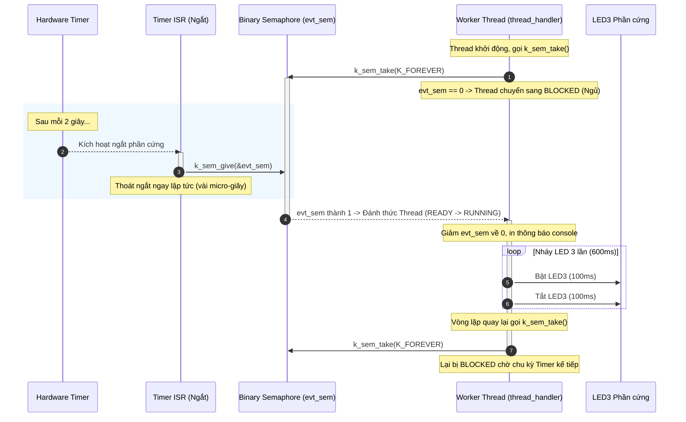

# BKIT ARM4 - Lab 2 - Demo 1: Binary Semaphore (Đồng bộ ISR -> Thread)

Tài liệu hướng dẫn chi tiết về kỹ thuật **Deferred Interrupt Processing (Xử lý ngắt hoãn lại)** sử dụng **Binary Semaphore** trên Zephyr RTOS.

---

## 1. Kỹ thuật & Khái niệm cốt lõi

### 1.1. Binary Semaphore là gì?
* **Binary Semaphore (Semaphore nhị phân):** Là đối tượng đồng bộ hóa chỉ nhận 2 trạng thái giá trị: `0` (không có sẵn / bận) hoặc `1` (có sẵn / rảnh).
* **Đặc tính cơ bản:**
  * Ban đầu tạo ra với giá trị `0`.
  * Khi hàm ngắt (ISR) gọi `k_sem_give()`: Giá trị tăng từ `0` lên `1` (đánh thức luồng đang chờ).
  * Khi luồng (Thread) gọi `k_sem_take()`: Luồng kiểm tra giá trị. Nếu bằng `1`, nó trừ về `0` và chạy tiếp; nếu bằng `0`, luồng bị **chặn (Block/ngủ)** để nhường CPU cho tác vụ khác.

### 1.2. Bảng tổng hợp API Zephyr sử dụng

| API / Macro | Ngữ cảnh gọi | Ý nghĩa |
| :--- | :---: | :--- |
| `K_SEM_DEFINE(evt_sem, 0, 1)` | Compile-time | Khởi tạo tĩnh Semaphore `evt_sem`: ban đầu = 0, tối đa = 1. |
| `k_sem_give(&evt_sem)` | **ISR** hoặc Thread | Tăng giá trị semaphore lên 1, đánh thức thread đang chờ. An toàn tuyệt đối trong ISR. |
| `k_sem_take(&evt_sem, K_FOREVER)` | **Chỉ Thread** | Chờ và lấy cờ hiệu. Nếu cờ = 0, thread bị block vô thời hạn cho tới khi có `give`. |
| `K_TIMER_DEFINE(evt_timer, isr, NULL)` | Compile-time | Tạo bộ định thời phần mềm gọi hàm `timer_isr` khi hết hạn. |
| `k_timer_start(&evt_timer, 2s, 2s)` | Thread | Kích hoạt Timer: sau 2 giây kích hoạt lần đầu, sau đó lặp lại mỗi 2 giây. |
| `K_THREAD_DEFINE(handler_tid, ...)` | Compile-time | Khởi tạo và tự động chạy luồng xử lý sự kiện `thread_handler`. |

---

## 2. Cơ chế hoạt động (Mechanism)

### 2.1. Trình tự chèn code trong file main.c (Template 5 bước)

Chương trình được lắp ghép tuần tự theo 5 bước rõ ràng với các khung code thực tế như sau:

#### 🔹 Bước 1: Khai báo thư viện & Cấu hình phần cứng
Lấy thông tin chân điều khiển LED3 từ Device Tree (`DT_ALIAS(led0)`):
```c
#include <stdio.h>
#include <zephyr/kernel.h>
#include <zephyr/drivers/gpio.h>

/* Cấu hình chân GPIO cho LED3 từ Device Tree */
static const struct gpio_dt_spec led3 = GPIO_DT_SPEC_GET(DT_ALIAS(led0), gpios);
```

#### 🔹 Bước 2: Khởi tạo đối tượng đồng bộ hóa (IPC)
Tạo Binary Semaphore với giá trị ban đầu là `0` (cổng đóng) và tối đa là `1`:
```c
/*
 * - initial_count = 0: Ban đầu chưa có sự kiện, thread sẽ bị block
 * - count_limit   = 1: Đặc trưng Binary Semaphore (chỉ chứa tối đa 1 tín hiệu)
 */
K_SEM_DEFINE(evt_sem, 0, 1);
```

#### 🔹 Bước 3: Định nghĩa hàm ngắt (ISR) và hàm xử lý của Thread
Tách rời: ISR chỉ làm nhiệm vụ phát cờ hiệu, Thread lo phần việc tốn thời gian:
```c
/* HÀM XỬ LÝ NGẮT (ISR): Thoát cực nhanh, không gọi hàm trễ */
static void timer_isr(struct k_timer *timer)
{
    /* Tăng evt_sem từ 0 lên 1 -> Đánh thức thread đang đợi */
    k_sem_give(&evt_sem);
}

/* THREAD XỬ LÝ SỰ KIỆN: Được phép ngủ và làm việc nặng */
static void thread_handler(void *p1, void *p2, void *p3)
{
    unsigned int n = 0;
    gpio_pin_configure_dt(&led3, GPIO_OUTPUT_INACTIVE);

    while (1) {
        /* [ĐIỂM CHẶN] Nếu evt_sem == 0: Thread chuyển sang BLOCKED nhường CPU.
         * Khi timer_isr gọi k_sem_give: Thread tỉnh lại, giảm evt_sem về 0 và chạy tiếp */
        k_sem_take(&evt_sem, K_FOREVER);
        n++;
        printf("[%6u ms] Su kien #%u -> thread xu ly\n", k_uptime_get_32(), n);

        /* Tác vụ tốn thời gian: Nháy LED 3 lần (tổng cộng mất 600 ms) */
        for (int i = 0; i < 3; i++) {
            gpio_pin_set_dt(&led3, 1);
            k_msleep(100);
            gpio_pin_set_dt(&led3, 0);
            k_msleep(100);
        }
    }
}
```

#### 🔹 Bước 4: Đăng ký Timer và Thread với Hệ điều hành
Đăng ký tĩnh để Kernel tự động cấp phát bộ nhớ Stack và lập lịch:
```c
/* Khởi tạo Timer: gọi timer_isr mỗi khi hết hạn */
K_TIMER_DEFINE(evt_timer, timer_isr, NULL);

/* Đăng ký Thread: tên handler_tid, Stack 1024 bytes, Priority 7 */
K_THREAD_DEFINE(handler_tid, 1024, thread_handler, NULL, NULL, NULL, 7, 0, 0);
```

#### 🔹 Bước 5: Hàm `main()` - "Châm ngòi" kích hoạt hệ thống
Khởi động Timer chu kỳ 2 giây để phát tín hiệu tuần hoàn:
```c
int main(void)
{
    printf("Lab 2 - Demo 1: Binary semaphore (ISR -> thread)\n");

    /* Sau 2s kích hoạt lần đầu, sau đó lặp lại đều đặn mỗi 2s */
    k_timer_start(&evt_timer, K_SECONDS(2), K_SECONDS(2));
    return 0;
}
```

---

### 2.2. Ẩn dụ trực quan: Cánh cổng Barie 1 vé
* Hãy tưởng tượng `evt_sem` như một **cánh cổng Barie chắn ngang**:
  * Ban đầu cổng đóng kín (`count = 0`).
  * `thread_handler` chạy tới cổng, gọi `k_sem_take()`. Vì không có vé, nó **dừng lại ngay tại vạch**, bị hệ điều hành cho ngủ.
  * Cứ mỗi 2 giây, Timer phần cứng gõ chuông gọi `timer_isr()`. Hàm ngắt này quẹt thẻ mở cổng `k_sem_give()` rồi đi ngay lập tức.
  * Cổng mở ra (`count = 1`), `thread_handler` được bước qua. Vừa bước qua xong, cổng lập tức sập lại sau lưng (`count = 0`).
  * Thread đi vào bên trong thực hiện công việc nặng (nháy LED 3 lần kéo dài 600 ms). Khi làm xong, nó quay lại và tiếp tục bị chặn bởi cánh cổng.

### 2.2. Sơ đồ khối nguyên lý



---

## 3. Nếu KHÔNG CÓ kỹ thuật này thì sẽ như thế nào?

Kỹ thuật này sinh ra để giải quyết vấn đề cốt tử trong hệ thống nhúng: **"Nguyên tắc vàng của ISR"**.

| Tiêu chí | Khi KHÔNG CÓ Semaphore (Xử lý trực tiếp trong ISR) | Khi CÓ Binary Semaphore (Deferred Processing) |
| :--- | :--- | :--- |
| **Cách viết** | Nhét luôn vòng lặp nháy LED và trễ 600ms vào trong `timer_isr()`. | ISR chỉ `k_sem_give()`, đẩy toàn bộ 600ms sang Thread xử lý. |
| **Nguy cơ vi phạm** | Gọi `k_msleep()` trong ISR sẽ **gây crash hệ thống (Kernel Panic)** vì ISR không có ngữ cảnh thread để ngủ. | ISR chạy cực nhanh (vài micro-giây), không bao giờ bị treo. |
| **Ảnh hưởng hệ thống** | Chiếm dụng toàn bộ CPU trong 600ms, khiến **mọi ngắt phần cứng khác (UART, nút bấm, bảo vệ quá dòng) bị tê liệt**. | Hệ thống phản hồi tức thì. Các ngắt quan trọng khác vẫn chen ngang bình thường. |
| **Hiệu suất năng lượng** | Nếu viết `while(!flag);` ở thread thì CPU chạy vòng lặp 100% công suất làm nóng chip và hao pin. | Khi chờ, thread chuyển sang `BLOCKED`, CPU có thể vào chế độ tiết kiệm năng lượng (Idle). |

---

## 4. Luồng thực thi chi tiết (Execution Flow & Lifecycle)

### 4.1. Các thực thể thực thi:
1. **Luồng `main`:** Khởi tạo GPIO cho LED3, khởi động Timer chu kỳ 2s bằng `k_timer_start()`, sau đó hoàn thành nhiệm vụ.
2. **Luồng `handler_tid` (Priority = 7):** Chứa vòng lặp `while(1)` chờ cờ hiệu và điều khiển LED3.
3. **Ngữ cảnh ngắt `timer_isr`:** Chạy với quyền ưu tiên cao nhất của phần cứng, không phải là một luồng (không có stack riêng của thread).

### 4.2. Dòng thời gian chi tiết (Timeline):

```
Thời gian      Thực thể                          Hành động
────────────────────────────────────────────────────────────────────────────────────
0 ms           Main Thread                       Khởi động timer (2000ms chu kỳ), kết thúc.
               Handler Thread                    Chạy đến k_sem_take(&evt_sem, K_FOREVER).
                                                 -> evt_sem = 0, Thread rơi vào trạng thái BLOCKED.
                                                 -> CPU rảnh tay (vào chế độ Idle).
────────────────────────────────────────────────────────────────────────────────────
2000 ms        Phần cứng Timer                   Đếm đủ 2 giây -> Nhảy vào ngắt timer_isr().
               timer_isr                         Gọi k_sem_give(&evt_sem) -> Thoát ngắt ngay.
               Kernel Scheduler                  Chuyển Handler Thread từ BLOCKED -> READY -> RUNNING.
               Handler Thread                    k_sem_take thành công, evt_sem trở về 0.
                                                 In: "[  2000 ms] Su kien #1 -> thread xu ly".
2000-2600 ms   Handler Thread                    Nháy LED 3 lần (mỗi lần 200ms -> tổng 600ms).
2600 ms        Handler Thread                    Quay lại đầu vòng lặp while(1), gọi k_sem_take.
                                                 -> Bị BLOCKED tiếp, đi ngủ nhường CPU.
────────────────────────────────────────────────────────────────────────────────────
4000 ms        Phần cứng Timer                   Đếm tiếp 2 giây -> Nhảy vào timer_isr() lần 2.
               ...                               Chu trình trên lặp lại tuần hoàn.
```

---

## 5. Hướng dẫn thử nghiệm & Kiểm chứng

1. **Quan sát phần cứng:** Đèn xanh lá (LED3) sẽ chớp nhanh 3 cái, sau đó tắt nghỉ khoảng 1.4 giây, rồi lại chớp 3 cái lặp đi lặp lại.
2. **Quan sát Serial Console:**
   ```text
   [  2000 ms] Su kien #1 -> thread xu ly
   [  4000 ms] Su kien #2 -> thread xu ly
   [  6000 ms] Su kien #3 -> thread xu ly
   ```
3. **Thử nghiệm mở rộng:** Thử đổi chu kỳ timer từ 2 giây xuống 500ms (`K_MSEC(500)`) trong hàm `main()`, quan sát hiện tượng khi chu kỳ phát tín hiệu ngắn hơn thời gian thread nháy LED (600ms).
