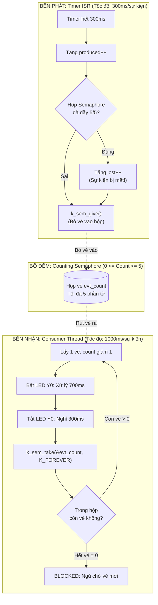

# BKIT ARM4 - Lab 2 - Demo 2: Counting Semaphore (Đếm và đệm sự kiện)

Tài liệu hướng dẫn chi tiết về kỹ thuật quản lý tải, tích lũy sự kiện dồn dập (**Burst Events**) và hiện tượng mất mát dữ liệu (**Event Loss / Buffer Overflow**) sử dụng **Counting Semaphore** trên Zephyr RTOS.

---

## 1. Kỹ thuật & Khái niệm cốt lõi

### 1.1. Counting Semaphore là gì?
* **Counting Semaphore (Semaphore đếm):** Là đối tượng đồng bộ hóa có giá trị đếm nguyên nằm trong dải từ `0` đến `N` (`count_limit`).
* **Đặc tính cơ bản:**
  * Khác với Binary Semaphore (chỉ lưu tối đa 1 sự kiện), Counting Semaphore có thể **ghi nhớ và tích lũy nhiều sự kiện chưa kịp xử lý**.
  * Mỗi lần gọi `k_sem_give()`: Bộ đếm tăng lên 1 (nếu chưa đạt ngưỡng `count_limit`).
  * Mỗi lần gọi `k_sem_take()`: Bộ đếm giảm đi 1 (nếu $> 0$). Nếu bộ đếm đang bằng `0`, luồng gọi sẽ bị **chặn (Block)** đứng chờ.
  * Khi bộ đếm đã chạm trần `N`, mọi thao tác `k_sem_give()` tiếp theo sẽ bị bỏ qua $\rightarrow$ dẫn đến **mất mát sự kiện**.

### 1.2. Bảng tổng hợp API Zephyr sử dụng

| API / Macro | Ngữ cảnh gọi | Ý nghĩa |
| :--- | :---: | :--- |
| `K_SEM_DEFINE(evt_count, 0, EVT_LIMIT)` | Compile-time | Khởi tạo tĩnh Semaphore đếm: ban đầu = 0, giới hạn tối đa = 5 (`EVT_LIMIT`). |
| `k_sem_count_get(&evt_count)` | ISR / Thread | Đọc giá trị đếm hiện tại trong semaphore (số sự kiện đang tồn đọng). |
| `k_sem_give(&evt_count)` | **ISR** / Thread | Bỏ thêm 1 sự kiện vào semaphore (tăng biến đếm lên 1 nếu chưa chạm mức 5). |
| `k_sem_take(&evt_count, K_FOREVER)` | **Chỉ Thread** | Lấy 1 sự kiện ra xử lý (nếu còn vé $> 0$ thì đi luôn; nếu $= 0$ thì bị block). |
| `k_timer_stop(&evt_timer)` | Thread | Dừng bộ định thời sau khi đã bắn đủ số lượng sự kiện burst. |

---

## 2. Cơ chế hoạt động (Mechanism)

### 2.1. Trình tự chèn code trong file main.c (Template 5 bước)

Chương trình được lắp ghép tuần tự theo 5 bước rõ ràng với các khung code thực tế như sau:

#### 🔹 Bước 1: Khai báo thư viện, Phần cứng & Biến đếm toàn cục
Lấy thông số chân LED1 (Y0) và LED0 (LED3). Khai báo các biến đếm dùng từ khóa `volatile` vì được chia sẻ giữa ngắt (ISR) và thread:
```c
#include <stdio.h>
#include <zephyr/kernel.h>
#include <zephyr/drivers/gpio.h>

#define EVT_LIMIT 5 /* Giới hạn tối đa của Semaphore */

static const struct gpio_dt_spec y0   = GPIO_DT_SPEC_GET(DT_ALIAS(led1), gpios); /* Đèn báo đang xử lý */
static const struct gpio_dt_spec led3 = GPIO_DT_SPEC_GET(DT_ALIAS(led0), gpios); /* Đèn báo Timer phát */

static volatile unsigned int produced; /* Tổng sự kiện tạo ra bởi Timer */
static volatile unsigned int lost;     /* Số sự kiện bị mất do đầy bộ đệm */
```

#### 🔹 Bước 2: Khởi tạo Counting Semaphore
Khởi tạo Semaphore đếm với sức chứa tối đa là 5 vé:
```c
/*
 * - initial_count = 0: Ban đầu hộp chưa có vé nào
 * - count_limit   = EVT_LIMIT (5): Hộp chỉ chứa tối đa 5 vé
 */
K_SEM_DEFINE(evt_count, 0, EVT_LIMIT);
```

#### 🔹 Bước 3: Định nghĩa hàm ngắt Producer và Thread Consumer
* **Hàm ngắt Timer (Producer):** Kiểm tra xem hộp đầy chưa trước khi ném vé:
```c
static void timer_isr(struct k_timer *timer)
{
    produced++;

    /* Nếu hộp đã đầy 5/5 mà vẫn ném tiếp -> Sự kiện bị rơi mất! */
    if (k_sem_count_get(&evt_count) >= EVT_LIMIT) {
        lost++;
    }

    /* Tăng bộ đếm nếu chưa đạt ngưỡng tối đa */
    k_sem_give(&evt_count);
}
```

* **Thread tiêu thụ (Consumer):** Lấy vé ra và thực thi công việc nặng (1000ms):
```c
static void thread_consumer(void *p1, void *p2, void *p3)
{
    unsigned int done = 0;
    gpio_pin_configure_dt(&y0, GPIO_OUTPUT_INACTIVE);

    while (1) {
        /* [ĐIỂM CHẶN] Nếu evt_count == 0 -> Block ngủ chờ.
         * Nếu evt_count > 0 -> Lấy 1 vé (giảm đếm) và chạy tiếp ngay */
        k_sem_take(&evt_count, K_FOREVER);
        done++;

        /* In thống kê dòng dữ liệu */
        printf("  xu ly #%2u | con cho: %u | da tao: %u | bi mat: %u\n",
               done, k_sem_count_get(&evt_count), produced, lost);

        /* Tác vụ nặng kéo dài 1000ms: Bật Y0 trong 700ms, tắt nghỉ 300ms */
        gpio_pin_set_dt(&y0, 1);
        k_msleep(700);
        gpio_pin_set_dt(&y0, 0);
        k_msleep(300);
    }
}
```

#### 🔹 Bước 4: Đăng ký Timer và Thread với Hệ điều hành
```c
/* Khởi tạo Timer phần mềm */
K_TIMER_DEFINE(evt_timer, timer_isr, NULL);

/* Đăng ký luồng Consumer: Stack 1024 bytes, Priority 5 */
K_THREAD_DEFINE(consumer_tid, 1024, thread_consumer, NULL, NULL, NULL, 5, 0, 0);
```

#### 🔹 Bước 5: Hàm `main()` - Điều phối đợt bùng nổ (Burst)
Kích hoạt Timer phát dồn dập 15 phát (mỗi phát 300ms) trong 4.5 giây:
```c
int main(void)
{
    gpio_pin_configure_dt(&led3, GPIO_OUTPUT_INACTIVE);
    printf("Lab 2 - Demo 2: Counting semaphore (limit = %d)\n", EVT_LIMIT);

    while (1) {
        printf("--- Burst: 15 su kien, moi 300 ms ---\n");
        gpio_pin_set_dt(&led3, 1); /* Bật LED3: Đang trong pha Burst */

        /* Bắn 1 sự kiện mỗi 300ms (trong 4500ms bắn đủ 15 sự kiện) */
        k_timer_start(&evt_timer, K_MSEC(300), K_MSEC(300));
        k_msleep(4500 + 100);

        /* Dừng phát sự kiện */
        k_timer_stop(&evt_timer);
        gpio_pin_set_dt(&led3, 0);

        /* Ngủ 10s chờ consumer dọn nốt 5 sự kiện còn đọng lại trong hộp */
        k_msleep(10000);
    }
    return 0;
}
```

---

### 2.2. Ẩn dụ trực quan: Hộp chứa tối đa 5 chiếc vé
* **Semaphore đóng vai trò là một "Hộp vé" có sức chứa đúng 5 vé:**
  * **Bên phát (Timer ISR - Tốc độ cực nhanh):** Cứ mỗi **300 ms**, Timer nhảy vào hàm ngắt và ném 1 vé vào hộp bằng lệnh `k_sem_give()`.
  * **Bên nhận (Consumer Thread - Tốc độ rất chậm):** Rút từng vé ra bằng `k_sem_take()`. Để xử lý xong 1 vé, nó phải bật đèn Y0 và mất tới **1000 ms (1 giây)**.
* **Quy luật va chạm tốc độ:**
  * Trong 1 giây, Timer có thể ném vào hơn 3 vé, trong khi Consumer chỉ mới làm xong 1 vé.
  * Hộp vé nhanh chóng bị đầy ứ ($5/5$).
  * Khi hộp đã đầy mà Timer vẫn tiếp tục ném vé, những chiếc vé ném thêm vào sẽ **bị rơi ra ngoài đất và mất vĩnh viễn** (`lost++`).

### 2.2. Sơ đồ tương tác luồng



---

## 3. Nếu KHÔNG CÓ Counting Semaphore thì sao?

| Trường hợp | Hiện tượng & Hậu quả |
| :--- | :--- |
| **Nếu chỉ dùng Binary Semaphore (giới hạn = 1)** | Ngay ở sự kiện thứ 2 (tại thời điểm 600ms), khi Consumer vẫn đang bận xử lý sự kiện thứ 1, sự kiện thứ 2 sẽ lập tức **bị ghi đè và mất luôn**. Tỷ lệ mất sự kiện lên tới hơn 70%. |
| **Nếu không có bất kỳ bộ đệm đồng bộ nào** | ISR buộc phải chờ Consumer xử lý xong thì mới được phát tiếp, dẫn đến vi phạm nguyên tắc RTOS và gây nghẽn toàn bộ hệ thống. |
| **Khi CÓ Counting Semaphore (như trong bài)** | Semaphore đóng vai trò như một **bộ giảm xóc (Shock Absorber)**: Nó có thể hấp thụ an toàn các đợt bùng nổ dữ liệu ngắn hạn (tối đa 5 sự kiện), giúp Consumer giải quyết dần dần mà không làm treo hệ thống. |

---

## 4. Luồng thực thi chi tiết (Execution Flow & Lifecycle)

### 4.1. Các thực thể thực thi:
1. **Luồng `main` (Priority của hệ thống):**
   * Bật đèn `LED3` để báo hiệu đang trong pha phát dồn dập (Burst phase).
   * Kích hoạt Timer với chu kỳ 300ms (`k_timer_start`).
   * Ngủ 4.6 giây (`k_msleep(4500 + 100)`) để Timer kịp phát đúng **15 sự kiện**.
   * Dừng Timer (`k_timer_stop`) và tắt đèn `LED3`.
   * Ngủ 10 giây chờ Consumer dọn sạch các sự kiện còn đọng trong hộp, sau đó lặp lại chu kỳ mới.
2. **Ngắt phần mềm `timer_isr`:** Bắn 1 sự kiện mỗi 300ms, theo dõi biến `produced` và `lost`.
3. **Luồng `consumer_tid` (Priority = 5):** Thường trực rút vé, bật đèn `Y0` trong 700ms, tắt trong 300ms.

### 4.2. Bảng diễn biến dòng thời gian tiêu biểu (Timeline):

| Thời gian (ms) | Sự kiện Timer (Producer) | Trạng thái Semaphore | Consumer Thread (LED Y0) | Ghi chú |
| :---: | :--- | :---: | :--- | :--- |
| **0** | Khởi động Burst 15 sự kiện | `count = 0` | Đang bị Block ở `k_sem_take` | Main bật LED3 |
| **300** | Bắn sự kiện #1 (`produced = 1`) | $0 \rightarrow 1 \rightarrow 0$ | Thức dậy, lấy vé #1, bắt đầu xử lý | Y0 sáng |
| **600** | Bắn sự kiện #2 (`produced = 2`) | $0 \rightarrow 1$ | Vẫn đang xử lý sự kiện #1 | Vé #2 nằm chờ |
| **900** | Bắn sự kiện #3 (`produced = 3`) | $1 \rightarrow 2$ | Vẫn đang xử lý sự kiện #1 | Vé #2, #3 nằm chờ |
| **1000** | Không có | $2 \rightarrow 1$ | Xong sự kiện #1 $\rightarrow$ lấy vé #2 | Y0 tắt rồi sáng lại |
| **1200** | Bắn sự kiện #4 (`produced = 4`) | $1 \rightarrow 2$ | Đang xử lý sự kiện #2 | |
| **...** | ... | ... | ... | ... |
| **~2400** | Bắn sự kiện liên tục | **`count = 5` (ĐẦY)**| Đang xử lý chậm chạp | Hộp đạt kịch trần 5/5 |
| **~2700** | Bắn sự kiện mới | **`count = 5`** | Bị tràn hộp! | **`lost++` (Mất sự kiện!)** |
| **4600** | Dừng Timer (Đã bắn đủ 15) | `count = 5` | Vẫn đang miệt mài xử lý tiếp | Tắt LED3 |
| **4600 - 9600**| Không sinh thêm sự kiện | $5 \rightarrow 4 \rightarrow 3 \rightarrow 2 \rightarrow 1 \rightarrow 0$ | Xử lý nốt 5 sự kiện còn đọng trong hộp | Rút cạn hộp |
| **> 9600** | Không có sự kiện | **`count = 0`** | Hết vé $\rightarrow$ Chuyển sang **BLOCKED** | Y0 tắt hẳn |

---

## 5. Kết quả quan sát & Phương trình kiểm chứng

### 5.1. Định luật bảo toàn sự kiện
Khi một chu kỳ burst kết thúc, trên màn hình Serial Console sẽ luôn tuân theo phương trình:

$$\mathbf{Tổng\ đã\ tạo\ (da\ tao)} = \mathbf{Đã\ xử\ lý\ (xu\ ly)} + \mathbf{Còn\ chờ\ trong\ hộp\ (con\ cho)} + \mathbf{Bị\ mất\ (bi\ mat)}$$

### 5.2. Kết quả mẫu trên Serial Terminal:
```text
Lab 2 - Demo 2: Counting semaphore (limit = 5)
--- Burst: 15 su kien, moi 300 ms ---
  xu ly # 1 | con cho: 0 | da tao: 1 | bi mat: 0
  xu ly # 2 | con cho: 2 | da tao: 4 | bi mat: 0
  xu ly # 3 | con cho: 4 | da tao: 7 | bi mat: 0
  xu ly # 4 | con cho: 5 | da tao: 10 | bi mat: 1
  xu ly # 5 | con cho: 5 | da tao: 13 | bi mat: 4
  xu ly # 6 | con cho: 5 | da tao: 15 | bi mat: 6
  xu ly # 7 | con cho: 4 | da tao: 15 | bi mat: 6
  xu ly # 8 | con cho: 3 | da tao: 15 | bi mat: 6
  ...
  xu ly #11 | con cho: 0 | da tao: 15 | bi mat: 6
```
*(Trong 15 sự kiện bắn ra, Consumer chỉ giải quyết được 9 sự kiện, 6 sự kiện đã bị mất do đầy bộ đệm).*

---

## 6. Bài học kỹ thuật thực tế
1. **Giải pháp khắc phục mất mát dữ liệu:**
   * **Cách 1:** Tăng `EVT_LIMIT` lên (tăng dung lượng RAM bộ đệm).
   * **Cách 2:** Tối ưu hóa Consumer để rút ngắn thời gian xử lý (ví dụ chuyển tác vụ nặng ra Background Thread khác).
   * **Cách 3:** Áp dụng cơ chế **Flow Control (Kiểm soát luồng)**: Khi bộ đệm gần đầy (ví dụ đạt 4/5), gửi tín hiệu yêu cầu Producer tạm giảm tốc độ phát.
