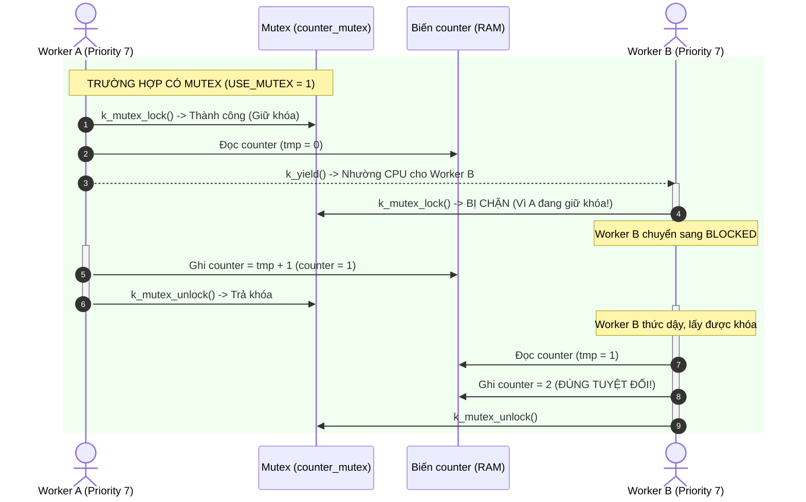
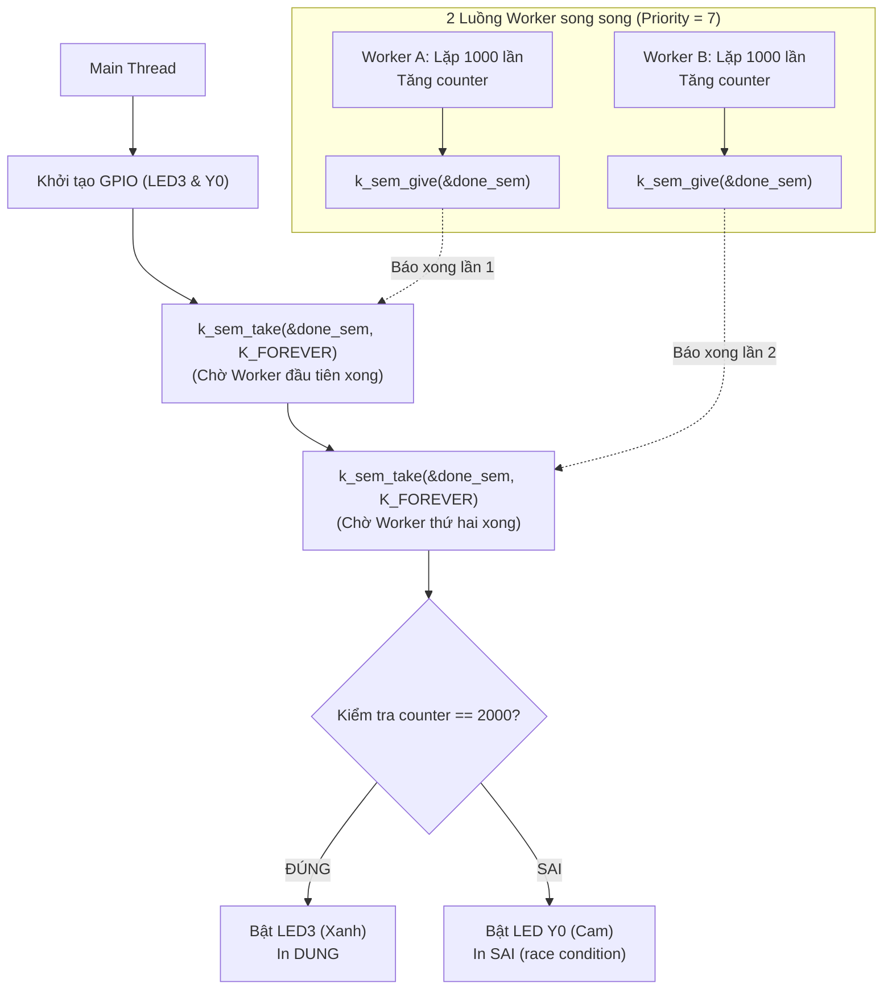

# BKIT ARM4 - Lab 2 - Demo 3: Mutex và Race Condition (Tranh chấp tài nguyên)

Tài liệu hướng dẫn chi tiết về hiện tượng tranh chấp dữ liệu (**Race Condition**) trong vùng găng (**Critical Section**) và cách sử dụng **Mutex (Mutual Exclusion)** để bảo toàn tính toàn vẹn dữ liệu trên Zephyr RTOS.

---

## 1. Kỹ thuật & Khái niệm cốt lõi

### 1.1. Race Condition và Critical Section là gì?
* **Critical Section (Vùng găng):** Là đoạn mã nguồn có thao tác truy xuất và thay đổi một tài nguyên dùng chung (biến toàn cục, bộ đệm, thanh ghi phần cứng) mà không thể thực hiện nguyên tử (*atomic*).
* **Race Condition (Điều kiện tranh chấp):** Hiện tượng xảy ra khi hai hay nhiều luồng (thread) cùng đồng thời can thiệp vào tài nguyên dùng chung, dẫn đến kết quả cuối cùng phụ thuộc vào trật tự ngẫu nhiên của việc lập lịch CPU (Scheduling).
* **Bản chất của phép toán `counter++` trong vi điều khiển:**
  Dù trong ngôn ngữ C chỉ là 1 dòng ngắn gọn, nhưng CPU ARM Cortex-M thực thi thông qua **3 chu kỳ máy riêng biệt**:
  1. **Read (Đọc):** Tải giá trị từ ô nhớ RAM vào thanh ghi CPU (`LDR r0, [counter]`).
  2. **Modify (Sửa):** Tăng giá trị trong thanh ghi lên 1 (`ADD r0, #1`).
  3. **Write (Ghi):** Lưu giá trị mới từ thanh ghi trở lại ô nhớ RAM (`STR r0, [counter]`).
  > Nếu hệ điều hành chuyển đổi ngữ cảnh (Context Switch) chen ngang giữa bước **Read** và **Write**, dữ liệu chắc chắn sẽ bị sai lệch!

### 1.2. Bảng tổng hợp API Zephyr sử dụng

| API / Macro | Ngữ cảnh gọi | Ý nghĩa |
| :--- | :---: | :--- |
| `K_MUTEX_DEFINE(counter_mutex)` | Compile-time | Khởi tạo tĩnh một Mutex dùng để bảo vệ biến `counter`. |
| `k_mutex_lock(&counter_mutex, timeout)` | **Chỉ Thread** | Chiếm quyền sở hữu Mutex. Nếu Mutex đã bị luồng khác giữ, luồng gọi sẽ bị **Block**. |
| `k_mutex_unlock(&counter_mutex)` | **Chỉ Thread** | Trả lại quyền sở hữu Mutex, giải phóng cho luồng đang chờ vào vùng găng. |
| `k_yield()` | Thread | Tự nguyện nhường quyền điều khiển CPU cho các luồng khác có cùng mức ưu tiên. |
| `K_SEM_DEFINE(done_sem, 0, 2)` | Compile-time | Semaphore dùng làm rào chắn báo hiệu hoàn thành (Thread Join). |

---

## 2. Cơ chế hoạt động (Mechanism)

### 2.1. Trình tự chèn code trong file main.c (Template 5 bước)

Chương trình được lắp ghép tuần tự theo 5 bước rõ ràng với các khung code thực tế như sau:

#### 🔹 Bước 1: Khai báo cờ thử nghiệm, Phần cứng & Biến toàn cục dùng chung
Khai báo biến dùng chung `counter` cùng các chân LED báo kết quả:
```c
#include <stdio.h>
#include <zephyr/kernel.h>
#include <zephyr/drivers/gpio.h>

/* THỬ NGHIỆM: Đặt 1 = Dùng Mutex; Đặt 0 = Tắt Mutex để xem lỗi */
#define USE_MUTEX 1
#define LOOPS     1000

static const struct gpio_dt_spec led3 = GPIO_DT_SPEC_GET(DT_ALIAS(led0), gpios); /* Sáng khi ĐÚNG (2000) */
static const struct gpio_dt_spec y0   = GPIO_DT_SPEC_GET(DT_ALIAS(led1), gpios); /* Sáng khi SAI (<2000) */

/* Tài nguyên dùng chung (Shared Resource) bị 2 Worker tranh chấp */
static unsigned int counter;
```

#### 🔹 Bước 2: Khởi tạo Mutex và Semaphore (Thread Join)
Tạo Mutex bảo vệ `counter` và Semaphore chờ 2 luồng hoàn thành:
```c
/* Khởi tạo Mutex bảo vệ biến 'counter' */
K_MUTEX_DEFINE(counter_mutex);

/* Semaphore đếm dùng làm rào chắn: chờ 2 worker hoàn thành (giới hạn = 2) */
K_SEM_DEFINE(done_sem, 0, 2);
```

#### 🔹 Bước 3: Định nghĩa hàm thực thi của Worker Thread
Bao bọc đoạn thao tác Read-Modify-Write bằng cặp lệnh `lock` và `unlock`:
```c
static void thread_worker(void *p1, void *p2, void *p3)
{
    const char *name = (const char *)p1;

    for (int i = 0; i < LOOPS; i++) {
#if USE_MUTEX
        /* BẮT ĐẦU VÙNG GĂNG: Chiếm chìa khóa duy nhất */
        k_mutex_lock(&counter_mutex, K_FOREVER);
#endif

        /* --- Mô phỏng thao tác Read-Modify-Write --- */
        unsigned int tmp = counter;   /* Bước 1: Đọc vào thanh ghi */
        k_yield();                    /* Bước 2: Cố tình nhường CPU để thử thách chen ngang */
        counter = tmp + 1;            /* Bước 3: Tăng và ghi lại vào RAM */

#if USE_MUTEX
        /* KẾT THÚC VÙNG GĂNG: Trả lại chìa khóa cho luồng khác */
        k_mutex_unlock(&counter_mutex);
#endif
    }

    printf("%s xong\n", name);

    /* Báo hiệu cho main thread biết worker này đã xong việc */
    k_sem_give(&done_sem);
}
```

#### 🔹 Bước 4: Đăng ký 2 Worker Thread với cùng độ ưu tiên
Cả 2 Worker đều có Priority = 7 để `k_yield()` có tác dụng chuyển đổi ngữ cảnh qua lại:
```c
K_THREAD_DEFINE(worker_a, 1024, thread_worker, (void *)"Worker A", NULL, NULL, 7, 0, 0);
K_THREAD_DEFINE(worker_b, 1024, thread_worker, (void *)"Worker B", NULL, NULL, 7, 0, 0);
```

#### 🔹 Bước 5: Hàm `main()` - Chờ hoàn tất & Đánh giá kết quả
Dùng kỹ thuật Thread Join: Chờ 2 lần `k_sem_take` trước khi kiểm tra giá trị `counter`:
```c
int main(void)
{
    gpio_pin_configure_dt(&led3, GPIO_OUTPUT_INACTIVE);
    gpio_pin_configure_dt(&y0, GPIO_OUTPUT_INACTIVE);
    printf("Lab 2 - Demo 3: USE_MUTEX = %d\n", USE_MUTEX);

    /* [THREAD JOIN] Chờ lần lượt cả 2 worker nộp bài */
    k_sem_take(&done_sem, K_FOREVER); /* Chờ worker thứ nhất */
    k_sem_take(&done_sem, K_FOREVER); /* Chờ worker thứ hai */

    /* Kiểm tra xem counter có đạt đúng 2000 hay không */
    printf("counter = %u (mong doi %d) -> %s\n", counter, 2 * LOOPS,
           counter == 2 * LOOPS ? "DUNG" : "SAI (race condition!)");

    /* Bật đèn LED tương ứng với kết quả */
    gpio_pin_set_dt(counter == 2 * LOOPS ? &led3 : &y0, 1);

    return 0;
}
```

---

### 2.2. Ẩn dụ trực quan: Căn phòng kín và Chiếc chìa khóa duy nhất
* Biến `counter` nằm trong một "căn phòng kín" (Vùng găng).
* **Mutex (`counter_mutex`)** đóng vai trò là **chiếc chìa khóa duy nhất** treo trước cửa:
  * Khi **Worker A** muốn vào tăng biến, nó lấy chìa khóa và khóa cửa lại (`k_mutex_lock`).
  * Trong lúc A đang ở trong phòng, A có "ngủ gật" hay "nhường ghế" (`k_yield`), thì **Worker B** đến nơi cũng **không thể vào được** vì cửa đã khóa cứng. Worker B phải ngồi đợi ở hành lang (trạng thái `BLOCKED`).
  * Sau khi A sửa xong và bước ra, A mở cửa và treo lại chìa khóa (`k_mutex_unlock`).
  * Lúc này Worker B mới được phép lấy chìa khóa và vào phòng làm việc của mình.

### 2.2. Sơ đồ tương tác luồng



---

## 3. Nếu KHÔNG CÓ Mutex thì sao? (Minh họa Race Condition)

Khi đặt cấu hình `#define USE_MUTEX 0` trong code, ta cố tình loại bỏ khóa bảo vệ:

```
Thời gian     Worker A (tmp_A)              Worker B (tmp_B)             Biến counter (RAM)
────────────────────────────────────────────────────────────────────────────────────
T1            Đọc counter (tmp_A = 0)                                    counter = 0
T2            Gọi k_yield() nhường CPU
              (A tạm dừng, chuyển sang B)
T3                                          Đọc counter (tmp_B = 0)      counter = 0 (Chưa kịp cập nhật!)
T4                                          Tăng và ghi counter = 1      counter = 1
T5                                          Gọi k_yield() nhường CPU
              (B tạm dừng, chuyển sang A)
T6            Tiếp tục bước ghi:
              Lấy tmp_A + 1 = 0 + 1 = 1
              Ghi đè số 1 vào RAM!                                       counter = 1 (SAI NGHIÊM TRỌNG!)
```

### Hậu quả thực tế:
* Cả 2 luồng đều đã tốn chu kỳ thực thi và ngỡ rằng mình đã tăng biến lên 1. Nhưng thực tế **thao tác của Worker B đã bị Worker A ghi đè và xóa sổ hoàn toàn**!
* Sau 1000 vòng lặp của A và 1000 vòng lặp của B:
  * Kết quả kỳ vọng: $1000 + 1000 = 2000$.
  * Kết quả thực tế khi không có Mutex: Thường chỉ rơi vào khoảng **vài chục đến vài trăm**.
  * **Đèn LED Y0 bật sáng báo lỗi.**

---

## 4. Luồng thực thi chi tiết & Kỹ thuật Thread Join

Trong chương trình có 3 luồng chạy đồng thời:



### Kỹ thuật Thread Join bằng Counting Semaphore:
* Luồng `main` cần kiểm tra kết quả sau cùng, nên nó không được chạy trước khi 2 Worker hoàn thành.
* Zephyr giải quyết bằng cách dùng `done_sem` (giới hạn = 2):
  * Khi `main` vừa khởi động xong, nó gọi liên tiếp 2 lệnh `k_sem_take(&done_sem, K_FOREVER)`. Cả 2 lần gọi này đều khiến `main` bị **Block** đứng chờ.
  * Mỗi khi một Worker chạy xong 1000 vòng, Worker đó sẽ gọi `k_sem_give(&done_sem)`.
  * Chỉ khi **cả 2 Worker đều đã gọi give**, `main` mới hoàn toàn thoát khỏi trạng thái chờ để bước vào phần kiểm tra kết quả.

---

## 5. Hướng dẫn thử nghiệm & Kiểm chứng

### Cách 1: Chế độ an toàn với Mutex (`USE_MUTEX 1`)
1. Mở file [src/main.c](file:///c:/Users/ASUS/zephyrproject/applications/lab2/demos/lab2_demo3_mutex/src/main.c), giữ nguyên `#define USE_MUTEX 1`.
2. Biên dịch và nạp code xuống board.
3. **Kết quả quan sát:**
   * Màn hình Console in:
     ```text
     Lab 2 - Demo 3: USE_MUTEX = 1
     Worker A xong
     Worker B xong
     counter = 2000 (mong doi 2000) -> DUNG
     ```
   * **Đèn xanh lá (LED3) bật sáng.**

---

### Cách 2: Kích hoạt lỗi Race Condition (`USE_MUTEX 0`)
1. Sửa dòng 43 thành:
   ```c
   #define USE_MUTEX 0
   ```
2. Biên dịch và nạp lại code xuống board.
3. **Kết quả quan sát:**
   * Màn hình Console in:
     ```text
     Lab 2 - Demo 3: USE_MUTEX = 0
     Worker A xong
     Worker B xong
     counter = 24 (mong doi 2000) -> SAI (race condition!)
     ```
   * **Đèn màu cam (Y0) bật sáng** cảnh báo hệ thống đã bị hỏng dữ liệu nghiêm trọng.
