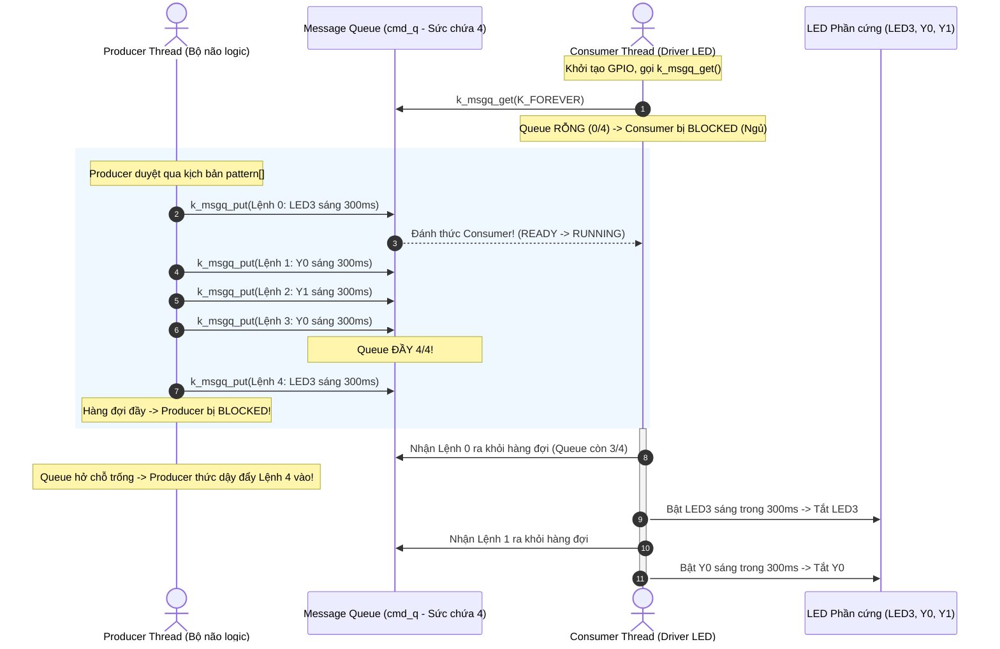

# BKIT ARM4 - Lab 2 - Demo 4: Message Queue (Giao tiếp dữ liệu Producer -> Consumer)

Tài liệu hướng dẫn chi tiết về kỹ thuật truyền nhận dữ liệu an toàn giữa các luồng sử dụng **Message Queue (Hàng đợi thông điệp)** theo mô hình **Producer - Consumer** trên Zephyr RTOS.

---

## 1. Kỹ thuật & Khái niệm cốt lõi

### 1.1. Message Queue là gì?
* **Message Queue (Hàng đợi thông điệp):** Là một đối tượng nhân RTOS cho phép truyền các **gói dữ liệu hoàn chỉnh** (struct, mảng, số nguyên...) giữa các thread hoặc từ ISR sang thread theo cơ chế **FIFO (First In - First Out: Vào trước thì Ra trước)**.
* **Sự khác biệt vượt trội so với Semaphore:**
  * **Semaphore:** Chỉ đóng vai trò là chiếc cờ hiệu (Flag) hoặc biến đếm số lượng sự kiện, **hoàn toàn không mang theo dữ liệu (No payload)**.
  * **Message Queue:** Vừa thực hiện **đồng bộ hóa**, vừa **sao chép an toàn một khối dữ liệu** từ không gian nhớ của luồng gửi sang không gian nhớ của luồng nhận.

### 1.2. Bảng tổng hợp API Zephyr sử dụng

| API / Macro | Ngữ cảnh gọi | Ý nghĩa |
| :--- | :---: | :--- |
| `K_MSGQ_DEFINE(q_name, size, max_msgs, align)` | Compile-time | Khởi tạo tĩnh một Message Queue chứa tối đa `max_msgs` phần tử, mỗi phần tử có kích thước `size` bytes. |
| `k_msgq_put(&cmd_q, &data, timeout)` | ISR / Thread | Gửi một gói dữ liệu vào cuối hàng đợi (sao chép theo giá trị). |
| `k_msgq_get(&cmd_q, &data, timeout)` | **Chỉ Thread** | Lấy gói dữ liệu ở đầu hàng đợi ra (sao chép vào biến cục bộ của thread). |
| `k_msgq_num_used_get(&cmd_q)` | ISR / Thread | Đọc số lượng gói tin hiện đang nằm chờ trong hàng đợi. |

---

## 2. Cơ chế hoạt động (Mechanism)

### 2.1. Trình tự chèn code trong file main.c (Template 5 bước)

Chương trình được lắp ghép tuần tự theo 5 bước rõ ràng với các khung code thực tế như sau:

#### 🔹 Bước 1: Khai báo cấu trúc gói tin (Payload) & Phần cứng
Định nghĩa nội dung của một "kiện hàng" và mảng chứa 3 chân đèn LED:
```c
#include <stdio.h>
#include <zephyr/kernel.h>
#include <zephyr/drivers/gpio.h>

/* Định nghĩa gói tin điều khiển đèn: Đèn nào và Sáng bao lâu */
struct led_cmd {
    uint8_t led;  /* 0: LED3 (Xanh), 1: Y0 (Cam), 2: Y1 (Đỏ) */
    uint16_t ms;  /* Thời gian bật sáng (mili-giây) */
};

/* Mảng chứa 3 chân GPIO cho 3 đèn */
static const struct gpio_dt_spec leds[3] = {
    GPIO_DT_SPEC_GET(DT_ALIAS(led0), gpios),
    GPIO_DT_SPEC_GET(DT_ALIAS(led1), gpios),
    GPIO_DT_SPEC_GET(DT_ALIAS(led2), gpios),
};
static const char *const names[3] = { "LED3", "Y0", "Y1" };
```

#### 🔹 Bước 2: Khởi tạo tĩnh Message Queue
Tạo hàng đợi với sức chứa tối đa là 4 phần tử:
```c
/*
 * - cmd_q: Tên hàng đợi
 * - sizeof(struct led_cmd): Kích thước mỗi phần tử
 * - 4: Số lượng thông điệp tối đa (dung lượng = 4)
 * - 4: Căn chỉnh bộ nhớ (alignment: 4 bytes)
 */
K_MSGQ_DEFINE(cmd_q, sizeof(struct led_cmd), 4, 4);
```

#### 🔹 Bước 3: Định nghĩa hàm Producer và Consumer
* **Luồng Producer (Bộ não):** Bơm các lệnh theo kịch bản vào hàng đợi:
```c
static void thread_producer(void *p1, void *p2, void *p3)
{
    /* Mẫu kịch bản 6 bước đuổi đèn */
    static const struct led_cmd pattern[] = {
        {0, 300}, {1, 300}, {2, 300}, {1, 300}, {0, 300}, {2, 1000},
    };

    while (1) {
        for (int i = 0; i < ARRAY_SIZE(pattern); i++) {
            /* [CHẶN KHI ĐẦY] Nếu queue đầy 4/4, Producer tự động ngủ chờ */
            k_msgq_put(&cmd_q, &pattern[i], K_FOREVER);

            printf("[P] gui lenh %d (%s) | trong hang doi: %u/4\n",
                   i, names[pattern[i].led], k_msgq_num_used_get(&cmd_q));
        }

        /* Nghỉ 2 giây trước khi lặp lại kịch bản */
        k_msleep(2000);
    }
}
```

* **Luồng Consumer (Driver LED):** Rút lệnh ra và lái phần cứng:
```c
static void thread_consumer(void *p1, void *p2, void *p3)
{
    struct led_cmd cmd;

    /* Cấu hình Output cho cả 3 chân LED */
    for (int i = 0; i < 3; i++) {
        gpio_pin_configure_dt(&leds[i], GPIO_OUTPUT_INACTIVE);
    }

    while (1) {
        /* [CHẶN KHI RỖNG] Nếu queue 0/4, Consumer tự động ngủ chờ lệnh mới */
        k_msgq_get(&cmd_q, &cmd, K_FOREVER);

        printf("    [C] thuc thi: %s sang %u ms\n", names[cmd.led], cmd.ms);

        /* Thực thi: Bật sáng trong đúng số ms chỉ định rồi tắt */
        gpio_pin_set_dt(&leds[cmd.led], 1);
        k_msleep(cmd.ms);
        gpio_pin_set_dt(&leds[cmd.led], 0);
    }
}
```

#### 🔹 Bước 4: Đăng ký 2 Thread với Hệ điều hành
Cả 2 Thread cùng chạy ở mức ưu tiên 7:
```c
K_THREAD_DEFINE(producer_tid, 1024, thread_producer, NULL, NULL, NULL, 7, 0, 0);
K_THREAD_DEFINE(consumer_tid, 1024, thread_consumer, NULL, NULL, NULL, 7, 0, 0);
```

#### 🔹 Bước 5: Hàm `main()` - Khởi động
```c
int main(void)
{
    printf("Lab 2 - Demo 4: Message queue (Producer -> Consumer)\n");
    return 0;
}
```

---

### 2.2. Ẩn dụ trực quan: Băng chuyền chuyển kiện hàng FIFO
* **Message Queue (`cmd_q`)** đóng vai trò là một **băng chuyền dài có đúng 4 vị trí đặt hàng**:
* Mỗi kiện hàng là một cấu trúc `struct led_cmd`:
  ```c
  struct led_cmd {
      uint8_t led;  // Chỉ số đèn: 0 (LED3 - Xanh), 1 (Y0 - Cam), 2 (Y1 - Đỏ)
      uint16_t ms;  // Thời gian bật sáng (mili-giây)
  };
  ```
* **Luồng Producer (Bộ não):** Tạo ra các kịch bản hiệu ứng ánh sáng và liên tục đặt các kiện hàng lên băng chuyền bằng `k_msgq_put()`.
* **Luồng Consumer (Tay chân thi công):** Đứng ở cuối băng chuyền, nhặt từng kiện hàng ra bằng `k_msgq_get()`, đọc hướng dẫn bên trong và bật tắt đúng chân đèn LED phần cứng.

### 2.2. Sơ đồ khối nguyên lý



---

## 3. Nếu KHÔNG CÓ Message Queue thì sao?

| Tiêu chí | Khi dùng biến toàn cục thông thường | Khi dùng Message Queue (Chuẩn RTOS) |
| :--- | :--- | :--- |
| **Xếp hàng tác vụ (Buffering)** | Chỉ lưu được 1 lệnh duy nhất tại một thời điểm. Lệnh mới sẽ **ghi đè và làm mất lệnh cũ**. | Hỗ trợ lưu trữ nhiều lệnh theo thứ tự FIFO, không bao giờ bị đè dữ liệu. |
| **Tính an toàn đa luồng** | Phải tự viết Mutex thủ công để bảo vệ biến dùng chung, dễ dẫn đến lỗi ngắt hoặc deadlock. | Thao tác `put` và `get` được Zephyr đảm bảo tính nguyên tử (Thread-safe) tự động. |
| **Kiến trúc phần mềm (Coupling)** | Mã điều khiển bị dính chặt (*tightly coupled*). Bên phát phải chờ bên nhận xử lý xong thì mới được ra lệnh tiếp. | **Tách rời hoàn toàn (Decoupling):** Producer cứ phát xong kịch bản rồi đi ngủ 2 giây, Consumer tự xử lý theo tốc độ phần cứng. |

---

## 4. Luồng thực thi chi tiết (Execution Flow & Lifecycle)

### 4.1. Cơ chế Chặn (Blocking) 2 chiều:
Message Queue trên Zephyr có cơ chế tự động điều tiết nhịp độ cực kỳ linh hoạt:

1. **Chặn Consumer khi Hàng đợi RỖNG (`cmd_q` có 0/4 món):**
   * Khi Consumer đã giải quyết hết mọi lệnh, lệnh `k_msgq_get(&cmd_q, &cmd, K_FOREVER)` sẽ lập tức đưa Consumer vào trạng thái **BLOCKED**.
   * Consumer không tiêu tốn chu kỳ CPU nào trong thời gian chờ Producer gửi lệnh mới.
2. **Chặn Producer khi Hàng đợi ĐẦY (`cmd_q` đã có 4/4 món):**
   * Kịch bản `pattern[]` có **6 lệnh**, nhưng hàng đợi chỉ chứa được **4 lệnh**.
   * Khi Producer đẩy đến lệnh thứ 5, hàm `k_msgq_put(&cmd_q, ..., K_FOREVER)` sẽ tự động đưa Producer vào trạng thái **BLOCKED**.
   * CPU lập tức được nhường cho Consumer để Consumer lấy bớt 1 món ra ngoài. Ngay khi có chỗ trống, Producer được đánh thức dậy để nhét tiếp món thứ 5 vào.

### 4.2. Kịch bản chạy đuổi LED trong bài:
Kịch bản gồm 6 bước sáng lần lượt:
$$\text{LED3 (300ms)} \longrightarrow \text{Y0 (300ms)} \longrightarrow \text{Y1 (300ms)} \longrightarrow \text{Y0 (300ms)} \longrightarrow \text{LED3 (300ms)} \longrightarrow \text{Y1 (1000ms)}$$

---

## 5. Kết quả quan sát & Hướng dẫn kiểm chứng

### 5.1. Quan sát phần cứng:
* 3 đèn LED trên board (LED3 - Xanh lá, Y0 - Cam, Y1 - Đỏ) sẽ lần lượt chạy hiệu ứng đuổi nhau mượt mà.
* Ở bước cuối cùng, đèn đỏ (Y1) sẽ sáng giữ lâu trong 1 giây (1000ms).
* Sau khi hết hiệu ứng, đèn tắt nghỉ 2 giây rồi chu kỳ mới lại bắt đầu.

### 5.2. Màn hình Serial Console:
```text
Lab 2 - Demo 4: Message queue (Producer -> Consumer)
[P] gui lenh 0 (LED3) | trong hang doi: 1/4
    [C] thuc thi: LED3 sang 300 ms
[P] gui lenh 1 (Y0) | trong hang doi: 1/4
[P] gui lenh 2 (Y1) | trong hang doi: 2/4
[P] gui lenh 3 (Y0) | trong hang doi: 3/4
[P] gui lenh 4 (LED3) | trong hang doi: 4/4
    [C] thuc thi: Y0 sang 300 ms
[P] gui lenh 5 (Y1) | trong hang doi: 4/4
    [C] thuc thi: Y1 sang 300 ms
    [C] thuc thi: Y0 sang 300 ms
    [C] thuc thi: LED3 sang 300 ms
    [C] thuc thi: Y1 sang 1000 ms
```

---

## 6. Tổng kết bài học kiến trúc nhúng
Mô hình **Producer - Consumer qua Message Queue** là mô hình chuẩn mực nhất trong hệ thống nhúng chuyên nghiệp:
* **Tầng ứng dụng (Application Layer):** Chỉ cần tập trung vào nghiệp vụ sinh dữ liệu/lệnh.
* **Tầng điều khiển thiết bị (Device Driver Layer):** Độc lập hoàn toàn, chỉ lắng nghe hàng đợi để tương tác với chân ngoại vi phần cứng.
* Cho phép mở rộng dễ dàng: Nếu sau này chuyển từ điều khiển LED sang gửi gói tin qua LoRa/WiFi, chỉ cần thay đổi bên trong Consumer mà không phải sửa một dòng code nào của Producer.
