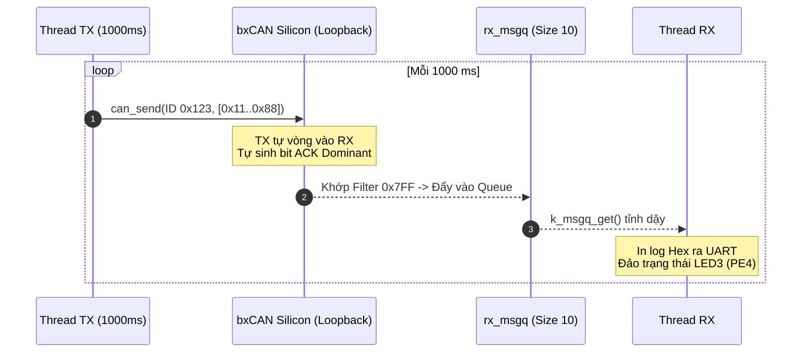

# BKIT ARM4 - Lab 3 - Demo 1: Gửi và Nhận CAN ở Chế độ Loopback

Tài liệu hướng dẫn chi tiết về kỹ thuật **Loopback Mode (Vòng lặp nội bộ)** trên bộ điều khiển bxCAN (STM32F407) sử dụng **Zephyr CAN API** và **Message Queue**.

---

## 1. Kỹ thuật & Khái niệm cốt lõi

### 1.1. Chế độ Loopback trong CAN là gì?
* **Loopback Mode (Vòng lặp nội bộ):** Là chế độ kiểm thử tích hợp trong bộ điều khiển `bxCAN` của STM32. 
* **Đặc tính kỹ thuật:**
  * Bộ điều khiển tự động ngắt kết nối với chân vật lý bên ngoài (`PB8`, `PB9`), tự nối đường truyền `TX` nội bộ vào đường nhận `RX` nội bộ.
  * Tín hiệu truyền đi được đưa thẳng vào bộ nhận của chính nó mà không cần chip Transceiver ngoài (TJA1050), không cần dây dẫn và không cần node thứ hai trên mạng.
  * Phần cứng bxCAN **tự động sinh bit Dominant (0) vào khe ACK** cho chính frame nó phát ra.
  * Giúp kiểm tra chức năng truyền/nhận và logic phần mềm chỉ với 1 kit duy nhất mà không lo lỗi đường truyền vật lý.

### 1.2. Bảng tổng hợp API Zephyr RTOS sử dụng

| API / Macro | Ngữ cảnh gọi | Ý nghĩa kỹ thuật |
| :--- | :---: | :--- |
| `DEVICE_DT_GET(DT_CHOSEN(zephyr_canbus))` | Thread | Lấy con trỏ thiết bị CAN được định nghĩa trong Devicetree (`zephyr,canbus = &can1`). |
| `can_set_mode(dev, CAN_MODE_LOOPBACK)` | Thread (Stopped) | Cấu hình bộ điều khiển chạy ở chế độ Loopback. Bắt buộc gọi trước khi start. |
| `CAN_MSGQ_DEFINE(rx_msgq, 10)` | Compile-time | Định nghĩa hàng đợi Message Queue chứa tối đa 10 frame CAN. |
| `can_add_rx_filter_msgq(dev, &msgq, &filter)` | Thread | Gắn bộ lọc phần cứng; frame thỏa mãn sẽ được bxCAN tự đẩy vào hàng đợi `rx_msgq`. |
| `can_start(dev)` | Thread | Kích hoạt bộ điều khiển CAN bắt đầu tham gia truyền nhận. |
| `can_send(dev, &frame, timeout, NULL, NULL)` | Thread | Gửi một frame CAN vào hộp thư phát TX Mailbox. |
| `k_msgq_get(&rx_msgq, &frame, K_FOREVER)` | Thread | Đọc một frame từ hàng đợi nhận; nếu rỗng thì thread bị block nhường CPU. |

---

## 2. Cơ chế hoạt động (Mechanism)

### 2.1. Trình tự chèn code trong file main.c (Template 5 bước)

#### 🔹 Bước 1: Khai báo thư viện và Định danh CAN ID
```c
#include <stdio.h>
#include <zephyr/kernel.h>
#include <zephyr/drivers/can.h>
#include <zephyr/drivers/gpio.h>

#define TX_ID 0x123
static const struct device *const can_dev = DEVICE_DT_GET(DT_CHOSEN(zephyr_canbus));
static const struct gpio_dt_spec led3 = GPIO_DT_SPEC_GET(DT_ALIAS(led0), gpios);
```

#### 🔹 Bước 2: Khởi tạo Hàng đợi nhận (CAN Message Queue)
```c
/* Hàng đợi chứa tối đa 10 frame CAN nhận được */
CAN_MSGQ_DEFINE(rx_msgq, 10);
```

#### 🔹 Bước 3: Định nghĩa Thread Phát (TX) và Thread Nhận (RX)
```c
/* THREAD PHÁT: Gửi ID 0x123 mỗi 1000 ms */
static void thread_tx(void *p1, void *p2, void *p3)
{
    struct can_frame frame = {
        .id = TX_ID,
        .dlc = 8,
        .flags = 0,
        .data = {0x11, 0x22, 0x33, 0x44, 0x55, 0x66, 0x77, 0x88}
    };
    while (1) {
        can_send(can_dev, &frame, K_MSEC(100), NULL, NULL);
        k_msleep(1000);
    }
}

/* THREAD NHẬN: Chờ frame từ rx_msgq và đảo LED3 */
static void thread_rx(void *p1, void *p2, void *p3)
{
    struct can_frame rx_frame;
    while (1) {
        k_msgq_get(&rx_msgq, &rx_frame, K_FOREVER);
        gpio_pin_toggle_dt(&led3);
        printf("[%6u ms] Nhan frame ID: 0x%03x, DLC: %d
",
               k_uptime_get_32(), rx_frame.id, rx_frame.dlc);
    }
}
```

#### 🔹 Bước 4: Đăng ký Thread với Kernel
```c
K_THREAD_DEFINE(tx_tid, 1024, thread_tx, NULL, NULL, NULL, 7, 0, 500);
K_THREAD_DEFINE(rx_tid, 1024, thread_rx, NULL, NULL, NULL, 7, 0, 500);
```

#### 🔹 Bước 5: Hàm `main()` — Khởi tạo theo trình tự bắt buộc của Zephyr CAN
```c
int main(void)
{
    const struct can_filter filter = {
        .id = TX_ID,
        .mask = CAN_STD_ID_MASK, // 0x7FF
        .flags = 0,
    };

    gpio_pin_configure_dt(&led3, GPIO_OUTPUT_INACTIVE);

    // 1. Set mode KHI ĐANG STOPPED
    can_set_mode(can_dev, CAN_MODE_LOOPBACK);

    // 2. Thêm bộ lọc phần cứng
    can_add_rx_filter_msgq(can_dev, &rx_msgq, &filter);

    // 3. Khởi động controller
    can_start(can_dev);

    return 0;
}
```

### 2.2. Sơ đồ tương tác (Mermaid)



---

## 3. Nếu KHÔNG CÓ kỹ thuật này thì sẽ như thế nào?

| Tiêu chí | Khi KHÔNG CÓ Loopback Mode | Khi CÓ Loopback Mode (Demo 1) |
| :--- | :--- | :--- |
| **Yêu cầu thiết bị** | Bắt buộc phải có **ít nhất 2 kit**, nối dây `CANH`, `CANL`, `GND` và trở 120 Ω. | **Chỉ cần 1 kit duy nhất**, không cần cắm bất kỳ dây nào. |
| **Khi test một mình** | Gửi frame sẽ bị lỗi **No ACK** liên tục, bộ đếm lỗi TEC tăng vọt lên 128 (Error-Passive). | bxCAN tự động sinh bit ACK nội bộ, gửi nhận thành công 100%. |
| **Cô lập lỗi phần mềm** | Khó biết lỗi do code phần mềm hay do tiếp xúc dây lỏng, thiếu trở kết cuối. | Chắc chắn 100% kiểm chứng được logic thuật toán và bộ lọc. |

---

## 4. Luồng thực thi chi tiết (Timeline Tracing)

```
Thời gian      Thực thể              Hành động
────────────────────────────────────────────────────────────────────────────
0 ms           Main Thread           Cài mode LOOPBACK -> Gắn Filter 0x123 -> can_start().
500 ms         RX Thread             Gọi k_msgq_get(&rx_msgq, ...) -> BLOCKED (chờ frame).
               TX Thread             Bắt đầu chạy -> can_send(0x123).
               bxCAN Hardware        Nội suy TX sang RX -> Đẩy frame vào rx_msgq.
               RX Thread             Thức dậy -> Đảo LED3 -> In "[  500 ms] Nhan frame...".
               TX Thread             k_msleep(1000) đi ngủ.
1500 ms        TX Thread             Thức dậy -> can_send(0x123) lần 2...
```

---

## 5. Hướng dẫn thử nghiệm & Kiểm chứng

1. **Biên dịch & nạp firmware:**
   ```powershell
   west build -p auto -b stm32f4_disco applications/lab3/demos/lab3_demo1_loopback
   west flash
   ```
2. **Quan sát phần cứng:** Đèn xanh **LED3 (PE4)** nhấp nháy đều đặn mỗi 1 giây.
3. **Quan sát Serial Monitor:** Log in ra màn hình mỗi giây:
   ```text
   [  1000 ms] Nhan frame ID: 0x123, DLC: 8, Data: 11 22 33 44 55 66 77 88
   [  2000 ms] Nhan frame ID: 0x123, DLC: 8, Data: 11 22 33 44 55 66 77 88
   ```
