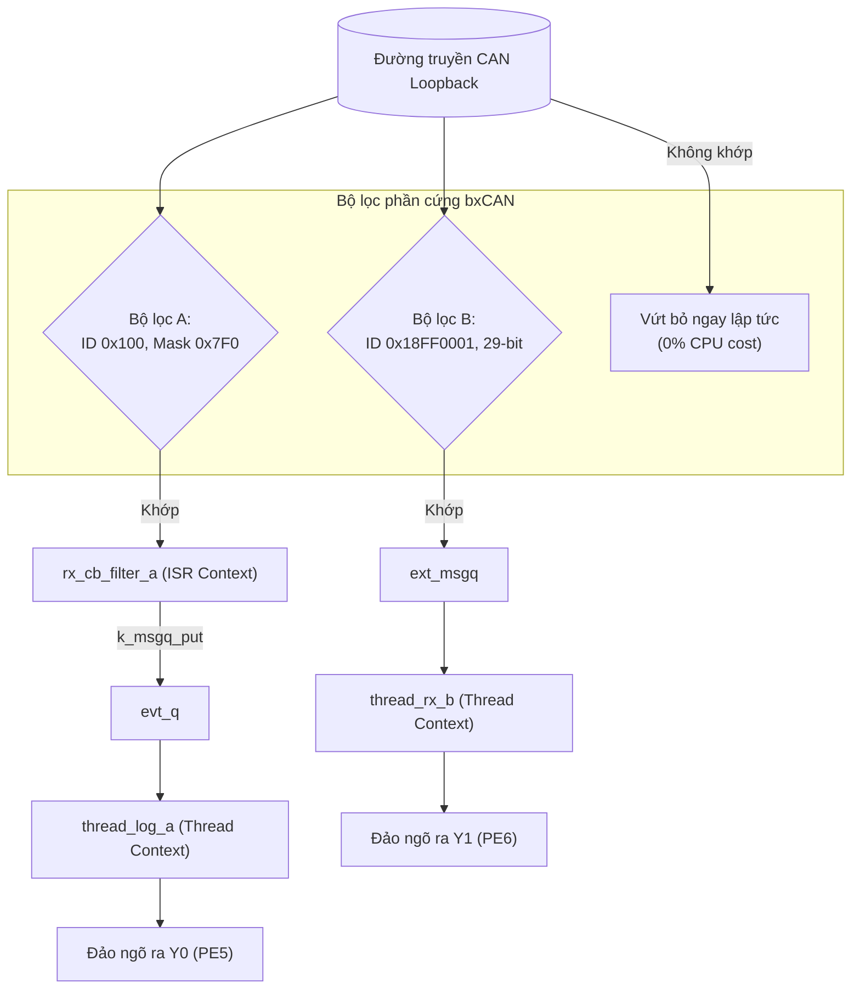

# BKIT ARM4 - Lab 3 - Demo 2: Bộ lọc phần cứng CAN và Khung yêu cầu RTR

Tài liệu hướng dẫn chi tiết về kỹ thuật **Hardware Acceptance Filtering (Bộ lọc ID/Mask)**, phân biệt **Standard vs Extended ID**, xử lý **Remote Transmission Request (RTR)** và so sánh **Callback ISR vs Message Queue** trên Zephyr RTOS.

---

## 1. Kỹ thuật & Khái niệm cốt lõi

### 1.1. Bộ lọc phần cứng bxCAN và Khung RTR là gì?
* **Bộ lọc phần cứng (Hardware Acceptance Filter):** bxCAN tích hợp 28 Filter Banks độc lập. Khi có frame đến từ bus, phần cứng so khớp ID theo công thức:
  $$(\text{Received_ID} \\ & \\ \text{Mask}) == (\text{Filter_ID} \\ & \\ \text{Mask})$$
  * Bit Mask $= 1$: Bắt buộc bit tương ứng của ID nhận được phải **khớp 100%**.
  * Bit Mask $= 0$: **Don't care** (0 hay 1 đều chấp nhận).
  * Frame không khớp bị phần cứng loại bỏ ngay lập tức $$\rightarrow$$ **CPU tốn 0% chu kỳ lệnh!**
* **Khung yêu cầu từ xa (Remote Transmission Request - RTR):** 
  * Là frame có cờ `CAN_FRAME_RTR`, DLC có thể mang giá trị nhưng **Data Field hoàn toàn rỗng (0 byte)**.
  * Dùng để yêu cầu node có dữ liệu phát nội dung lên bus.
  * Cần kích hoạt `CONFIG_CAN_ACCEPT_RTR=y` trong `prj.conf`.
* **So sánh Callback ISR vs Message Queue:**
  * `can_add_rx_filter()`: Gọi trực tiếp hàm callback trong **ngữ cảnh ngắt (ISR)**. Phù hợp cho sự kiện khẩn cấp, nhưng cấm gọi hàm blocking, cấm `printf`.
  * `can_add_rx_filter_msgq()`: Phần cứng tự đẩy frame vào hàng đợi `k_msgq`. Luồng xử lý an toàn, được phép gọi mọi hàm của RTOS.

### 1.2. Bảng tổng hợp API Zephyr RTOS sử dụng

| API / Macro | Ngữ cảnh gọi | Ý nghĩa kỹ thuật |
| :--- | :---: | :--- |
| `can_add_rx_filter(dev, callback, user_data, &filter)` | Thread | Đăng ký bộ lọc gắn liền với hàm Callback thực thi trong ISR Context. |
| `can_add_rx_filter_msgq(dev, &msgq, &filter)` | Thread | Đăng ký bộ lọc đẩy frame tự động vào Message Queue. |
| `k_msgq_put(&evt_q, &evt, K_NO_WAIT)` | **ISR** | Đẩy sự kiện nhanh từ ISR sang Thread xử lý nặng. |
| `CAN_FILTER_IDE` | Cờ bộ lọc | Báo cho phần cứng đây là bộ lọc dành cho Identifier mở rộng 29-bit. |
| `CAN_FRAME_RTR` | Cờ frame | Báo hiệu frame là khung yêu cầu từ xa RTR. |

---

## 2. Cơ chế hoạt động (Mechanism)

### 2.1. Trình tự chèn code trong file main.c (Template 5 bước)

#### 🔹 Bước 1: Khai báo cấu trúc sự kiện và Hàng đợi
```c
#include <zephyr/kernel.h>
#include <zephyr/drivers/can.h>
#include <zephyr/drivers/gpio.h>

/* Hàng đợi sự kiện cho Bộ lọc A (từ ISR chuyển sang Thread) */
struct rx_evt {
    uint32_t id;
    uint8_t flags;
};
K_MSGQ_DEFINE(evt_q, sizeof(struct rx_evt), 10, 4);

/* Hàng đợi Message Queue cho Bộ lọc B */
CAN_MSGQ_DEFINE(ext_msgq, 10);
```

#### 🔹 Bước 2: Định nghĩa Callback ISR cho Bộ lọc A (0x100..0x10F)
```c
static void rx_cb_filter_a(const struct device *dev, struct can_frame *frame, void *user_data)
{
    /* HÀM CHẠY TRONG ISR: Chỉ đẩy dữ liệu qua MsgQ, thoát tức thì */
    struct rx_evt evt = { .id = frame->id, .flags = frame->flags };
    k_msgq_put(&evt_q, &evt, K_NO_WAIT);
}
```

#### 🔹 Bước 3: Định nghĩa Thread xử lý log và điều khiển LED
```c
/* Thread A: Nhận sự kiện từ ISR của Bộ lọc A -> Đảo LED Y0 (PE5) */
static void thread_log_a(void *p1, void *p2, void *p3)
{
    struct rx_evt evt;
    while (1) {
        k_msgq_get(&evt_q, &evt, K_FOREVER);
        gpio_pin_toggle_dt(&y0);
        printf("[FILTER A - ISR CB] Nhan ID: 0x%03x (RTR=%d)
", evt.id, (evt.flags & CAN_FRAME_RTR) != 0);
    }
}

/* Thread B: Nhận từ MsgQ của Bộ lọc B (Extended 29-bit) -> Đảo LED Y1 (PE6) */
static void thread_rx_b(void *p1, void *p2, void *p3)
{
    struct can_frame frame;
    while (1) {
        k_msgq_get(&ext_msgq, &frame, K_FOREVER);
        gpio_pin_toggle_dt(&y1);
        printf("[FILTER B - MSGQ] Nhan Extended ID: 0x%08x
", frame.id);
    }
}
```

#### 🔹 Bước 4: Thiết lập Bộ lọc phần cứng trong `main()`
```c
int main(void)
{
    can_set_mode(can_dev, CAN_MODE_LOOPBACK);

    /* Bộ lọc A: ID chuẩn 0x100, Mask 0x7F0 (Nhận 0x100..0x10F) */
    const struct can_filter filter_a = {
        .id = 0x100,
        .mask = 0x7F0,
        .flags = 0,
    };
    can_add_rx_filter(can_dev, rx_cb_filter_a, NULL, &filter_a);

    /* Bộ lọc B: ID mở rộng 0x18FF0001, Mask 0x1FFFFFFF, cờ CAN_FILTER_IDE */
    const struct can_filter filter_b = {
        .id = 0x18FF0001,
        .mask = CAN_EXT_ID_MASK,
        .flags = CAN_FILTER_IDE,
    };
    can_add_rx_filter_msgq(can_dev, &ext_msgq, &filter_b);

    can_start(can_dev);
    return 0;
}
```

### 2.2. Sơ đồ phân luồng kiến trúc (Mermaid)



---

## 3. Nếu KHÔNG CÓ kỹ thuật này thì sẽ như thế nào?

| Tiêu chí | Khi KHÔNG CÓ Lọc phần cứng | Khi CÓ Lọc phần cứng bxCAN |
| :--- | :--- | :--- |
| **Gánh nặng CPU** | Mọi frame ngoại lai kích hoạt ngắt ISR, CPU phải thức giấc đọc và so sánh chuỗi `if`. | bxCAN tự loại bỏ frame ngay ở phần cứng ngoại vi, **CPU ngủ yên 100%**. |
| **Tiêu tốn RAM** | Message Queue phải cấp phát kích thước khổng lồ để chứa cả frame rác. | Message Queue chỉ chứa đúng các frame hữu ích. |
| **Xử lý ngắt** | Nếu in `printf` hoặc trễ trong Callback ISR sẽ **làm sập hệ thống (Kernel Panic)**. | Tách rời: ISR chỉ đẩy sự kiện vào `evt_q`, Thread lo việc in log an toàn. |

---

## 4. Hướng dẫn thử nghiệm & Kiểm chứng

1. **Biên dịch & nạp firmware:**
   ```powershell
   west build -p auto -b stm32f4_disco applications/lab3/demos/lab3_demo2_filters
   west flash
   ```
2. **Quan sát phần cứng:** 
   * Ngõ ra **Y0 (PE5)** đảo trạng thái khi nhận dải ID `0x100..0x10F`.
   * Ngõ ra **Y1 (PE6)** đảo trạng thái khi nhận Extended ID `0x18FF0001`.
3. **Quan sát Serial Monitor:**
   ```text
   [FILTER A - ISR CB] Nhan ID: 0x100 (RTR=0)
   [FILTER A - ISR CB] Nhan ID: 0x105 (RTR=0)
   [FILTER B - MSGQ] Nhan Extended ID: 0x18FF0001
   [FILTER A - ISR CB] Nhan ID: 0x100 (RTR=1) -> Khung RTR duoc nhan dang chinh xac!
   ```
