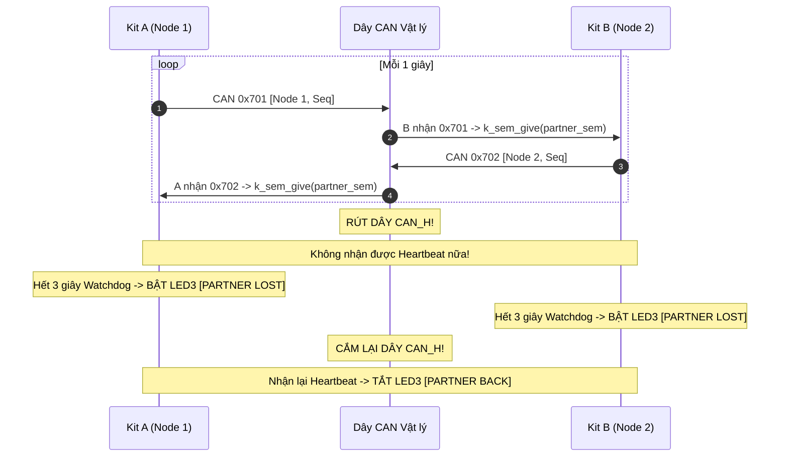

# BKIT ARM4 - Lab 3 - Demo 3: Giao tiếp hai Node trên Bus thật và Giám sát lỗi

Tài liệu hướng dẫn chi tiết về kỹ thuật kết nối **Bus CAN vật lý giữa 2 Kit**, cơ chế **Heartbeat định kỳ**, **Watchdog phát hiện mất kết nối** và **Giám sát trạng thái vật lý của mạng CAN** trên Zephyr RTOS.

---

## 1. Kỹ thuật & Khái niệm cốt lõi

### 1.1. Giao tiếp trên Bus thật & Cơ chế bảo vệ đường truyền
* **Kết nối vật lý:** Nối `CAN_H` với `CAN_H`, `CAN_L` với `CAN_L`, nối chung `GND` và gạt công tắc `SW13 = ON` trên cả 2 kit để đóng trở kết cuối 120 Ω.
* **Heartbeat & Watchdog:** Mỗi node phát định kỳ gói Heartbeat `0x700 + NODE_ID` mỗi 1 giây. Node đối tác dùng Semaphore kèm Timeout 3 giây (`k_sem_take(&partner_sem, K_SECONDS(3))`) để phát hiện đứt cáp hoặc mất nguồn đối tác.
* **Quy tắc vàng khi gửi trên Bus thật:**
  * **TUYỆT ĐỐI KHÔNG DÙNG** `can_send(..., K_FOREVER, NULL, NULL)`.
  * Vì nếu bus đứt hoặc node kia tắt nguồn, không có ai gửi ACK → hàm gửi sẽ **treo cứng luồng vĩnh viễn**!
  * **Bắt buộc:** Dùng `can_send(..., K_MSEC(100), tx_done_cb, NULL)` với timeout ngắn và callback bất đồng bộ.
* **Giám sát trạng thái Bus (CAN State Machine):**
  * `can_set_state_change_callback()`: Đăng ký callback theo dõi 4 trạng thái lỗi: `ERROR-ACTIVE`, `ERROR-WARNING`, `ERROR-PASSIVE`, `BUS-OFF` cùng hai bộ đếm lỗi `TEC` và `REC`.

### 1.2. Bảng tổng hợp API Zephyr RTOS sử dụng

| API / Macro | Ngữ cảnh gọi | Ý nghĩa kỹ thuật |
| :--- | :---: | :--- |
| `can_set_mode(dev, CAN_MODE_NORMAL)` | Thread (Stopped) | Chuyển sang chế độ Bus vật lý bình thường (bật transceiver phát tín hiệu ra ngoài). |
| `can_set_state_change_callback(dev, cb, NULL)` | Thread | Đăng ký hàm callback theo dõi sự thay đổi trạng thái vật lý và bộ đếm lỗi TEC/REC. |
| `can_send(dev, &f, K_MSEC(100), tx_cb, NULL)` | Thread | Gửi bất đồng bộ kèm timeout 100ms chống treo luồng khi mất ACK. |
| `k_sem_take(&partner_sem, K_SECONDS(3))` | Thread | Chờ nhịp tim từ đối tác với giới hạn 3 giây (cơ chế Watchdog). |
| `k_sem_give(&partner_sem)` | Thread | Đánh thức luồng watchdog khi nhận được heartbeat hợp lệ. |

---

## 2. Cơ chế hoạt động (Mechanism)

### 2.1. Trình tự chèn code trong file main.c (Template 5 bước)

#### 🔹 Bước 1: Cấu hình `NODE_ID` và Định danh
```c
/* Đổi thành 1 khi nạp Kit A, đổi thành 2 khi nạp Kit B */
#define NODE_ID    1
#define PARTNER_ID ((NODE_ID == 1) ? 2 : 1)

#define HB_ID_TX   (0x700 + NODE_ID)
#define HB_ID_RX   (0x700 + PARTNER_ID)
```

#### 🔹 Bước 2: Khởi tạo Semaphore và Hàng đợi giám sát lỗi
```c
K_SEM_DEFINE(partner_sem, 0, 1);

struct state_evt {
    enum can_state state;
    struct can_bus_err_cnt err;
};
K_MSGQ_DEFINE(state_q, sizeof(struct state_evt), 8, 4);
```

#### 🔹 Bước 3: Định nghĩa Thread Heartbeat Phát và Nhận
```c
/* THREAD PHÁT HEARTBEAT: Mỗi 1s gửi gói tin chứa mã trạng thái */
static void thread_heartbeat_tx(void *p1, void *p2, void *p3)
{
    struct can_frame f = { .id = HB_ID_TX, .dlc = 2, .flags = 0 };
    uint8_t seq = 0;
    while (1) {
        f.data[0] = NODE_ID;
        f.data[1] = seq++;
        can_send(can_dev, &f, K_MSEC(100), tx_done_cb, NULL);
        k_msleep(1000);
    }
}

/* THREAD NHẬN: Nhận heartbeat của đối tác -> Give semaphore */
static void thread_heartbeat_rx(void *p1, void *p2, void *p3)
{
    struct can_frame f;
    while (1) {
        k_msgq_get(&hb_rx_msgq, &f, K_FOREVER);
        k_sem_give(&partner_sem); // Đánh thức watchdog
    }
}
```

#### 🔹 Bước 4: Thread Watchdog giám sát sống còn
```c
static void thread_watchdog(void *p1, void *p2, void *p3)
{
    while (1) {
        int ret = k_sem_take(&partner_sem, K_SECONDS(3));
        if (ret == 0) {
            gpio_pin_set_dt(&led3, 0); // Có tín hiệu: Tắt LED3 báo lỗi
        } else {
            gpio_pin_set_dt(&led3, 1); // Quá 3s không có tín hiệu: BẬT LED3 báo động
            printf("[WATCHDOG] !!! PARTNER LOST !!! Mat ket noi voi Node %d\n", PARTNER_ID);
        }
    }
}
```

#### 🔹 Bước 5: Hàm `main()` — Khởi tạo chế độ NORMAL
```c
int main(void)
{
    can_set_mode(can_dev, CAN_MODE_NORMAL);
    can_set_state_change_callback(can_dev, state_change_cb, NULL);

    const struct can_filter f_hb = {.id = HB_ID_RX, .mask = CAN_STD_ID_MASK, .flags = 0};
    can_add_rx_filter_msgq(can_dev, &hb_rx_msgq, &f_hb);

    can_start(can_dev);
    return 0;
}
```

### 2.2. Sơ đồ tương tác mạng 2 Kit (Mermaid)



---

## 3. Nếu KHÔNG CÓ kỹ thuật này thì sẽ như thế nào?

| Tiêu chí | Khi KHÔNG CÓ Cơ chế (Gửi đồng bộ, không watchdog) | Khi CÓ Cơ chế (Demo 3) |
| :--- | :--- | :--- |
| **Khi đứt dây / tắt nguồn** | Hàm `can_send` bị block mãi mãi do thiếu ACK, **toàn bộ thread bị treo cứng**. | `can_send` thoát sau 100ms, hệ thống tiếp tục hoạt động an toàn. |
| **Phát hiện sự cố** | Hệ thống hoàn toàn không biết node đối tác còn sống hay đã chết. | Watchdog 3s phát hiện tức thì, bật đèn cảnh báo và chuyển mode phòng vệ. |
| **Giám sát phần cứng** | Không biết đường truyền bị nhiễu hay chập chờn. | Đọc được bộ đếm lỗi `TEC/REC` và 4 trạng thái vật lý của bus. |

---

## 4. Hướng dẫn thử nghiệm & Kiểm chứng

1. **Nạp firmware:**
   * Nạp Kit A: Giữ `#define NODE_ID 1`, chạy `west build -p auto -b stm32f4_disco ...` và `west flash`.
   * Nạp Kit B: Sửa `#define NODE_ID 2`, build và flash vào Kit B.
2. **Đấu dây:** Nối `CANH` với `CANH`, `CANL` với `CANL`, nối chung `GND`, gạt `SW13 = ON` trên cả 2 kit.
3. **Thực nghiệm rút dây:**
   * Rút dây CANH trong 10 giây: Quan sát LED3 trên cả 2 kit cùng bật sáng báo `[PARTNER LOST]`.
   * Cắm lại dây: Quan sát LED3 tắt và log in `[PARTNER BACK]`.
