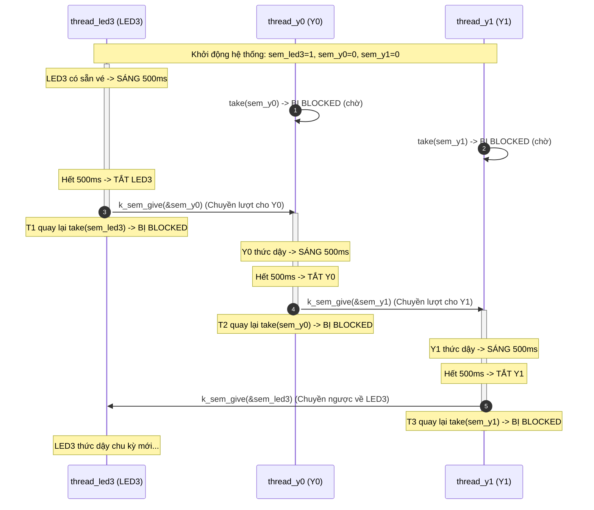

# BKIT ARM4 - Lab 2 - Bài 1: Chạy tiếp sức ba đèn bằng Binary Semaphore

Tài liệu hướng dẫn chi tiết về **Lý thuyết cốt lõi**, **Trình tự đọc hiểu mã nguồn** và **Cơ chế ép thứ tự thực thi tuần tự (Strict Execution Ordering)** giữa nhiều luồng chạy song song trên Zephyr RTOS.

---

## 1. Yêu cầu đề bài & Lý thuyết cốt lõi

### 1.1. Yêu cầu đề bài & Quy định phần cứng
* **Đề bài**: Viết ba thread `thread_led3`, `thread_y0`, `thread_y1` có cùng mức ưu tiên (`Priority = 5`), mỗi thread chỉ điều khiển một đèn. Ba đèn sáng lần lượt theo đúng thứ tự:
  $$\text{LED3} \longrightarrow \text{Y0} \longrightarrow \text{Y1} \longrightarrow \text{LED3} \longrightarrow \dots$$
* **Quy tắc thời gian**: Mỗi đèn sáng đúng **500 ms** rồi tắt và "chuyển lượt" cho đèn kế tiếp. Tại mọi thời điểm, **tuyệt đối không bao giờ có hai đèn cùng sáng**.
* **Ràng buộc RTOS**:
  * Việc chuyển lượt chỉ được dùng **ba Binary Semaphore** (`sem_led3`, `sem_y0`, `sem_y1`).
  * Mỗi thread take semaphore của mình, làm việc, rồi give semaphore của thread kế tiếp.
  * **Cấm dùng biến toàn cục** kiểm tra vòng lặp hỏi vòng (`while (!flag);` - Busy-waiting).
  * **Cấm dùng `k_msleep()`** để "canh giờ" khởi động lệch nhau giữa các thread.
* **Quy ước phần cứng**:
  * Đèn `LED3` $\rightarrow$ Chân `PE4` (Devicetree alias: `led0`)
  * Đèn `Y0` $\rightarrow$ Chân `PE5` (Devicetree alias: `led1`)
  * Đèn `Y1` $\rightarrow$ Chân `PE6` (Devicetree alias: `led2`)

### 1.2. Khái niệm & Cơ chế RTOS áp dụng
* **Binary Semaphore (Semaphore nhị phân)**: Là đối tượng đồng bộ chỉ nhận hai giá trị đếm: `0` (không có sẵn) hoặc `1` (sẵn sàng).
* **Mô hình Chuyền gậy tiếp sức (Relay Race Synchronization)**:
  * Khi thread chưa có gậy (Semaphore = 0), nó chủ động gọi `k_sem_take(&sem, K_FOREVER)` $\rightarrow$ Hệ điều hành lập tức đưa thread này vào trạng thái **BLOCKED** (ngủ sâu, tiêu tốn 0% CPU).
  * Khi thread trước làm xong, nó gọi `k_sem_give(&sem_next)` $\rightarrow$ Chuyền gậy sang đánh thức thread tiếp theo dậy chạy.
  * Nhờ vậy, chu trình chạy tuần tự được đảm bảo chính xác 100% về mặt thời gian thực mà không phụ thuộc vào độ ưu tiên hay bộ lập lịch thời gian.

### 1.3. Bảng tổng hợp API Zephyr RTOS sử dụng

| API / Macro | Ngữ cảnh | Chức năng kỹ thuật |
| :--- | :---: | :--- |
| `K_SEM_DEFINE(sem_name, initial_count, count_limit)` | Compile-time | Khởi tạo tĩnh Semaphore với giá trị ban đầu và giá trị tối đa (ở đây limit = 1). |
| `k_sem_take(&sem, timeout)` | Chỉ Thread | Chờ nhận vé Semaphore. Nếu vé = 0, thread bị **BLOCKED** chờ đến khi có vé hoặc hết timeout. |
| `k_sem_give(&sem)` | Thread / ISR | Trả vé Semaphore (tăng count lên 1) và đánh thức ngay lập tức luồng đang xếp hàng chờ vé. |
| `K_THREAD_DEFINE(...)` | Compile-time | Đăng ký tĩnh luồng với bộ lập lịch (Stack size, hàm thực thi, độ ưu tiên, cờ bắt đầu). |

---

## 2. Hướng dẫn trình tự đọc hiểu mã nguồn (Code Reading Guide)

Để người đọc hoặc người chấm bài nhanh chóng nắm bắt logic toàn bộ file `src/main.c`, hãy theo dõi mã nguồn theo **5 bước tuần tự** dưới đây:

### 🔹 Bước 1: Khai báo phần cứng qua Devicetree
Mở đầu file `main.c`, ta liên kết các macro alias từ Devicetree với cấu trúc `struct gpio_dt_spec` để điều khiển chân GPIO:
```c
#define LED0_NODE DT_ALIAS(led0) /* LED3 - PE4 */
#define LED1_NODE DT_ALIAS(led1) /* Y0   - PE5 */
#define LED2_NODE DT_ALIAS(led2) /* Y1   - PE6 */

static const struct gpio_dt_spec led3 = GPIO_DT_SPEC_GET(LED0_NODE, gpios);
static const struct gpio_dt_spec y0   = GPIO_DT_SPEC_GET(LED1_NODE, gpios);
static const struct gpio_dt_spec y1   = GPIO_DT_SPEC_GET(LED2_NODE, gpios);
```

### 🔹 Bước 2: Khởi tạo các Binary Semaphore (Cấp vé ban đầu)
Quan sát cách cấp giá trị khởi tạo `initial_count` để quyết định luồng nào chạy trước:
```c
/*
 * - sem_led3 khởi tạo = 1: Cấp trước 1 vé để LED3 chạy đầu tiên ngay khi bật nguồn.
 * - sem_y0 và sem_y1 khởi tạo = 0: Chưa có vé, buộc phải ngủ chờ lượt.
 */
K_SEM_DEFINE(sem_led3, 1, 1);
K_SEM_DEFINE(sem_y0,   0, 1);
K_SEM_DEFINE(sem_y1,   0, 1);

#define BLINK_TIME_MS 500
```

### 🔹 Bước 3: Đọc hàm thực thi của 3 Thread
Mỗi hàm thread tuân theo cấu trúc chuẩn: **Cấu hình chân $\rightarrow$ Vòng lặp vô hạn `while(1)` $\rightarrow$ Chờ gậy của mình $\rightarrow$ Bật đèn 500ms $\rightarrow$ Tắt đèn $\rightarrow$ Chuyền gậy cho đèn tiếp theo**:
```c
/* Luồng 1: Điều khiển LED3 (Chuyền cho Y0) */
void fn_thread_led3(void *p1, void *p2, void *p3) {
    gpio_pin_configure_dt(&led3, GPIO_OUTPUT_INACTIVE);
    while (1) {
        k_sem_take(&sem_led3, K_FOREVER);    // 1. Chờ gậy của mình
        printf("[%6u ms] LED3\n", k_uptime_get_32());
        gpio_pin_set_dt(&led3, 1);
        k_msleep(BLINK_TIME_MS);             // Sáng 500ms
        gpio_pin_set_dt(&led3, 0);           // Tắt đèn
        k_sem_give(&sem_y0);                 // 2. Chuyền gậy cho Y0
    }
}

/* Luồng 2: Điều khiển Y0 (Chuyền cho Y1) */
void fn_thread_y0(void *p1, void *p2, void *p3) {
    gpio_pin_configure_dt(&y0, GPIO_OUTPUT_INACTIVE);
    while (1) {
        k_sem_take(&sem_y0, K_FOREVER);
        printf("[%6u ms] Y0\n", k_uptime_get_32());
        gpio_pin_set_dt(&y0, 1);
        k_msleep(BLINK_TIME_MS);
        gpio_pin_set_dt(&y0, 0);
        k_sem_give(&sem_y1);                 // Chuyền gậy cho Y1
    }
}

/* Luồng 3: Điều khiển Y1 (Chuyền khép kín về LED3) */
void fn_thread_y1(void *p1, void *p2, void *p3) {
    gpio_pin_configure_dt(&y1, GPIO_OUTPUT_INACTIVE);
    while (1) {
        k_sem_take(&sem_y1, K_FOREVER);
        printf("[%6u ms] Y1\n", k_uptime_get_32());
        gpio_pin_set_dt(&y1, 1);
        k_msleep(BLINK_TIME_MS);
        gpio_pin_set_dt(&y1, 0);
        k_sem_give(&sem_led3);               // Chuyền ngược về LED3
    }
}
```

### 🔹 Bước 4: Đăng ký Thread với Kernel
Cả 3 thread được tạo tĩnh với cùng mức ưu tiên `Priority = 5` và kích thước stack 1024 bytes:
```c
K_THREAD_DEFINE(thread_led3, 1024, fn_thread_led3, NULL, NULL, NULL, 5, 0, 0);
K_THREAD_DEFINE(thread_y0,   1024, fn_thread_y0,   NULL, NULL, NULL, 5, 0, 0);
K_THREAD_DEFINE(thread_y1,   1024, fn_thread_y1,   NULL, NULL, NULL, 5, 0, 0);
```

### 🔹 Bước 5: Hàm `main()`
Vì các thread đã được Kernel tự động khởi chạy sau khi boot, hàm `main()` chỉ in tiêu đề giới thiệu hệ thống:
```c
int main(void) {
    printf("=== BKIT ARM4: Lab 2 - Bai 1: Tiep suc 3 den bang Binary Semaphore ===\n");
    return 0;
}
```

---

## 3. Cơ chế hoạt động & Sơ đồ tương tác (Mermaid)

### 3.1. Sơ đồ tuần tự chuyển giao quyền thực thi



### 3.2. Dòng thời gian diễn biến (Timeline Tracing)

| Mốc thời gian (ms) | Luồng đang chạy | Đèn sáng | Trạng thái 3 Semaphore |
| :---: | :--- | :---: | :---: |
| **$0\text{ ms}$** | `thread_led3` (lấy vé đầu tiên) | **LED3 BẬT** | `sem_led3 = 0, sem_y0 = 0, sem_y1 = 0` |
| **$500\text{ ms}$** | Tắt LED3, give `sem_y0` $\rightarrow$ Đánh thức `thread_y0` | **Y0 BẬT** | `sem_led3 = 0, sem_y0 = 0, sem_y1 = 0` |
| **$1000\text{ ms}$** | Tắt Y0, give `sem_y1` $\rightarrow$ Đánh thức `thread_y1` | **Y1 BẬT** | `sem_led3 = 0, sem_y0 = 0, sem_y1 = 0` |
| **$1500\text{ ms}$** | Tắt Y1, give `sem_led3` $\rightarrow$ Đánh thức `thread_led3` | **LED3 BẬT** | `sem_led3 = 0, sem_y0 = 0, sem_y1 = 0` |
| **$2000\text{ ms}$** | Tắt LED3, give `sem_y0` $\rightarrow$ Đánh thức `thread_y0` | **Y0 BẬT** | `sem_led3 = 0, sem_y0 = 0, sem_y1 = 0` |
| **$2500\text{ ms}$** | Tắt Y0, give `sem_y1` $\rightarrow$ Đánh thức `thread_y1` | **Y1 BẬT** | `sem_led3 = 0, sem_y0 = 0, sem_y1 = 0` |

---

## 4. Nếu KHÔNG CÓ cơ chế này thì sao? (Phân tích lỗi)

| Phương pháp thay thế | Hiện tượng & Lỗi thực tế |
| :--- | :--- |
| **Dùng biến cờ toàn cục `int turn` (Busy-Waiting)** | Các luồng chưa đến lượt phải liên tục chạy vòng lặp rỗng `while (turn != 0);`. Việc này **ngốn 100% công suất CPU**, làm nóng vi điều khiển, lãng phí điện năng và chặn đứng các tiến trình ưu tiên thấp hơn. |
| **Dùng `k_msleep()` để canh giờ lệch nhau** | Ví dụ cho Thread 1 chạy ngay, Thread 2 sleep 500ms, Thread 3 sleep 1000ms. Trong hệ điều hành thực tế, thời gian trễ của bộ lập lịch luôn có sai số tích lũy (*drift*). Chỉ sau một thời gian ngắn, các luồng sẽ **bị lệch pha, chèn đè lên nhau** dẫn đến nhiều đèn cùng sáng một lúc. |
| **Dùng Binary Semaphore (Giải pháp tối ưu)** | Khi chưa có vé, luồng tự động ngủ sâu (**BLOCKED**, 0% CPU). Khi có tín hiệu `give()`, chuyển ngữ cảnh diễn ra tức thì trong vài micro-giây, bảo đảm trật tự tuyệt đối. |

---

## 5. Đáp án câu hỏi bài tập (Q&A)

### ❓ Câu (a): Bạn chọn giá trị ban đầu của ba semaphore như thế nào? Điều gì xảy ra nếu cả ba đều bằng 0? Nếu cả ba đều bằng 1?
* **Cách chọn**: `sem_led3 = 1`, `sem_y0 = 0`, `sem_y1 = 0`. Cấp trước 1 lượt cho `sem_led3` để `thread_led3` chạy ngay khi khởi động, hai thread còn lại chờ lượt.
* **Nếu cả ba đều bằng 0**: Xảy ra hiện tượng **Deadlock** (khóa chết). Cả ba thread cùng gọi `k_sem_take` và bị chặn vĩnh viễn, không có thread nào được chạy và không có đèn nào sáng.
* **Nếu cả ba đều bằng 1**: Cả ba thread đều take thành công ngay lập tức ở lần chạy đầu tiên. Khi đó **cả 3 đèn cùng bật sáng đồng thời trong 500 ms đầu**, vi phạm hoàn toàn quy tắc "không bao giờ có hai đèn cùng sáng".

### ❓ Câu (b): Muốn đổi thứ tự thành LED3 $\rightarrow$ Y1 $\rightarrow$ Y0, bạn phải sửa những gì?
* Giữ nguyên giá trị khởi tạo: `sem_led3 = 1`, `sem_y1 = 0`, `sem_y0 = 0`.
* Sửa lệnh `k_sem_give` ở cuối mỗi hàm luồng:
  1. Trong `fn_thread_led3`: sửa `k_sem_give(&sem_y0)` thành `k_sem_give(&sem_y1)`.
  2. Trong `fn_thread_y1`: sửa `k_sem_give(&sem_led3)` thành `k_sem_give(&sem_y0)`.
  3. Trong `fn_thread_y0`: sửa `k_sem_give(&sem_y1)` thành `k_sem_give(&sem_led3)`.
