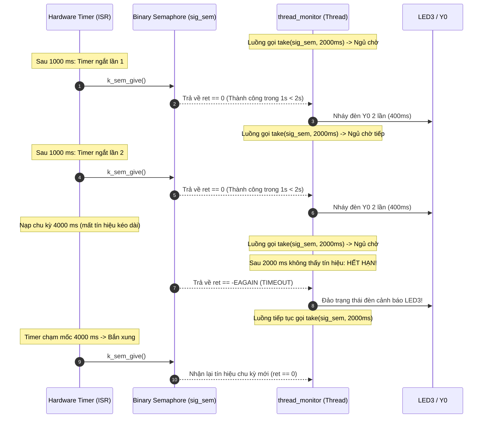

# BKIT ARM4 - Lab 2 - Bài 2: Giám sát tín hiệu có Timeout

Tài liệu hướng dẫn chi tiết về **Lý thuyết cốt lõi**, **Trình tự đọc hiểu mã nguồn** và **Cơ chế xử lý Timeout trong RTOS** để phát hiện sự cố mất tín hiệu định kỳ từ ngắt phần cứng sang luồng trên Zephyr RTOS.

---

## 1. Yêu cầu đề bài & Lý thuyết cốt lõi

### 1.1. Yêu cầu đề bài & Quy định phần cứng
* **Đề bài**:
  * Tạo một `k_timer` chạy chế độ one-shot. Trong callback (ISR), sau khi gọi `k_sem_give(&sig_sem)`, tự khởi động lại timer với chu kỳ lần lượt: **$1\text{ s} \longrightarrow 1\text{ s} \longrightarrow 4\text{ s}$** rồi lặp lại (mô phỏng một cảm biến ngoại vi thỉnh thoảng bị mất tín hiệu).
  * Thread `thread_monitor` chờ tín hiệu bằng `k_sem_take(&sig_sem, K_MSEC(2000))` và kiểm tra giá trị trả về:
    * `0` $\longrightarrow$ In log `Nhan tin hieu`, nháy đèn `Y0` hai lần (mỗi lần 100 ms sáng / 100 ms tắt).
    * `-EAGAIN` $\longrightarrow$ In log `TIMEOUT - mat tin hieu!` và đảo trạng thái đèn `LED3`.
  * **Quy tắc ISR**: Trình phục vụ ngắt tuyệt đối không được in log (`printf`), không được điều khiển đèn — chỉ được phép give semaphore và khởi động lại timer.
* **Quy ước phần cứng**:
  * `LED3` (PE4): Đèn cảnh báo lỗi Timeout (mất tín hiệu).
  * `Y0` (PE5): Đèn báo nhận tín hiệu bình thường.

### 1.2. Khái niệm & Cơ chế RTOS áp dụng
* **Giám sát thời gian thực với Timeout (Watchdog Pattern)**:
  * Trong các hệ thống nhúng quan trọng, nếu một cảm biến hoặc kết nối truyền thông bị hỏng (đứt cáp, treo vi xử lý phụ), luồng xử lý nếu chỉ chờ vô hạn (`K_FOREVER`) sẽ bị **treo vĩnh viễn** mà hệ thống không hề hay biết.
  * Việc áp dụng tham số timeout (ở đây là 2000 ms) giúp luồng vừa có khả năng ngủ tiết kiệm điện năng khi chưa có sự kiện, vừa tự động tỉnh dậy để kích hoạt quy trình cảnh báo/xử lý sự cố khi tín hiệu không đến đúng hạn.
* **Nguyên tắc an toàn trong Ngữ cảnh Ngắt (ISR Context)**:
  * ISR chạy trên Interrupt Stack chung, không có Stack riêng của tiến trình, không được quản lý bởi bộ lập lịch luồng.
  * Mọi lời gọi hàm trong ISR bắt buộc phải là **Non-blocking (phi phong tỏa)** với tham số `K_NO_WAIT`.

### 1.3. Bảng tổng hợp API Zephyr RTOS sử dụng

| API / Macro | Ngữ cảnh | Chức năng kỹ thuật |
| :--- | :---: | :--- |
| `K_SEM_DEFINE(sig_sem, 0, 1)` | Compile-time | Khởi tạo Binary Semaphore nhận tín hiệu (ban đầu = 0, tối đa = 1). |
| `k_sem_take(&sem, timeout)` | Chỉ Thread | Chờ tín hiệu có thời hạn. Trả về `0` (thành công) hoặc `-EAGAIN` (hết hạn timeout). |
| `k_sem_give(&sem)` | Thread / ISR | Phát tín hiệu đánh thức thread đang chờ. An toàn gọi từ trong ISR. |
| `K_TIMER_DEFINE(timer, isr, expiry)` | Compile-time | Đăng ký tĩnh phần cứng Software Timer của Zephyr. |
| `k_timer_start(&timer, duration, period)` | Thread / ISR | Nạp thời gian và kích hoạt timer chạy. |
| `gpio_pin_toggle_dt(&spec)` | Thread / ISR | Đảo trạng thái logic của chân GPIO (bật thành tắt, tắt thành bật). |

---

## 2. Hướng dẫn trình tự đọc hiểu mã nguồn (Code Reading Guide)

Khi tiếp cận file `src/main.c`, hãy đọc theo lộ trình **5 bước chuẩn** dưới đây:

### 🔹 Bước 1: Khai báo chân GPIO từ Devicetree
Liên kết chân đèn cảnh báo `LED3` (PE4) và đèn nhận tín hiệu `Y0` (PE5):
```c
#define LED0_NODE DT_ALIAS(led0) /* LED3 - PE4: Đèn cảnh báo Timeout */
#define LED1_NODE DT_ALIAS(led1) /* Y0   - PE5: Đèn báo nhận tín hiệu */

static const struct gpio_dt_spec led3 = GPIO_DT_SPEC_GET(LED0_NODE, gpios);
static const struct gpio_dt_spec y0   = GPIO_DT_SPEC_GET(LED1_NODE, gpios);
```

### 🔹 Bước 2: Khởi tạo Binary Semaphore & Mảng chu kỳ giả lập
Semaphore ban đầu bằng 0 (chưa có tín hiệu). Mảng `delay_pattern_ms` định nghĩa kịch bản phát xung 1s $\rightarrow$ 1s $\rightarrow$ 4s:
```c
K_SEM_DEFINE(sig_sem, 0, 1);

static const int delay_pattern_ms[] = {1000, 1000, 4000};
static int pattern_idx = 0;
```

### 🔹 Bước 3: Đọc hàm ngắt Timer ISR (`sig_timer_isr`)
Hàm ngắt thực hiện đúng 2 nhiệm vụ tối giản, tuân thủ nghiêm ngặt nguyên tắc phi phong tỏa trong ISR:
```c
static void sig_timer_isr(struct k_timer *timer)
{
    /* 1. Phát tín hiệu cho thread */
    k_sem_give(&sig_sem);

    /* 2. Nạp lại chu kỳ tiếp theo trong mảng (chế độ one-shot với K_NO_WAIT) */
    k_timer_start(timer, K_MSEC(delay_pattern_ms[pattern_idx]), K_NO_WAIT);
    pattern_idx = (pattern_idx + 1) % 3;
}
K_TIMER_DEFINE(sig_timer, sig_timer_isr, NULL);
```

### 🔹 Bước 4: Đọc hàm thực thi luồng giám sát (`fn_thread_monitor`)
Trọng tâm bài toán nằm ở việc kiểm tra giá trị trả về của `k_sem_take`:
```c
void fn_thread_monitor(void *p1, void *p2, void *p3)
{
    gpio_pin_configure_dt(&led3, GPIO_OUTPUT_INACTIVE);
    gpio_pin_configure_dt(&y0,   GPIO_OUTPUT_INACTIVE);

    while (1) {
        /* Chờ tín hiệu tối đa 2000 ms */
        int ret = k_sem_take(&sig_sem, K_MSEC(2000));

        if (ret == 0) {
            /* TRƯỜNG HỢP 1: Nhận tín hiệu đúng hạn -> Nháy Y0 hai lần */
            printf("[%6u ms] Nhan tin hieu\n", k_uptime_get_32());
            for (int i = 0; i < 2; i++) {
                gpio_pin_set_dt(&y0, 1);
                k_msleep(100);
                gpio_pin_set_dt(&y0, 0);
                k_msleep(100);
            }
        } else if (ret == -EAGAIN) {
            /* TRƯỜNG HỢP 2: Quá 2000 ms không có tín hiệu -> TIMEOUT! */
            printf("[%6u ms] TIMEOUT - mat tin hieu!\n", k_uptime_get_32());
            gpio_pin_toggle_dt(&led3); // Đảo trạng thái đèn cảnh báo
        }
    }
}

K_THREAD_DEFINE(thread_monitor, 1024, fn_thread_monitor, NULL, NULL, NULL, 5, 0, 0);
```

### 🔹 Bước 5: Hàm `main()` kích hoạt chu kỳ đầu tiên
```c
int main(void)
{
    printf("=== BKIT ARM4: Lab 2 - Bai 2: Giam sat tin hieu co Timeout ===\n");
    k_timer_start(&sig_timer, K_MSEC(delay_pattern_ms[0]), K_NO_WAIT);
    pattern_idx = 1;
    return 0;
}
```

---

## 3. Cơ chế hoạt động & Sơ đồ tương tác (Mermaid)

### 3.1. Sơ đồ tuần tự xử lý tín hiệu và Timeout



### 3.2. Dòng thời gian diễn biến (Timeline Tracing)

| Thời điểm (ms) | Hành động của Timer ISR | Trạng thái `thread_monitor` | Hiện tượng đèn |
| :---: | :--- | :--- | :---: |
| **$0\text{ ms}$** | Khởi động timer $1000\text{ ms}$ | Gọi `k_sem_take(..., 2000ms)` $\rightarrow$ Chờ | Cả hai đèn tắt |
| **$1000\text{ ms}$** | Bắn xung lần 1, nạp tiếp $1000\text{ ms}$ | Nhận vé (`ret == 0`), in `Nhan tin hieu` | **Y0 nháy 2 lần** |
| **$2400\text{ ms}$** | Bắn xung lần 2, nạp tiếp $4000\text{ ms}$ | Nhận vé (`ret == 0`), in `Nhan tin hieu` | **Y0 nháy 2 lần** |
| **$4400\text{ ms}$** | Đang đếm khoảng chờ 4s (chưa bắn) | Đã chờ đủ $2000\text{ ms}$ không có vé $\rightarrow$ **TIMEOUT** (`ret == -EAGAIN`) | **LED3 ĐẢO TRẠNG THÁI** |
| **$6400\text{ ms}$** | Hết 4000 ms, bắn xung lần 3, nạp $1000\text{ ms}$ | Thức dậy nhận vé chu kỳ mới (`ret == 0`) | **Y0 nháy 2 lần** |

---

## 4. Nếu KHÔNG CÓ cơ chế này thì sao? (Phân tích lỗi)

* **Nếu thread chờ với `K_FOREVER` thay vì timeout**:
  * Khi cảm biến bị ngắt kết nối (hoặc khoảng delay kéo dài vô hạn), luồng sẽ bị **treo vĩnh viễn** ở trạng thái BLOCKED. Hệ thống mất khả năng tự chẩn đoán lỗi, không có đèn cảnh báo nào được bật và người vận hành không biết thiết bị đã ngừng hoạt động.
* **Nếu gọi `k_sem_take(..., K_FOREVER)` hoặc `k_msleep()` trong ISR**:
  * Gây ra lỗi sập nhân hệ điều hành (**Kernel Panic / Usage Fault**). Kiến trúc ARM Cortex-M4 không cho phép chuyển ngữ cảnh luồng trong lúc đang phục vụ ngắt phần cứng.
* **Nếu không khởi động lại timer ở chế độ non-blocking (`K_NO_WAIT`)**:
  * Sẽ vi phạm quy tắc cấm chờ trong ISR, làm hệ thống bị tê liệt.

---

## 5. Đáp án câu hỏi bài tập (Q&A)

### ❓ Câu (a): Trong log, mỗi chu kỳ 6 s có bao nhiêu lần timeout và tại thời điểm nào? Giải thích con số đó.
* **Số lần timeout**: Mỗi chu kỳ 6s của timer ($1\text{s} + 1\text{s} + 4\text{s} = 6\text{s}$) có **đúng 1 lần timeout**.
* **Thời điểm & Giải thích**: Sau 2 lần nhận tín hiệu đầu tiên (khoảng cách 1s, nhỏ hơn timeout 2s nên nhận thành công), timer được nạp chu kỳ one-shot là 4000 ms. Luồng `thread_monitor` gọi `k_sem_take` với thời gian chờ tối đa 2000 ms (`K_MSEC(2000)`). Khi chờ đủ 2000 ms mà vẫn chưa có tín hiệu từ timer, hàm `k_sem_take` hết hạn và trả về mã lỗi `-EAGAIN` $\rightarrow$ Luồng ghi nhận TIMEOUT và đảo trạng thái LED3. Tại giây thứ 4 của khoảng chờ, timer mới hết hạn và gọi `k_sem_give(&sig_sem)`. Tín hiệu này được lưu lại trong semaphore để luồng nhận ngay ở chu kỳ tiếp theo.

### ❓ Câu (b): Vì sao ISR không được gọi `k_sem_take(&sig_sem, K_FOREVER)` hay `k_msleep()`?
* ISR (trình phục vụ ngắt) chạy trong ngữ cảnh ngắt phần cứng, không phải là một luồng (thread) có không gian ngăn xếp (stack) riêng của bộ lập lịch RTOS, nên nó **không thể bị chuyển sang trạng thái ngủ/chờ (BLOCKED/SLEEP)**.
* Nếu gọi hàm chờ như `k_sem_take(..., K_FOREVER)` hoặc `k_msleep()` trong ISR, nhân hệ điều hành Zephyr sẽ phát hiện vi phạm và kích hoạt Kernel Panic / Fatal Usage Fault (báo lỗi: *"Illegal use of wait in ISR context"*), dẫn đến việc khóa cứng CPU và treo toàn bộ hệ thống ngay lập tức. ISR phải thực thi với tốc độ cực nhanh và thoát ngay để CPU tiếp nhận các ngắt khác.

### ❓ Câu (c): Nếu ISR give hai lần liên tiếp trước khi thread kịp take thì thread xử lý mấy lần? Muốn không mất lần nào thì sửa khai báo semaphore ra sao?
* **Số lần xử lý**: Thread chỉ xử lý **đúng 1 lần**, lần give thứ hai bị mất hoàn toàn.
* **Giải thích**: Do `sig_sem` được khai báo là Binary Semaphore với giới hạn tối đa `limit = 1`. Khi semaphore đã đạt giá trị 1 mà thread chưa kịp lấy, mọi lệnh `k_sem_give` tiếp theo sẽ không làm tăng bộ đếm mà bị bỏ qua.
* **Cách sửa**: Chuyển sang dùng Counting Semaphore bằng cách tăng tham số giới hạn tối đa (`limit`) đủ lớn, ví dụ:
  ```c
  K_SEM_DEFINE(sig_sem, 0, 10);
  ```
  Khi đó bộ đếm semaphore có thể tích lũy nhiều lần give liên tiếp để thread lấy dần ra xử lý mà không bị mất.
