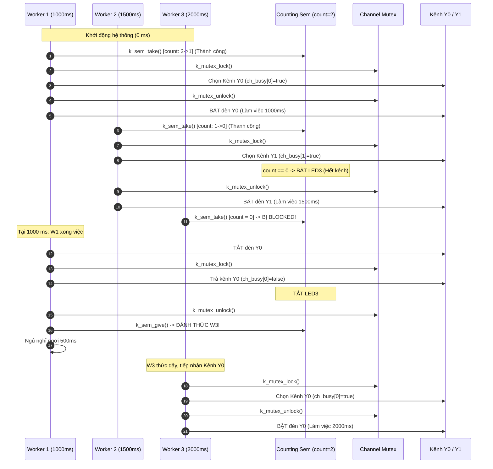

# BKIT ARM4 - Lab 2 - Bài 3: Chia sẻ 2 kênh Output cho 4 Worker bằng Counting Semaphore & Mutex

Tài liệu hướng dẫn chi tiết về **Lý thuyết cốt lõi**, **Trình tự đọc hiểu mã nguồn** và **Mô hình quản lý hồ tài nguyên hữu hạn (Resource Pool)** kết hợp giữa **Counting Semaphore** và **Mutex** trên Zephyr RTOS.

---

## 1. Yêu cầu đề bài & Lý thuyết cốt lõi

### 1.1. Yêu cầu đề bài & Quy định phần cứng
* **Đề bài**:
  * Hệ thống có **2 kênh output vật lý** giống nhau: `Y0` (PE5) và `Y1` (PE6).
  * Có **4 Worker độc lập** (`W1`..`W4`) cùng có nhu cầu sử dụng kênh, mỗi worker lặp vô hạn: *Xin một kênh trống $\rightarrow$ Bật đèn kênh đó trong thời gian làm việc $\rightarrow$ Tắt đèn, trả kênh $\rightarrow$ Nghỉ ngơi*.
  * Dùng một hàm thread `thread_worker` duy nhất nhận cấu hình thông số qua tham số `p1`, tạo thành 4 luồng độc lập bằng `K_THREAD_DEFINE`.
* **Bảng thông số cấu hình của 4 Worker**:

| Worker | Thời gian làm việc (`work_ms`) | Thời gian nghỉ (`rest_ms`) | Chu kỳ lặp cơ sở |
| :---: | :---: | :---: | :---: |
| **W1** | 1000 ms | 500 ms | 1500 ms |
| **W2** | 1500 ms | 700 ms | 2200 ms |
| **W3** | 2000 ms | 300 ms | 2300 ms |
| **W4** | 2500 ms | 900 ms | 3400 ms |

* **Ràng buộc RTOS**:
  * Dùng `K_SEM_DEFINE(pool_sem, 2, 2)` để giới hạn tối đa 2 worker được phép chiếm dụng kênh cùng lúc.
  * Dùng một Mutex (`ch_mutex`) bảo vệ mảng trạng thái `bool ch_busy[2]` khi kiểm tra và phân phối kênh.
  * Đèn `LED3` (PE4) sáng khi không còn kênh trống (`k_sem_count_get(&pool_sem) == 0`), tắt khi có ít nhất một kênh rảnh.
  * Định dạng in log: `[t] W2 dung kenh Y1` và `[t] W2 tra kenh Y1`.

### 1.2. Khái niệm & Cơ chế RTOS áp dụng
* **Counting Semaphore (Quản lý dung lượng tài nguyên - Resource Throttling)**:
  * Counting Semaphore lưu giữ một số nguyên đại diện cho số lượng đơn vị tài nguyên còn trống trong hồ (ở đây là 2 kênh).
  * Khi worker xin vé bằng `k_sem_take`, bộ đếm giảm đi 1. Khi cả 2 vé đã bị lấy hết (`count == 0`), worker thứ 3 và thứ 4 gọi `take` sẽ tự động bị **BLOCKED** đưa vào danh sách chờ.
  * Khi một worker trả vé bằng `k_sem_give`, bộ đếm tăng lên và tự động đánh thức ngay 1 worker đang xếp hàng.
* **Mutex (Bảo vệ vùng găng - Critical Section)**:
  * Counting Semaphore chỉ cho biết "hệ thống có ít nhất một kênh rảnh", nhưng **không biết cụ thể đó là kênh 0 hay kênh 1**.
  * Để biết kênh nào rảnh, worker phải duyệt mảng toàn cục `ch_busy[2]`. Mutex đảm bảo việc kiểm tra và đánh dấu kênh diễn ra nguyên tử (atomic), ngăn chặn hiện tượng tranh chấp điều kiện (Race Condition) khiến hai worker cùng chọn chung một kênh vật lý!

### 1.3. Bảng tổng hợp API Zephyr RTOS sử dụng

| API / Macro | Ngữ cảnh | Chức năng kỹ thuật |
| :--- | :---: | :--- |
| `K_SEM_DEFINE(pool_sem, 2, 2)` | Compile-time | Khởi tạo Counting Semaphore: giá trị ban đầu = 2, giới hạn tối đa = 2. |
| `k_sem_take(&pool_sem, K_FOREVER)` | Chỉ Thread | Xin 1 vé từ hồ tài nguyên. Nếu hết vé, thread tự động ngủ (BLOCKED). |
| `k_sem_give(&pool_sem)` | Thread / ISR | Trả 1 vé cho hồ tài nguyên và đánh thức luồng đang chờ. |
| `k_sem_count_get(&pool_sem)` | Thread / ISR | Đọc số vé hiện còn trong hồ. Dùng để kiểm tra `count == 0` bật `LED3`. |
| `K_MUTEX_DEFINE(ch_mutex)` | Compile-time | Khởi tạo Mutex bảo vệ vùng găng mảng `ch_busy`. |
| `k_mutex_lock(&ch_mutex, timeout)` | Chỉ Thread | Chiếm quyền độc quyền truy cập mảng trạng thái kênh. |
| `k_mutex_unlock(&ch_mutex)` | Chỉ Thread | Giải phóng quyền độc quyền cho các worker khác. |

---

## 2. Hướng dẫn trình tự đọc hiểu mã nguồn (Code Reading Guide)

Khi theo dõi file `src/main.c`, hãy đọc tuần tự theo **5 bước thiết kế cấu trúc** sau:

### 🔹 Bước 1: Khai báo phần cứng kênh Output và đèn cảnh báo
Mảng cấu trúc `channels[2]` quản lý 2 kênh ngõ ra `Y0` và `Y1`:
```c
#define LED0_NODE DT_ALIAS(led0) /* LED3 - PE4: Báo cả 2 kênh đều bận */
#define LED1_NODE DT_ALIAS(led1) /* Y0   - PE5: Kênh output 0 */
#define LED2_NODE DT_ALIAS(led2) /* Y1   - PE6: Kênh output 1 */

static const struct gpio_dt_spec led3 = GPIO_DT_SPEC_GET(LED0_NODE, gpios);
static const struct gpio_dt_spec channels[2] = {
    GPIO_DT_SPEC_GET(LED1_NODE, gpios),
    GPIO_DT_SPEC_GET(LED2_NODE, gpios)
};
static const char *const ch_names[2] = {"Y0", "Y1"};
```

### 🔹 Bước 2: Khởi tạo Counting Semaphore, Mutex và Bảng trạng thái
```c
/* Counting semaphore: giới hạn tối đa 2 worker được cấp quyền */
K_SEM_DEFINE(pool_sem, 2, 2);

/* Mutex bảo vệ thao tác tìm và xí kênh trên mảng ch_busy */
K_MUTEX_DEFINE(ch_mutex);

static bool ch_busy[2] = {false, false};
```

### 🔹 Bước 3: Định nghĩa cấu trúc tham số cấu hình Worker
Mỗi worker có ID, thời gian làm việc và thời gian nghỉ riêng biệt:
```c
struct worker_cfg {
    int id;
    int work_ms;
    int rest_ms;
};

static const struct worker_cfg cfg1 = {1, 1000, 500};
static const struct worker_cfg cfg2 = {2, 1500, 700};
static const struct worker_cfg cfg3 = {3, 2000, 300};
static const struct worker_cfg cfg4 = {4, 2500, 900};
```

### 🔹 Bước 4: Đọc hàm thực thi chung của Worker (`thread_worker`)
Hàm thực thi chuẩn quy trình 5 giai đoạn: **Xin vé $\rightarrow$ Chọn kênh (có Mutex) $\rightarrow$ Làm việc $\rightarrow$ Trả kênh (có Mutex) $\rightarrow$ Nghỉ ngơi**:
```c
void thread_worker(void *p1, void *p2, void *p3)
{
    const struct worker_cfg *cfg = (const struct worker_cfg *)p1;

    while (1) {
        /* Giai đoạn 1: Xin vé từ Counting Semaphore */
        k_sem_take(&pool_sem, K_FOREVER);

        /* Giai đoạn 2: Critical Section - Tìm kênh rảnh dưới bảo vệ của Mutex */
        k_mutex_lock(&ch_mutex, K_FOREVER);
        int ch = -1;
        if (!ch_busy[0]) {
            ch = 0;
            ch_busy[0] = true;
        } else if (!ch_busy[1]) {
            ch = 1;
            ch_busy[1] = true;
        }
        /* Nếu hết vé trong pool -> Cả 2 kênh đều bận -> Bật LED3 */
        if (k_sem_count_get(&pool_sem) == 0) {
            gpio_pin_set_dt(&led3, 1);
        }
        k_mutex_unlock(&ch_mutex);

        /* Giai đoạn 3: Làm việc - Bật đèn kênh tương ứng */
        printf("[%6u ms] W%d dung kenh %s\n", k_uptime_get_32(), cfg->id, ch_names[ch]);
        gpio_pin_set_dt(&channels[ch], 1);
        k_msleep(cfg->work_ms);
        gpio_pin_set_dt(&channels[ch], 0);

        /* Giai đoạn 4: Trả kênh an toàn dưới bảo vệ của Mutex */
        printf("[%6u ms] W%d tra kenh %s\n", k_uptime_get_32(), cfg->id, ch_names[ch]);
        k_mutex_lock(&ch_mutex, K_FOREVER);
        ch_busy[ch] = false;
        gpio_pin_set_dt(&led3, 0); // Đã có kênh rảnh -> Tắt LED3
        k_mutex_unlock(&ch_mutex);

        k_sem_give(&pool_sem); // Trả lại 1 vé cho pool

        /* Giai đoạn 5: Nghỉ ngơi */
        k_msleep(cfg->rest_ms);
    }
}
```

### 🔹 Bước 5: Đăng ký 4 luồng tĩnh và Hàm `main()`
Cả 4 worker được tạo với cùng mức ưu tiên `Priority = 5`, truyền địa chỉ cấu hình tương ứng vào tham số `p1`:
```c
K_THREAD_DEFINE(worker1, 1024, thread_worker, (void *)&cfg1, NULL, NULL, 5, 0, 0);
K_THREAD_DEFINE(worker2, 1024, thread_worker, (void *)&cfg2, NULL, NULL, 5, 0, 0);
K_THREAD_DEFINE(worker3, 1024, thread_worker, (void *)&cfg3, NULL, NULL, 5, 0, 0);
K_THREAD_DEFINE(worker4, 1024, thread_worker, (void *)&cfg4, NULL, NULL, 5, 0, 0);

int main(void)
{
    gpio_pin_configure_dt(&led3, GPIO_OUTPUT_INACTIVE);
    gpio_pin_configure_dt(&channels[0], GPIO_OUTPUT_INACTIVE);
    gpio_pin_configure_dt(&channels[1], GPIO_OUTPUT_INACTIVE);
    printf("=== BKIT ARM4: Lab 2 - Bai 3: Chia se 2 kenh output cho 4 worker ===\n");
    return 0;
}
```

---

## 3. Cơ chế hoạt động & Sơ đồ tương tác (Mermaid)

### 3.1. Sơ đồ tuần tự phối hợp giữa Counting Semaphore và Mutex



### 3.2. Dòng thời gian diễn biến (Timeline Tracing)

| Mốc thời gian (ms) | Worker 1 | Worker 2 | Worker 3 | Worker 4 | Trạng thái Kênh Y0 / Y1 | Đèn LED3 (Hết kênh) |
| :---: | :---: | :---: | :---: | :---: | :---: | :---: |
| **$0\text{ ms}$** | Dùng **Y0** | Dùng **Y1** | Bị BLOCKED | Bị BLOCKED | **Y0: BẬT, Y1: BẬT** | **SÁNG** |
| **$1000\text{ ms}$** | Trả **Y0** $\rightarrow$ Nghỉ 500ms | Đang dùng Y1 | Lấy **Y0** $\rightarrow$ Dùng 2000ms | Bị BLOCKED | **Y0: BẬT, Y1: BẬT** | **SÁNG** |
| **$1500\text{ ms}$** | Hết nghỉ $\rightarrow$ Bị BLOCKED | Trả **Y1** $\rightarrow$ Nghỉ 700ms | Đang dùng Y0 | Lấy **Y1** $\rightarrow$ Dùng 2500ms | **Y0: BẬT, Y1: BẬT** | **SÁNG** |
| **$3000\text{ ms}$** | Lấy **Y0** $\rightarrow$ Dùng 1000ms | Bị BLOCKED | Trả **Y0** $\rightarrow$ Nghỉ 300ms | Đang dùng Y1 | **Y0: BẬT, Y1: BẬT** | **SÁNG** |
| **$4000\text{ ms}$** | Trả **Y0** $\rightarrow$ Nghỉ 500ms | Lấy **Y0** $\rightarrow$ Dùng 1500ms | Lấy **Y1** $\rightarrow$ Dùng 2000ms | Trả **Y1** $\rightarrow$ Nghỉ 900ms | **Y0: BẬT, Y1: BẬT** | **SÁNG** |

---

## 4. Nếu KHÔNG CÓ cơ chế này thì sao? (Phân tích lỗi)

* **Nếu KHÔNG dùng Counting Semaphore**:
  * Cả 4 worker sẽ cùng lao vào giành kênh. Do hệ thống chỉ có 2 kênh vật lý (`Y0`, `Y1`), 2 worker thừa hoặc sẽ phải kiểm tra vòng lặp liên tục (ngốn 100% CPU), hoặc đè lên kênh đang chạy làm đảo lộn chu kỳ nháy đèn.
* **Nếu KHÔNG dùng Mutex để bảo vệ `ch_busy[2]` (Race Condition cực kỳ nguy hiểm!)**:
  * Giả sử cả Worker A và Worker B cùng được cấp phép qua Semaphore. Worker A kiểm tra thấy `ch_busy[0] == false`. Đúng lúc đó, chuyển ngữ cảnh xảy ra sang Worker B.
  * Worker B cũng thấy `ch_busy[0] == false`, lập tức gán `ch_busy[0] = true` và chọn kênh 0 (`Y0`).
  * Khi CPU trả về cho Worker A, nó tiếp tục câu lệnh chọn kênh 0 (`Y0`)!
  * **Hậu quả**: Cả Worker A và Worker B **cùng chọn chung kênh Y0**, trong khi kênh Y1 bị bỏ trống lãng phí. Hai worker sẽ bật/tắt đè tín hiệu lên nhau làm sai hoàn toàn logic bài toán.

---

## 5. Đáp án câu hỏi bài tập (Q&A)

### ❓ Câu (a): Vì sao cần cả counting semaphore và mutex? Mỗi cái giải quyết vấn đề gì?
* **Counting Semaphore (`pool_sem = 2`)**: Giải quyết bài toán **Định lượng và giới hạn tài nguyên** (Resource Capacity Control). Giới hạn tối đa 2 worker được phép sử dụng kênh đồng thời. Khi cả 2 kênh đều bận (`count == 0`), semaphore tự động đưa worker thứ 3 và thứ 4 vào hàng đợi chờ (BLOCKED) mà không tiêu tốn chu kỳ CPU. Nhược điểm: Semaphore chỉ đếm số lượng tài nguyên còn trống chứ không chỉ ra cụ thể kênh nào (kênh 0 hay kênh 1) đang rảnh.
* **Mutex (`ch_mutex`)**: Giải quyết bài toán **Loại trừ tương hỗ** (Mutual Exclusion) cho bảng trạng thái `ch_busy[2]`. Đảm bảo việc kiểm tra và cập nhật mảng trạng thái (tìm kênh rảnh và đánh dấu bận) diễn ra nguyên tử (Critical Section), ngăn chặn tranh chấp giữa các worker.

### ❓ Câu (b): Nếu thay pool_sem bằng binary semaphore thì hệ thống chạy thế nào? Nếu bỏ mutex thì lỗi gì có thể xảy ra?
* **Nếu thay `pool_sem` bằng Binary Semaphore (`initial = 1, max = 1`)**: Giới hạn tài nguyên bị giảm từ 2 xuống 1. Tại mọi thời điểm chỉ có DUY NHẤT 1 worker được làm việc, kênh output còn lại bị bỏ phí hoàn toàn. Thời gian chờ đợi của các worker tăng gấp đôi và hiệu năng hệ thống giảm một nửa.
* **Nếu bỏ Mutex**: Xảy ra lỗi Race Condition (tranh chấp điều kiện) trên mảng `ch_busy[2]`. Nếu 2 worker cùng thức dậy và kiểm tra `ch_busy[0] == false` trước khi kịp gán `true`, **cả hai worker sẽ cùng chọn và điều khiển chung kênh Y0**! Khi đó kênh Y1 bị bỏ trống vô cớ, còn đèn Y0 bị 2 worker bật tắt chồng chéo gây loạn logic.

### ❓ Câu (c): Từ log, có lúc nào cả 4 worker cùng chờ không? Worker nào chờ lâu nhất?
* **Có lúc nào cả 4 worker cùng chờ không?** **Không bao giờ**. Vì điều kiện để một worker phải chờ là số vé trong `pool_sem` bằng 0, đồng nghĩa với việc đang có đúng 2 worker đang chiếm kênh làm việc. Do đó, tối đa chỉ có 2 worker rơi vào trạng thái chờ (BLOCKED) cùng một lúc.
* **Worker nào chờ lâu nhất?** **Worker 4 (W4)** là worker phải chờ lâu nhất. Do W4 có thời gian làm việc dài nhất (2500 ms) và thời gian nghỉ cũng dài (900 ms). Khi W4 nghỉ xong và quay lại xin kênh, các worker có chu kỳ làm việc và thời gian nghỉ ngắn hơn (như W3 chỉ nghỉ 300 ms, W1 nghỉ 500 ms) đã nhanh chân chiếm mất các kênh vừa rảnh, khiến W4 có thời gian tích lũy chờ đợi lâu nhất giữa các lần được cấp kênh.
