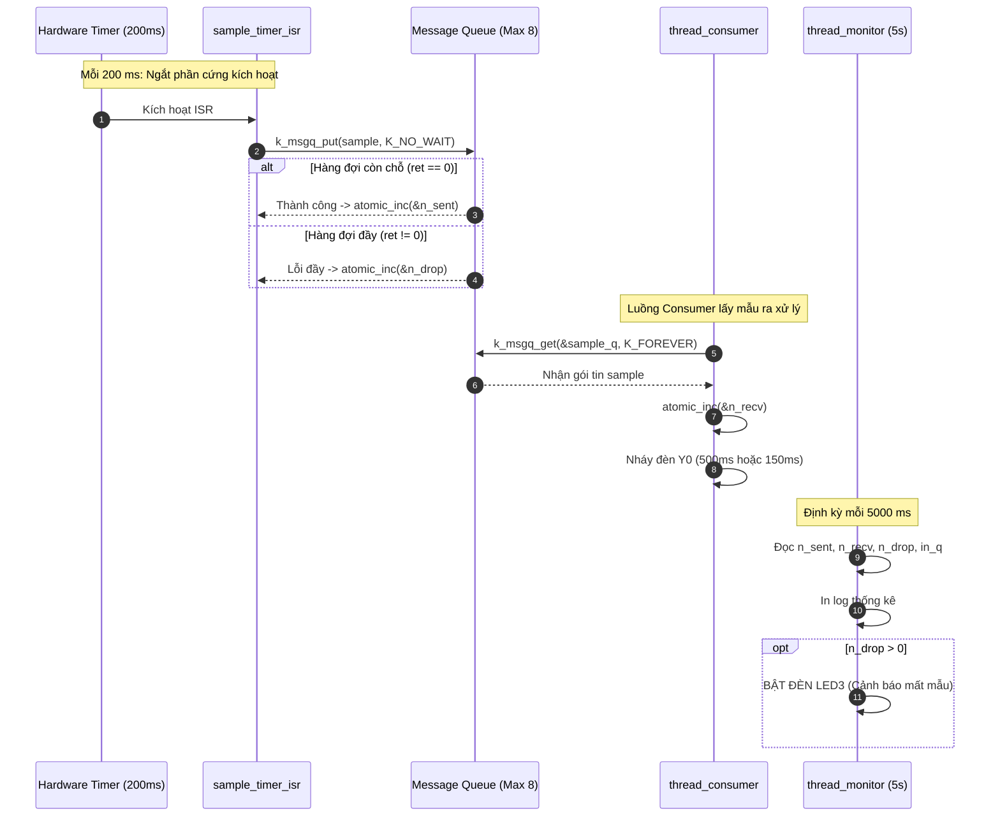

# BKIT ARM4 - Lab 2 - Bài 4: Thu thập dữ liệu từ ISR qua Message Queue

Tài liệu hướng dẫn chi tiết về **Lý thuyết cốt lõi**, **Trình tự đọc hiểu mã nguồn** và **Mô hình Producer - Consumer giữa Ngắt phần cứng và Luồng** sử dụng **Message Queue** và biến nguyên tử **atomic_t** trên Zephyr RTOS.

---

## 1. Yêu cầu đề bài & Lý thuyết cốt lõi

### 1.1. Yêu cầu đề bài & Quy định phần cứng
* **Đề bài**:
  * Định nghĩa cấu trúc dữ liệu gói tin: `struct sample { uint32_t seq; uint32_t t_ms; };`
  * Khởi tạo tĩnh hàng đợi: `K_MSGQ_DEFINE(sample_q, sizeof(struct sample), 8, 4);` (sức chứa tối đa 8 mẫu, căn lề 4 bytes).
  * Một `k_timer` chu kỳ **200 ms**: Trong ISR tạo một mẫu (`seq` tăng dần, `t_ms = k_uptime_get_32()`) và gửi vào hàng đợi bằng `k_msgq_put(..., K_NO_WAIT)`.
    * Nếu gửi thành công $\longrightarrow$ Tăng bộ đếm `n_sent`.
    * Nếu gửi thất bại (hàng đợi đầy) $\longrightarrow$ Tăng bộ đếm `n_drop`.
    * Các bộ đếm bắt buộc phải dùng kiểu biến nguyên tử **`atomic_t`**.
  * Luồng `thread_consumer` lấy từng mẫu ra khỏi hàng đợi và "xử lý" mất **500 ms** (nháy đèn `Y0` sáng 250 ms, tắt 250 ms), tăng bộ đếm `n_recv`.
  * Luồng `thread_monitor` định kỳ mỗi **5 giây** in một dòng thống kê: `GUI / NHAN / MAT / TRONG HANG DOI`, và bật đèn `LED3` khi đã có mẫu bị mất (`n_drop > 0`).
  * **Phần b**: Giảm thời gian xử lý của Consumer xuống **150 ms** (75 ms bật / 75 ms tắt) để chứng minh thông lượng được cân bằng và không còn mẫu nào bị rơi (`n_drop = 0`).
* **Quy ước phần cứng**:
  * `LED3` (PE4): Đèn cảnh báo phát hiện có mẫu dữ liệu bị mất (`n_drop > 0`).
  * `Y0` (PE5): Đèn nháy biểu thị Consumer đang bận xử lý mẫu.

### 1.2. Khái niệm & Cơ chế RTOS áp dụng
* **Message Queue (Hàng đợi thông điệp - IPC FIFO an toàn)**:
  * Cho phép truyền các khối dữ liệu có cấu trúc (`struct`) giữa hai ngữ cảnh thực thi độc lập theo cơ chế "First-In, First-Out".
  * Dữ liệu được sao chép (copy by value) an toàn vào vùng nhớ đệm dạng vòng tròn (Ring Buffer) do kernel quản lý, giúp giải quyết triệt để vấn đề rách dữ liệu (*torn read*) khi ngắt chen ngang.
* **Quy tắc sinh tử trong ISR**:
  * Ngắt không có ngăn xếp tiến trình riêng, do đó **không được phép chờ đợi (sleep/block)**.
  * Khi gọi `k_msgq_put()`, bắt buộc phải truyền tham số timeout là **`K_NO_WAIT`**. Nếu hàng đợi đầy, hàm phải lập tức trả về lỗi để ISR thoát ra, chấp nhận bỏ rơi gói tin (*packet drop*).
* **Biến nguyên tử `atomic_t` (Thread-safe & ISR-safe)**:
  * Phép toán tăng biến trong C (`n_sent++`) khi biên dịch sang kiến trúc ARM Cortex-M4 gồm 3 lệnh máy Assembly rời rạc: `LDR` (đọc từ RAM vào thanh ghi), `ADD` (cộng 1), `STR` (ghi từ thanh ghi ra RAM).
  * Nếu ngắt xảy ra ngay giữa `LDR` và `STR`, giá trị biến chia sẻ sẽ bị sai lệch hoàn toàn (Data Race). Kiểu dữ liệu `atomic_t` sử dụng tập lệnh độc quyền `LDREX`/`STREX` của vi xử lý để bảo đảm phép toán diễn ra nguyên tử mà không cần khóa ngắt toàn cục.

### 1.3. Bảng tổng hợp API Zephyr RTOS sử dụng

| API / Macro | Ngữ cảnh | Chức năng kỹ thuật |
| :--- | :---: | :--- |
| `K_MSGQ_DEFINE(q_name, msg_size, max_msgs, align)` | Compile-time | Khởi tạo tĩnh Message Queue trong bộ nhớ RAM. |
| `k_msgq_put(&q, &data, timeout)` | Thread / ISR | Đẩy một phần tử vào đuôi hàng đợi (trong ISR bắt buộc dùng `K_NO_WAIT`). |
| `k_msgq_get(&q, &data, timeout)` | Chỉ Thread | Lấy một phần tử ở đầu hàng đợi ra (ngủ chờ nếu hàng đợi đang rỗng). |
| `k_msgq_num_used_get(&q)` | Thread / ISR | Đọc số lượng phần tử hiện đang nằm trong hàng đợi. |
| `atomic_inc(&target)` | Thread / ISR | Tăng biến nguyên tử lên 1 an toàn tuyệt đối. |
| `atomic_get(&target)` | Thread / ISR | Đọc giá trị hiện tại của biến nguyên tử. |

---

## 2. Hướng dẫn trình tự đọc hiểu mã nguồn (Code Reading Guide)

Khi tiếp cận file `src/main.c`, hãy đọc theo **5 bước thiết kế kiến trúc Producer - Consumer**:

### 🔹 Bước 1: Khai báo cấu trúc dữ liệu gói tin `struct sample`
Định nghĩa định dạng của gói dữ liệu thu thập gồm số thứ tự và mốc thời gian:
```c
struct sample {
    uint32_t seq;  /* Số thứ tự tăng dần */
    uint32_t t_ms; /* Mốc thời gian hệ thống (ms) */
};
```

### 🔹 Bước 2: Khởi tạo tĩnh Message Queue & Biến đếm nguyên tử `atomic_t`
Hàng đợi chứa tối đa 8 mẫu. Các biến đếm thống kê được khởi tạo an toàn:
```c
/* Message queue tĩnh: 8 phần tử, căn lề 4 bytes */
K_MSGQ_DEFINE(sample_q, sizeof(struct sample), 8, 4);

/* Biến đếm nguyên tử an toàn giữa ISR và Thread */
static atomic_t n_sent = ATOMIC_INIT(0);
static atomic_t n_drop = ATOMIC_INIT(0);
static atomic_t n_recv = ATOMIC_INIT(0);

/* Điều chỉnh thời gian xử lý: 500 ms cho Phần a, 150 ms cho Phần b */
#define CONSUME_TIME_MS 150
```

### 🔹 Bước 3: Đọc hàm ngắt Producer (`sample_timer_isr`)
Hàm ngắt Timer kích hoạt mỗi 200 ms. Sử dụng `K_NO_WAIT` để kiểm tra khả năng chứa của hàng đợi:
```c
static void sample_timer_isr(struct k_timer *timer)
{
    static uint32_t current_seq = 0;
    struct sample s;

    current_seq++;
    s.seq = current_seq;
    s.t_ms = k_uptime_get_32();

    /* BẮT BUỘC dùng K_NO_WAIT trong ngắt */
    int ret = k_msgq_put(&sample_q, &s, K_NO_WAIT);
    if (ret == 0) {
        atomic_inc(&n_sent); /* Gửi thành công */
    } else {
        atomic_inc(&n_drop); /* Hàng đợi đầy -> Mất mẫu */
    }
}
K_TIMER_DEFINE(sample_timer, sample_timer_isr, NULL);
```

### 🔹 Bước 4: Đọc hàm luồng Consumer (`fn_thread_consumer`)
Consumer rút từng mẫu ra khỏi hàng đợi và mô phỏng việc xử lý tính toán bằng cách nháy đèn `Y0`:
```c
void fn_thread_consumer(void *p1, void *p2, void *p3)
{
    struct sample s;
    gpio_pin_configure_dt(&y0, GPIO_OUTPUT_INACTIVE);

    while (1) {
        /* Chờ lấy mẫu: Nếu hàng đợi rỗng, luồng tự động ngủ (BLOCKED) */
        k_msgq_get(&sample_q, &s, K_FOREVER);
        atomic_inc(&n_recv);

        /* Xử lý mẫu: Nháy Y0 */
        gpio_pin_set_dt(&y0, 1);
        k_msleep(CONSUME_TIME_MS / 2);
        gpio_pin_set_dt(&y0, 0);
        k_msleep(CONSUME_TIME_MS / 2);
    }
}
```

### 🔹 Bước 5: Đọc hàm luồng Giám sát (`fn_thread_monitor`) và Hàm `main()`
Thread Monitor định kỳ mỗi 5 giây thu thập số liệu in báo cáo và bật đèn cảnh báo `LED3`:
```c
void fn_thread_monitor(void *p1, void *p2, void *p3)
{
    gpio_pin_configure_dt(&led3, GPIO_OUTPUT_INACTIVE);

    while (1) {
        k_msleep(5000);

        long sent = atomic_get(&n_sent);
        long recv = atomic_get(&n_recv);
        long drop = atomic_get(&n_drop);
        uint32_t in_q = k_msgq_num_used_get(&sample_q);

        printf("[%6u ms] GUI: %ld | NHAN: %ld | MAT: %ld | TRONG HANG DOI: %u/8\n",
               k_uptime_get_32(), sent, recv, drop, in_q);

        if (drop > 0) {
            gpio_pin_set_dt(&led3, 1); // Bật LED3 nếu có mẫu bị mất
        }
    }
}

K_THREAD_DEFINE(thread_consumer, 1024, fn_thread_consumer, NULL, NULL, NULL, 5, 0, 0);
K_THREAD_DEFINE(thread_monitor,  1024, fn_thread_monitor,  NULL, NULL, NULL, 6, 0, 0);

int main(void)
{
    k_timer_start(&sample_timer, K_MSEC(200), K_MSEC(200));
    return 0;
}
```

---

## 3. Cơ chế hoạt động & Tính toán lý thuyết (Mermaid)

### 3.1. Sơ đồ tuần tự Producer - Consumer giữa ISR và Thread



### 3.2. Tính toán lý thuyết về hiện tượng nghẽn cổ chai (Phần a)
1. **Tốc độ sản xuất của Timer ISR**:
   $$R_{prod} = \frac{1000\text{ ms}}{200\text{ ms}} = 5\text{ mẫu / giây}$$
2. **Tốc độ tiêu thụ tối đa của Consumer (ở Phần a)**:
   $$R_{cons} = \frac{1000\text{ ms}}{500\text{ ms}} = 2\text{ mẫu / giây}$$
3. **Thời điểm hàng đợi 8 phần tử bị đầy kín**:
   $$t_{full} = \frac{8\text{ mẫu}}{R_{prod} - R_{cons}} = \frac{8}{5 - 2} = \frac{8}{3} \approx 2.67\text{ giây}$$
4. **Tốc độ mất dữ liệu khi hàng đợi đã đầy**:
   $$R_{drop} = R_{prod} - R_{cons} = 5 - 2 = 3\text{ mẫu bị mất mỗi giây}$$
5. **Dự báo số mẫu mất thêm sau mỗi chu kỳ 5 giây của Monitor**:
   $$\Delta \text{MAT} = 5\text{ giây} \times 3\text{ mẫu/giây} = \mathbf{15\text{ mẫu / 5 giây}}$$

---

## 4. Nếu KHÔNG CÓ cơ chế này thì sao? (Phân tích lỗi)

* **Nếu gọi `k_msgq_put(&sample_q, &s, K_FOREVER)` trong ISR**:
  * Gây ra lỗi sập toàn bộ hệ điều hành (**Kernel Panic / Fatal Exception**). Kiến trúc ARM Cortex-M4 cấm tuyệt đối việc đưa CPU vào danh sách chờ ngủ trong lúc đang phục vụ ngắt.
* **Nếu không dùng Message Queue mà dùng biến con trỏ toàn cục**:
  * Khi Consumer đang đọc dở cấu trúc dữ liệu, ISR chen ngang và ghi đè dữ liệu mới lên. Kết quả là Consumer đọc phải dữ liệu bị chắp vá (*torn read*), làm sai lệch số thứ tự và mốc thời gian.
* **Nếu dùng biến thông thường (`int n_sent; n_sent++;`) thay vì `atomic_t`**:
  * Xảy ra lỗi **Data Race** khi ISR và Thread cùng truy cập biến đồng thời. Các thao tác đọc - sửa - ghi bị đè lên nhau khiến bộ đếm thống kê bị sai lệch số liệu so với thực tế.

---

## 5. Đáp án câu hỏi bài tập (Q&A)

### ❓ Câu (a): Vì sao trong ISR phải dùng `K_NO_WAIT`? Điều gì sẽ xảy ra nếu dùng `K_FOREVER`?
* **Vì sao phải dùng `K_NO_WAIT`**: Trình phục vụ ngắt (ISR) chạy ngoài ngữ cảnh của bất kỳ thread nào, không có cấu trúc quản lý luồng để hệ điều hành đưa vào danh sách chờ ngủ (Wait Queue). ISR bắt buộc phải thực thi ngay và kết thúc tức thì để giải phóng CPU. Vì vậy, khi hàng đợi đầy, ISR buộc phải chấp nhận bỏ mẫu (drop) bằng tham số `K_NO_WAIT` chứ không được phép dừng lại chờ.
* **Điều gì sẽ xảy ra nếu dùng `K_FOREVER`**: Nhân hệ điều hành Zephyr sẽ kích hoạt Fatal Exception / Kernel Panic ngay lập tức (thông báo lỗi: *"Illegal use of wait in ISR context!"*), dẫn đến việc dừng hoạt động và khóa cứng CPU (halt system).

### ❓ Câu (b): Với tốc độ phần a, tính lý thuyết: mỗi giây có bao nhiêu mẫu bị mất khi hàng đợi đã đầy? So sánh với log.
* **Tính toán lý thuyết**:
  * Tốc độ sinh mẫu của Timer ISR: $1000\text{ ms} / 200\text{ ms} = 5\text{ mẫu / giây}$.
  * Tốc độ tiêu thụ tối đa của Consumer (xử lý 500 ms): $1000\text{ ms} / 500\text{ ms} = 2\text{ mẫu / giây}$.
  * Khi hàng đợi 8 phần tử đã đầy, mỗi giây lượng mẫu dôi dư không thể chứa vào hàng đợi là:
    $$5 - 2 = 3\text{ mẫu bị mất mỗi giây.}$$
* **So sánh với thực tế trên log**:
  * Thread monitor in thống kê mỗi 5 giây (5000 ms).
  * Trên log, số mẫu mất sau mỗi khoảng 5 giây tăng đều đặn thêm: $5\text{ giây} \times 3\text{ mẫu/giây} = \mathbf{15\text{ mẫu}}$ (các mốc MAT tăng từ $7 \rightarrow 22 \rightarrow 37 \rightarrow 52 \rightarrow 67$).
  * **Kết luận**: Số liệu thực tế trên log Serial Monitor khớp hoàn toàn 100\% với tính toán lý thuyết ($15\text{ mẫu} / 5\text{s} = 3\text{ mẫu/s}$).

### ❓ Câu (c): Tăng kích thước hàng đợi từ 8 lên 64 có giải quyết được vấn đề ở phần a không? Vì sao?
* **Không giải quyết được vấn đề.**
* **Giải thích**: Việc tăng kích thước hàng đợi lên 64 chỉ làm **trì hoãn thời điểm bắt đầu mất mẫu**, chứ không ngăn chặn được việc mất mẫu. Do tốc độ sinh mẫu ($5\text{ mẫu/s}$) luôn lớn hơn tốc độ tiêu thụ ($2\text{ mẫu/s}$), lượng mẫu tích tụ liên tục với tốc độ $3\text{ mẫu/s}$. Với dung lượng 64 mẫu, hàng đợi sẽ đầy kín sau:
  $$t_{full} = \frac{64}{3} \approx 21.3\text{ giây.}$$
  Sau giây thứ 21.3, khi 64 ô đã đầy, hệ thống vẫn tiếp tục làm rơi 3 mẫu mỗi giây như trước và LED3 lại bật sáng. Biện pháp duy nhất giải quyết triệt để là tối ưu hóa Consumer để tốc độ xử lý nhanh hơn tốc độ sinh mẫu (thời gian xử lý $< 200\text{ ms}$, như đã chứng minh ở Phần b với 150 ms).
