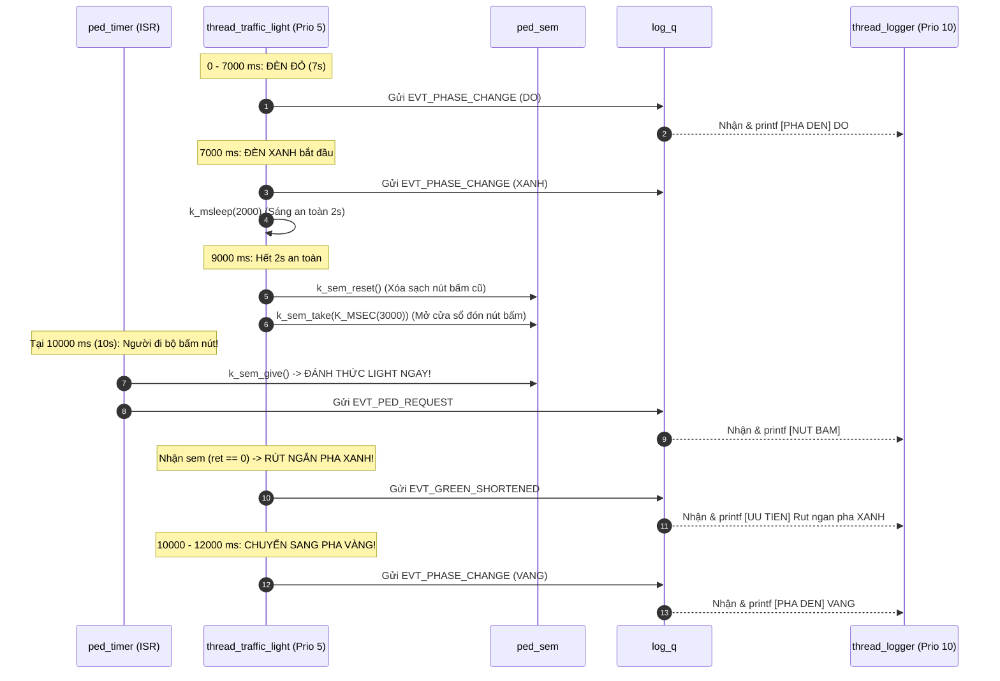

# BKIT ARM4 - Lab 2 - Bài 5: Đèn giao thông có nút xin qua đường (Bài tổng hợp)

Tài liệu hướng dẫn chi tiết về **Lý thuyết cốt lõi**, **Trình tự đọc hiểu mã nguồn** và **Kiến trúc hệ thống RTOS tổng hợp** kết hợp **Binary Semaphore có Timeout**, **Xóa cờ tồn đọng (`k_sem_reset`)**, **Message Queue** với **Mô hình Ghi Log Tập Trung (Centralized Logger)** trên Zephyr RTOS.

---

## 1. Yêu cầu đề bài & Lý thuyết cốt lõi

### 1.1. Yêu cầu đề bài & Quy định phần cứng
* **Đề bài**:
  * Luồng `thread_traffic_light` (Độ ưu tiên: **5**) điều khiển chu kỳ đèn giao thông:
    $$\text{ĐỎ (7s)} \longrightarrow \text{XANH (5s)} \longrightarrow \text{VÀNG (2s)} \longrightarrow \text{ĐỎ (7s)} \dots$$
  * Nút xin qua đường được mô phỏng bằng `k_timer` chạy chế độ one-shot: Lần đầu tại giây thứ **10**, sau đó cách nhau lần lượt **14s $\rightarrow$ 8s $\rightarrow$ 17s** rồi lặp lại. Trong ISR gọi `k_sem_give(&ped_sem)` và gửi sự kiện vào hàng đợi log.
  * **Quy tắc ưu tiên người đi bộ**:
    * Đèn XANH luôn sáng tối thiểu **2 giây** bắt buộc để các phương tiện lưu thông an toàn.
    * Sau 2 giây đầu, hệ thống xóa bỏ các yêu cầu bấm nút cũ bằng lệnh `k_sem_reset(&ped_sem)`.
    * Sau đó, luồng mở cửa sổ chờ yêu cầu mới trong 3 giây còn lại bằng `k_sem_take(&ped_sem, K_MSEC(3000))`. Nếu có người bấm nút, kết thúc pha Xanh ngay lập tức và chuyển sang Vàng! Các yêu cầu nhấn nút lúc đèn Đỏ hoặc Vàng không có tác dụng.
  * **Kiến trúc Ghi Log Tập Trung (Centralized Logging)**:
    * Duy nhất luồng `thread_logger` (Độ ưu tiên: **10** - thấp nhất hệ thống) được phép gọi hàm `printf()` ra màn hình Serial Monitor.
    * Tất cả các luồng khác và ISR chỉ đóng gói dữ liệu vào `struct evt { type, phase, t_ms }` và gửi vào hàng đợi `log_q` bằng `k_msgq_put(..., K_NO_WAIT)`.
  * Luồng `thread_led_blinky` (Độ ưu tiên: **7**): Điều khiển đèn `LED3` nhấp nháy 1s sáng / 1s tắt báo hiệu nhịp tim (*Heartbeat*) hệ thống đang hoạt động bình thường.
* **Quy ước phần cứng**:
  * Đèn `ĐỎ`: Đèn `Y0` (PE5) BẬT, `Y1` TẮT.
  * Đèn `XANH`: Đèn `Y0` TẮT, `Y1` (PE6) BẬT.
  * Đèn `VÀNG`: Cả hai đèn `Y0` và `Y1` CÙNG BẬT.
  * Đèn `Heartbeat`: Đèn `LED3` (PE4).

### 1.2. Khái niệm & Cơ chế RTOS áp dụng
* **Timed Semaphore & Reset Semaphore (`k_sem_reset`)**:
  * Khi người đi bộ bấm nút lúc xe đang đèn Đỏ, cờ Semaphore được bật lên 1. Nếu không dọn dẹp, ngay khi đèn chuyển sang Xanh và hết 2s an toàn, lệnh `take` sẽ ăn ngay cờ cũ và tắt đèn xanh tức thì, gây nguy hiểm khôn lường.
  * Lệnh `k_sem_reset(&ped_sem)` đưa Semaphore về 0 một cách an toàn mà không đánh thức bất kỳ thread nào, giúp thanh lọc dữ liệu rác trước khi mở cửa sổ chờ mới.
* **Mô hình Ghi Log Tập Trung (Centralized Logger Pattern)**:
  * Cổng truyền thông nối tiếp UART là một tài nguyên phần cứng đơn kênh và có tốc độ truyền rất chậm (mất vài ms cho một chuỗi text).
  * Nếu để nhiều luồng cùng gọi `printf()`, các ký tự sẽ bị xen kẽ làm hỏng log; đồng thời thời gian chờ UART sẽ phá vỡ tính thời gian thực (*Real-time Determinism*) của các tác vụ điều khiển an toàn. Việc dồn toàn bộ tác vụ in ấn vào một luồng ưu tiên thấp nhất qua Message Queue giải quyết triệt để vấn đề này.

### 1.3. Bảng tổng hợp API Zephyr RTOS sử dụng

| API / Macro | Ngữ cảnh | Chức năng kỹ thuật |
| :--- | :---: | :--- |
| `K_SEM_DEFINE(ped_sem, 0, 1)` | Compile-time | Binary Semaphore nhận tín hiệu xin qua đường từ người đi bộ. |
| `k_sem_reset(&ped_sem)` | Thread | Đưa bộ đếm Semaphore về 0 ngay tức khắc, xóa sạch các tín hiệu bấm nút cũ. |
| `k_sem_take(&sem, timeout)` | Thread | Chờ tín hiệu có thời hạn (ở đây là 3000 ms trong cửa sổ ưu tiên). |
| `K_MSGQ_DEFINE(log_q, size, max, align)` | Compile-time | Khởi tạo tĩnh Message Queue chứa tối đa 16 sự kiện ghi log. |
| `k_msgq_put(&q, &data, K_NO_WAIT)` | Thread / ISR | Đẩy sự kiện vào hàng đợi log an toàn, không phong tỏa CPU. |
| `k_msgq_get(&q, &data, K_FOREVER)` | Chỉ Thread | Luồng logger ngủ chờ sự kiện mới để in ra màn hình. |
| `K_THREAD_DEFINE(...)` | Compile-time | Đăng ký tĩnh 3 luồng với các mức ưu tiên: Light (5), Blinky (7), Logger (10). |

---

## 2. Hướng dẫn trình tự đọc hiểu mã nguồn (Code Reading Guide)

Khi tiếp cận file `src/main.c`, hãy theo dõi tuần tự theo **5 bước thiết kế tích hợp**:

### 🔹 Bước 1: Khai báo phần cứng, định nghĩa Pha đèn và Cấu trúc Sự kiện Log
```c
#define LED0_NODE DT_ALIAS(led0) /* LED3 - PE4: Heartbeat */
#define LED1_NODE DT_ALIAS(led1) /* Y0   - PE5: Đèn ĐỎ */
#define LED2_NODE DT_ALIAS(led2) /* Y1   - PE6: Đèn XANH */

static const struct gpio_dt_spec led3 = GPIO_DT_SPEC_GET(LED0_NODE, gpios);
static const struct gpio_dt_spec y0   = GPIO_DT_SPEC_GET(LED1_NODE, gpios);
static const struct gpio_dt_spec y1   = GPIO_DT_SPEC_GET(LED2_NODE, gpios);

#define PHASE_RED    0
#define PHASE_GREEN  1
#define PHASE_YELLOW 2
static const char *const phase_names[] = {"DO", "XANH", "VANG"};

#define EVT_PHASE_CHANGE    1
#define EVT_PED_REQUEST     2
#define EVT_GREEN_SHORTENED 3

/* Gói tin sự kiện gửi vào hàng đợi log */
struct evt {
    uint8_t  type;
    uint8_t  phase;
    uint32_t t_ms;
};
```

### 🔹 Bước 2: Khởi tạo tĩnh Message Queue, Semaphore và Hàm đẩy log tiện ích
```c
K_MSGQ_DEFINE(log_q, sizeof(struct evt), 16, 4);
K_SEM_DEFINE(ped_sem, 0, 1);

/* Hàm tiện ích: đóng gói và đẩy event vào log_q bằng K_NO_WAIT */
static inline void send_log_evt(uint8_t type, uint8_t phase)
{
    struct evt e = {
        .type  = type,
        .phase = phase,
        .t_ms  = k_uptime_get_32(),
    };
    k_msgq_put(&log_q, &e, K_NO_WAIT);
}
```

### 🔹 Bước 3: Đọc hàm ngắt mô phỏng nút bấm (`ped_timer_isr`)
Mô phỏng chuỗi nhấn nút ngẫu nhiên của người đi bộ ($10\text{s} \rightarrow 14\text{s} \rightarrow 8\text{s} \rightarrow 17\text{s}$):
```c
static const int ped_intervals_ms[] = {14000, 8000, 17000};
static int ped_idx = 0;

static void ped_timer_isr(struct k_timer *timer)
{
    /* Phát tín hiệu cho máy trạng thái đèn */
    k_sem_give(&ped_sem);

    /* Báo cáo sự kiện bấm nút cho logger qua queue */
    struct evt e = {
        .type  = EVT_PED_REQUEST,
        .phase = 0,
        .t_ms  = k_uptime_get_32(),
    };
    k_msgq_put(&log_q, &e, K_NO_WAIT);

    /* Nạp lại timer cho lần bấm kế tiếp */
    k_timer_start(timer, K_MSEC(ped_intervals_ms[ped_idx]), K_NO_WAIT);
    ped_idx = (ped_idx + 1) % 3;
}
K_TIMER_DEFINE(ped_timer, ped_timer_isr, NULL);
```

### 🔹 Bước 4: Đọc hàm máy trạng thái điều khiển đèn (`fn_thread_traffic_light`)
Trọng tâm bài toán nằm ở việc quản lý pha XANH: 2s bắt buộc $\rightarrow$ `k_sem_reset()` $\rightarrow$ chờ 3s:
```c
void fn_thread_traffic_light(void *p1, void *p2, void *p3)
{
    gpio_pin_configure_dt(&y0, GPIO_OUTPUT_INACTIVE);
    gpio_pin_configure_dt(&y1, GPIO_OUTPUT_INACTIVE);

    while (1) {
        /* Giai đoạn 1: PHA ĐỎ (7 giây) */
        gpio_pin_set_dt(&y0, 1);
        gpio_pin_set_dt(&y1, 0);
        send_log_evt(EVT_PHASE_CHANGE, PHASE_RED);
        k_msleep(7000);

        /* Giai đoạn 2: PHA XANH (5 giây, tối thiểu 2 giây) */
        gpio_pin_set_dt(&y0, 0);
        gpio_pin_set_dt(&y1, 1);
        send_log_evt(EVT_PHASE_CHANGE, PHASE_GREEN);
        k_msleep(2000); // 2s an toàn bắt buộc

        /* Xóa sạch các tín hiệu nhấn nút cũ trước đó */
        k_sem_reset(&ped_sem);

        /* Mở cửa sổ chờ yêu cầu mới trong 3 giây còn lại */
        int ret = k_sem_take(&ped_sem, K_MSEC(3000));
        if (ret == 0) {
            send_log_evt(EVT_GREEN_SHORTENED, PHASE_GREEN); // Rút ngắn pha Xanh!
        }

        /* Giai đoạn 3: PHA VÀNG (2 giây) */
        gpio_pin_set_dt(&y0, 1);
        gpio_pin_set_dt(&y1, 1);
        send_log_evt(EVT_PHASE_CHANGE, PHASE_YELLOW);
        k_msleep(2000);
    }
}
```

### 🔹 Bước 5: Đọc luồng Logger, luồng Heartbeat và Hàm `main()`
Quan sát cách phân tầng độ ưu tiên để bảo đảm tính ổn định của hệ thống:
```c
/* Luồng Ghi Log Tập Trung: Priority 10 (thấp nhất) */
void fn_thread_logger(void *p1, void *p2, void *p3)
{
    struct evt e;
    while (1) {
        k_msgq_get(&log_q, &e, K_FOREVER);
        switch (e.type) {
        case EVT_PHASE_CHANGE:
            printf("[%6u ms] [PHA DEN] Chuyen sang: %s\n", e.t_ms, phase_names[e.phase]);
            break;
        case EVT_PED_REQUEST:
            printf("[%6u ms] [NUT BAM] Nguoi di bo bam xin qua duong!\n", e.t_ms);
            break;
        case EVT_GREEN_SHORTENED:
            printf("[%6u ms] [UU TIEN] Rut ngan pha XANH de nhuong duong!\n", e.t_ms);
            break;
        }
    }
}

/* Luồng Heartbeat Blinky: Priority 7 */
void fn_thread_led_blinky(void *p1, void *p2, void *p3)
{
    gpio_pin_configure_dt(&led3, GPIO_OUTPUT_INACTIVE);
    while (1) {
        gpio_pin_set_dt(&led3, 1);
        k_msleep(1000);
        gpio_pin_set_dt(&led3, 0);
        k_msleep(1000);
    }
}

/* Đăng ký các luồng theo thứ tự ưu tiên: Light (5) > Blinky (7) > Logger (10) */
K_THREAD_DEFINE(thread_traffic_light, 1024, fn_thread_traffic_light, NULL, NULL, NULL, 5, 0, 0);
K_THREAD_DEFINE(thread_led_blinky,    1024, fn_thread_led_blinky,    NULL, NULL, NULL, 7, 0, 0);
K_THREAD_DEFINE(thread_logger,        1024, fn_thread_logger,        NULL, NULL, NULL, 10, 0, 0);

int main(void)
{
    k_timer_start(&ped_timer, K_MSEC(10000), K_NO_WAIT);
    return 0;
}
```

---

## 3. Cơ chế hoạt động & Dòng thời gian 0 – 40s (Mermaid)

### 3.1. Sơ đồ tương tác rút ngắn pha Xanh khi có nút bấm



### 3.2. Bảng diễn biến dòng thời gian 0 – 40 giây (Timeline Tracing)

| Mốc thời gian | Pha đèn | Trạng thái đèn | Sự kiện nút bấm | Phản ứng của hệ thống RTOS |
| :---: | :---: | :---: | :---: | :--- |
| **0 – 7s** ($0 - 7000\text{ ms}$) | **ĐÈN ĐỎ** | Y0 sáng, Y1 tắt | Chưa có | Chạy đủ 7 giây đỏ. |
| **7 – 9s** ($7000 - 9000\text{ ms}$) | **ĐÈN XANH** | Y0 tắt, Y1 sáng | Chưa có | Giai đoạn 2 giây an toàn bắt buộc. |
| **9s** ($9000\text{ ms}$) | **ĐÈN XANH** | Y0 tắt, Y1 sáng | Chưa có | Gọi `k_sem_reset()`, mở cửa sổ chờ tối đa 3000 ms. |
| **10s** ($10000\text{ ms}$) | **ĐÈN XANH** | Y0 tắt, Y1 sáng | **Bấm lần 1 (10s)** | **`k_sem_take` thành công! Rút ngắn pha Xanh sớm 2 giây!** |
| **10 – 12s** ($10000 - 12000\text{ ms}$) | **ĐÈN VÀNG** | **Cả Y0 và Y1 sáng** | Không có | Chuyển sang Vàng sớm, kéo dài đủ 2 giây. |
| **12 – 19s** ($12000 - 19000\text{ ms}$) | **ĐÈN ĐỎ** | Y0 sáng, Y1 tắt | Không có | Chu kỳ Đỏ 7 giây. |
| **19 – 24s** ($19000 - 24000\text{ ms}$) | **ĐÈN XANH** | Y0 tắt, Y1 sáng | Không có trong cửa sổ | Chờ hết 3s không ai bấm (`-EAGAIN`). Pha xanh đủ 5s! |
| **24s** ($24000\text{ ms}$) | **ĐÈN VÀNG** | Cả Y0 và Y1 sáng | **Bấm lần 2 (24s)** | Rơi trúng lúc đèn Vàng $\rightarrow$ Bị bỏ qua, không rút ngắn. |
| **24 – 26s** ($24000 - 26000\text{ ms}$) | **ĐÈN VÀNG** | Cả Y0 và Y1 sáng | Không có | Chạy đủ 2 giây vàng. |
| **26 – 33s** ($26000 - 33000\text{ ms}$) | **ĐÈN ĐỎ** | Y0 sáng, Y1 tắt | **Bấm lần 3 (32s)** | Rơi vào đèn Đỏ $\rightarrow$ Sẽ bị `k_sem_reset` xóa bỏ ở giây 35. |
| **33 – 35s** ($33000 - 35000\text{ ms}$) | **ĐÈN XANH** | Y0 tắt, Y1 sáng | Không có | 2 giây an toàn đầu tiên. |
| **35s** ($35000\text{ ms}$) | **ĐÈN XANH** | Y0 tắt, Y1 sáng | Không có | **Gọi `k_sem_reset()` $\rightarrow$ Xóa sạch yêu cầu lúc 32s!** |
| **35 – 38s** ($35000 - 38000\text{ ms}$) | **ĐÈN XANH** | Y0 tắt, Y1 sáng | Không có yêu cầu mới | Chạy trọn vẹn 5s do không có ai bấm mới. |
| **38 – 40s** ($38000 - 40000\text{ ms}$) | **ĐÈN VÀNG** | Cả Y0 và Y1 sáng | Không có | Chạy 2 giây đèn vàng. |

---

## 4. Nếu KHÔNG CÓ cơ chế này thì sao? (Phân tích lỗi)

* **Nếu KHÔNG có lệnh `k_sem_reset(&ped_sem)`**:
  * Người đi bộ nhấn nút lúc xe đang gặp đèn Đỏ (ví dụ tại $t = 32\text{s}$). Semaphore được nạp lên 1.
  * Khi đèn chuyển sang Xanh ở giây thứ 33 và chạy xong 2 giây an toàn đầu tiên (đến giây 35).
  * Nếu không reset, lệnh `k_sem_take` tại giây thứ 35 sẽ **ăn ngay chiếc vé cũ từ lúc đèn đỏ** và cắt ngắn pha xanh ngay tức khắc! Xe cộ vừa khởi hành được đúng 2 giây đã bị bắt dừng đột ngột, gây nguy cơ tai nạn giao thông nghiêm trọng.
* **Nếu KHÔNG dùng Centralized Logger mà để mọi luồng tự do gọi `printf()`**:
  * Tốc độ in UART rất chậm sẽ làm trôi lệch thời gian của hàm `k_msleep()`, khiến chu kỳ đèn giao thông bị sai lệch theo thời gian.
  * Nhiều luồng cùng gọi `printf()` làm hỏng bộ đệm UART, dòng log bị chồng chéo ký tự và ISR sẽ làm sập hệ điều hành nếu gọi `printf()`.

---

## 5. Đáp án câu hỏi bài tập (Q&A)

### ❓ Câu (a): Vì sao cần `k_sem_reset` trước khi chờ yêu cầu trong pha XANH? Cho ví dụ cụ thể từ log nếu bỏ lệnh này.
* **Vì sao cần `k_sem_reset`**: Đèn giao thông chỉ ưu tiên cho người đi bộ khi yêu cầu được bấm trong lúc đèn xe đang XANH (sau 2 giây an toàn bắt buộc ban đầu). Nếu người đi bộ bấm nút lúc xe đang đèn Đỏ hoặc trong 2 giây đầu của đèn Xanh, yêu cầu đó là không hợp lệ. Hàm `k_sem_reset(&ped_sem)` đưa semaphore về 0 để xóa sạch các lần bấm cũ không hợp lệ trước đó, bảo đảm luồng chỉ phản ứng với yêu cầu mới phát sinh trong 3 giây tiếp theo.
* **Ví dụ cụ thể từ log nếu bỏ lệnh này**:
  * Tại mốc $32000\text{ ms}$ ($32\text{s}$), nút bấm được kích hoạt khi hệ thống đang ở **PHA ĐỎ** (từ $26\text{s}$ đến $33\text{s}$).
  * Đến $33000\text{ ms}$ đèn chuyển sang **PHA XANH** và chạy 2 giây an toàn bắt buộc (đến $35\text{s}$).
  * **Nếu BỎ `k_sem_reset`**: Đúng tại $35000\text{ ms}$, lệnh `k_sem_take` sẽ lấy ngay tín hiệu cũ từ lúc $32\text{s}$ và rút ngắn pha xanh ngay lập tức $\rightarrow$ Đèn xanh chỉ sáng được đúng 2 giây đã chuyển sang Vàng, xe cộ vừa xuất phát đã bị ép dừng đột ngột gây tai nạn nguy hiểm.
  * **Có `k_sem_reset`**: Tín hiệu lúc $32\text{s}$ bị xóa, đèn XANH sáng trọn vẹn 5 giây (đến $38\text{s}$) trước khi chuyển sang Vàng.

### ❓ Câu (b): Vì sao dùng một thread logger duy nhất thay vì để mọi thread tự `printf`? Vì sao logger nên có ưu tiên thấp nhất?
* **Vì sao dùng một thread logger duy nhất**:
  * **Tránh xung đột ngoại vi UART**: Cổng Serial UART là tài nguyên chia sẻ phần cứng. Nếu nhiều thread cùng gọi `printf()`, các ký tự sẽ bị xen kẽ làm hỏng dòng log in ra.
  * **Bảo đảm tính thời gian thực (Real-time determinism)**: Hàm `printf()` qua UART rất chậm. Sử dụng Message Queue với `k_msgq_put(..., K_NO_WAIT)` giúp các thread điều khiển và ISR chỉ mất vài micro-giây để đẩy sự kiện vào hàng đợi rồi quay lại làm việc ngay, không bị trễ thời gian điều khiển.
* **Vì sao logger nên có ưu tiên thấp nhất (Priority 10)**: Việc in thông tin ra màn hình chỉ là tác vụ phụ (giám sát). Các tác vụ điều khiển đèn giao thông an toàn (`Priority 5`) và báo nhịp tim hệ thống (`Priority 7`) phải luôn được ưu tiên CPU cao hơn. Đặt logger ở mức thấp nhất bảo đảm nó chỉ chạy khi các tác vụ quan trọng đã xử lý xong hoặc đang ngủ.

### ❓ Câu (c): Vẽ (hoặc mô tả) dòng thời gian 0–40 s: các pha đèn, các thời điểm có yêu cầu, và những lần pha XANH bị rút ngắn.
* **Mô tả dòng thời gian 0 – 40 giây**:
  1. **0 – 7s ($0 - 7000\text{ ms}$)**: Đèn **ĐỎ** (Y0 bật).
  2. **7 – 10s ($7000 - 10000\text{ ms}$)**: Đèn **XANH** (Y1 bật). Tại $t = 10\text{s}$ có yêu cầu bấm nút lần 1 $\rightarrow$ **RÚT NGẮN PHA XANH LẦN 1** (sớm 2 giây).
  3. **10 – 12s ($10000 - 12000\text{ ms}$)**: Đèn **VÀNG** (Cả Y0 và Y1 cùng bật).
  4. **12 – 19s ($12000 - 19000\text{ ms}$)**: Đèn **ĐỎ** (Y0 bật).
  5. **19 – 24s ($19000 - 24000\text{ ms}$)**: Đèn **XANH** (Y1 bật) chạy trọn vẹn 5 giây (không có nút bấm trong cửa sổ chờ).
  6. **24 – 26s ($24000 - 26000\text{ ms}$)**: Đèn **VÀNG** (Cả Y0 và Y1 cùng bật). Tại $t = 24\text{s}$ có yêu cầu bấm nút lần 2 ($10 + 14 = 24\text{s}$) rơi trúng lúc đèn Vàng nên không có tác dụng rút ngắn.
  7. **26 – 33s ($26000 - 33000\text{ ms}$)**: Đèn **ĐỎ** (Y0 bật). Tại $t = 32\text{s}$ có yêu cầu bấm nút lần 3 ($24 + 8 = 32\text{s}$) rơi vào đèn Đỏ nên sẽ bị `k_sem_reset` xóa bỏ ở giây 35.
  8. **33 – 38s ($33000 - 38000\text{ ms}$)**: Đèn **XANH** (Y1 bật) chạy trọn vẹn 5 giây (yêu cầu ở 32s bị xóa, không có nút bấm mới trong 35s - 38s).
  9. **38 – 40s ($38000 - 40000\text{ ms}$)**: Đèn **VÀNG** (Cả Y0 và Y1 cùng bật).
* **Kết luận**: Trong khoảng 0 – 40 giây, chỉ có **duy nhất 1 lần pha XANH bị rút ngắn** tại mốc **10000 ms (giây thứ 10)**.
