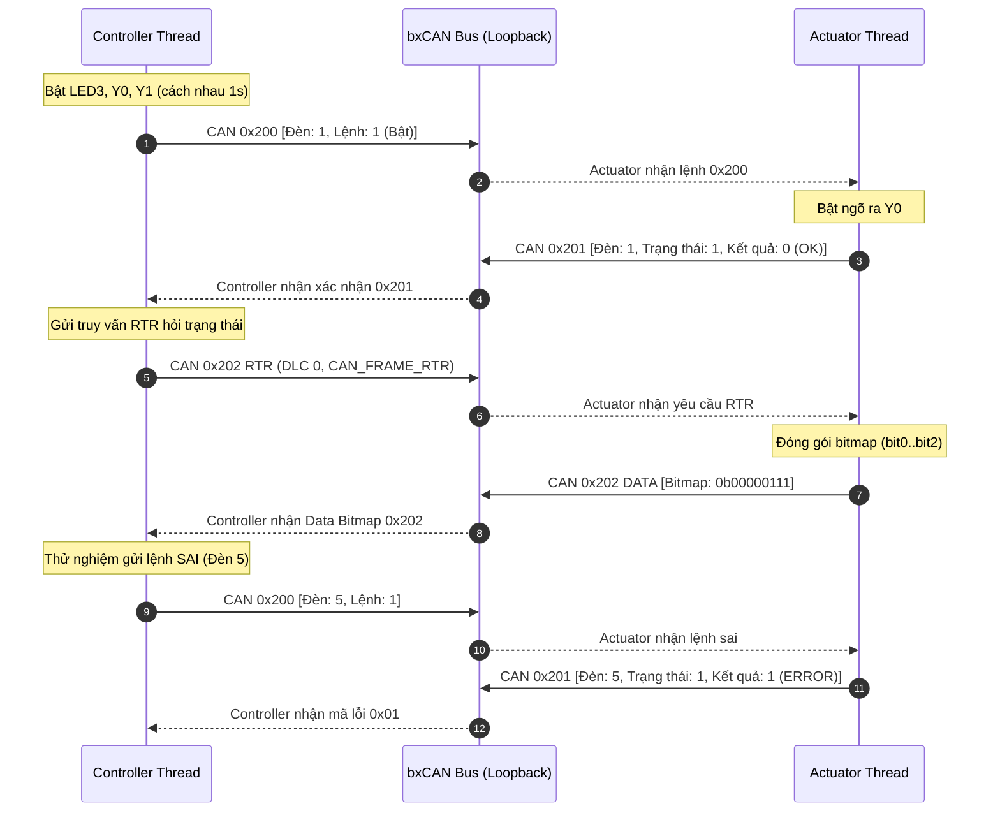

# BKIT ARM4 - Lab 3 - Bài 2: Điều khiển đèn bằng lệnh CAN và Frame RTR (Loopback)

Tài liệu hướng dẫn chi tiết về **Lý thuyết cốt lõi**, **Trình tự đọc hiểu mã nguồn**, **Giao thức Lệnh/Phản hồi (Command/Response)** và **Cơ chế Khung yêu cầu từ xa (RTR)** trên Zephyr RTOS.

---

## 1. Yêu cầu đề bài & Lý thuyết cốt lõi

### 1.1. Yêu cầu đề bài & Quy định phần cứng
* **Môi trường thực thi:** Mô phỏng hai vai trò trên cùng một kit ở chế độ Loopback:
  * `thread_controller` (Bộ điều khiển).
  * `thread_actuator` (Bộ chấp hành điều khiển 3 đèn).
* **Định nghĩa giao thức truyền thông:**
  * **ID `0x200` (Controller → Actuator):** Lệnh điều khiển. `DLC = 2`.
    * `data[0]` = Mã đèn (0 = LED3, 1 = Y0, 2 = Y1).
    * `data[1]` = Trạng thái (0 = Tắt, 1 = Bật).
  * **ID `0x201` (Actuator → Controller):** Phản hồi thực thi lệnh. `DLC = 3`.
    * `data[0]` = Mã đèn.
    * `data[1]` = Trạng thái mới.
    * `data[2]` = Kết quả thực thi (0 = Thành công OK, 1 = Lỗi đèn không hợp lệ).
  * **ID `0x202 RTR` (Controller → Actuator):** Khung yêu cầu từ xa, không có payload (`DLC = 0`, cờ `CAN_FRAME_RTR`): *"Báo cáo trạng thái tất cả đèn"*.
  * **ID `0x202 DATA` (Actuator → Controller):** Khung dữ liệu trả lời RTR. `DLC = 1`.
    * `data[0]` = Bitmap trạng thái (`bit0` = LED3, `bit1` = Y0, `bit2` = Y1).
* **Kịch bản hoạt động của Controller:**
  1. Bật lần lượt LED3 → Y0 → Y1 (cách nhau 1 giây).
  2. Gửi khung RTR `0x202` để truy vấn trạng thái bitmap.
  3. Tắt lần lượt LED3 → Y0 → Y1 (cách nhau 1 giây).
  4. Gửi lệnh cố ý sai (đèn số 5) để kiểm tra phản hồi lỗi NAK.
* **Cấu hình Kernel bắt buộc:** Phải bật `CONFIG_CAN_ACCEPT_RTR=y` trong `prj.conf`.

### 1.2. Khái niệm & Cơ chế áp dụng
* **Khung yêu cầu từ xa RTR (Remote Transmission Request):**
  * Trong giao thức CAN, RTR cho phép một node yêu cầu dữ liệu mà không cần gửi payload, tiết kiệm băng thông tối đa.
  * Khi nhận được frame RTR với ID đã đăng ký, node sở hữu dữ liệu có trách nhiệm phát ngược lại một Data Frame mang cùng ID chứa payload thực tế.
* **Xử lý dội ngược (Loopback Echo) của RTR:**
  * Ở chế độ Loopback, chính Controller cũng sẽ "nghe thấy" frame RTR do nó vừa phát ra.
  * Controller phải phân biệt bằng cách kiểm tra: nếu `(frame.flags & CAN_FRAME_RTR)` thì bỏ qua; chỉ khi `!(frame.flags & CAN_FRAME_RTR)` thì mới bóc tách dữ liệu bitmap.

### 1.3. Bảng tổng hợp API Zephyr RTOS sử dụng

| API / Macro | Ngữ cảnh | Chức năng kỹ thuật |
| :--- | :---: | :--- |
| `CONFIG_CAN_ACCEPT_RTR=y` | `prj.conf` | Bật tính năng chấp nhận khung RTR trong driver CAN của Zephyr. |
| `frame.flags = CAN_FRAME_RTR` | Thread | Đánh dấu frame phát đi là khung yêu cầu từ xa RTR (DLC = 0). |
| `can_add_rx_filter_msgq()` | Thread | Đăng ký các bộ lọc ID `0x200`, `0x201`, `0x202` vào các hàng đợi tương ứng. |
| `gpio_pin_set_dt(&led, state)` | Thread | Bật/tắt ngõ ra LED3 (PE4), Y0 (PE5), Y1 (PE6). |

---

## 2. Hướng dẫn trình tự đọc hiểu mã nguồn (Code Reading Guide)

Để nắm bắt toàn bộ file `src/main.c`, hãy theo dõi mã nguồn theo **5 bước tuần tự** dưới đây:

### 🔹 Bước 1: Khai báo 3 ngõ ra điều khiển và Hàng đợi riêng biệt
Actuator và Controller sử dụng 2 hàng đợi Message Queue tách rời:
```c
static const struct gpio_dt_spec leds[3] = {
    GPIO_DT_SPEC_GET(DT_ALIAS(led0), gpios), /* Đèn 0: LED3 (PE4) */
    GPIO_DT_SPEC_GET(DT_ALIAS(led1), gpios), /* Đèn 1: Y0   (PE5) */
    GPIO_DT_SPEC_GET(DT_ALIAS(led2), gpios), /* Đèn 2: Y1   (PE6) */
};

CAN_MSGQ_DEFINE(actuator_msgq, 8);
CAN_MSGQ_DEFINE(controller_msgq, 8);
```

### 🔹 Bước 2: Quan sát cách Actuator xử lý lệnh và phản hồi RTR
Actuator phân biệt lệnh `0x200` và RTR `0x202`:
```c
/* 1. Xử lý Lệnh ID 0x200 */
if (rx_frame.id == CAN_ID_CMD && !(rx_frame.flags & CAN_FRAME_RTR)) {
    uint8_t led_idx = rx_frame.data[0];
    uint8_t state   = rx_frame.data[1];
    struct can_frame resp = { .id = CAN_ID_RESP, .dlc = 3, .flags = 0 };
    resp.data[0] = led_idx;
    resp.data[1] = state;
    if (led_idx < 3) {
        led_states[led_idx] = state;
        gpio_pin_set_dt(&leds[led_idx], state);
        resp.data[2] = 0; /* OK */
    } else {
        resp.data[2] = 1; /* ERROR */
    }
    can_send(can_dev, &resp, K_MSEC(50), NULL, NULL);
}
/* 2. Xử lý Yêu cầu RTR ID 0x202 */
else if (rx_frame.id == CAN_ID_RTR_STATUS && (rx_frame.flags & CAN_FRAME_RTR)) {
    uint8_t bitmap = (led_states[0] & 1) | ((led_states[1] & 1) << 1) | ((led_states[2] & 1) << 2);
    struct can_frame data_resp = { .id = CAN_ID_RTR_STATUS, .dlc = 1, .flags = 0 };
    data_resp.data[0] = bitmap;
    can_send(can_dev, &data_resp, K_MSEC(50), NULL, NULL);
}
```

### 🔹 Bước 3: Quan sát cách Controller gửi yêu cầu RTR
```c
static void send_rtr_status_request(void)
{
    struct can_frame rtr = {
        .id = CAN_ID_RTR_STATUS,
        .dlc = 0,
        .flags = CAN_FRAME_RTR, /* Đặt cờ RTR */
    };
    can_send(can_dev, &rtr, K_MSEC(50), NULL, NULL);
}
```

### 🔹 Bước 4: Quan sát Controller lọc bỏ RTR loopback
```c
k_msgq_get(&controller_msgq, &resp, K_FOREVER);

/* Nếu nhận được chính frame RTR do Controller gửi trong Loopback -> BỎ QUA */
if (resp.flags & CAN_FRAME_RTR) {
    continue;
}
/* Xử lý phản hồi 0x201 hoặc dữ liệu bitmap 0x202 */
```

### 🔹 Bước 5: Cấu hình bộ lọc phần cứng trong hàm `main()`
```c
int main(void)
{
    can_set_mode(can_dev, CAN_MODE_LOOPBACK);

    /* Bộ lọc cho Actuator: Nhận 0x200 và 0x202 */
    const struct can_filter f_act_cmd = {.id = 0x200, .mask = 0x7FF, .flags = 0};
    const struct can_filter f_act_rtr = {.id = 0x202, .mask = 0x7FF, .flags = 0};
    can_add_rx_filter_msgq(can_dev, &actuator_msgq, &f_act_cmd);
    can_add_rx_filter_msgq(can_dev, &actuator_msgq, &f_act_rtr);

    /* Bộ lọc cho Controller: Nhận phản hồi 0x201 và 0x202 */
    const struct can_filter f_ctrl_resp = {.id = 0x201, .mask = 0x7FF, .flags = 0};
    const struct can_filter f_ctrl_data = {.id = 0x202, .mask = 0x7FF, .flags = 0};
    can_add_rx_filter_msgq(can_dev, &controller_msgq, &f_ctrl_resp);
    can_add_rx_filter_msgq(can_dev, &controller_msgq, &f_ctrl_data);

    can_start(can_dev);
    return 0;
}
```

---

## 3. Cơ chế hoạt động & Sơ đồ tương tác (Mermaid)

### 3.1. Sơ đồ tương tác Command/Response và RTR



### 3.2. Dòng thời gian diễn biến (Timeline Tracing)

| Mốc thời gian | Hành động của Controller | Hành động của Actuator | Trạng thái phần cứng |
| :---: | :--- | :--- | :--- |
| **1000 ms** | Gửi lệnh `0x200` [Đèn 0: BẬT] | Nhận lệnh → Bật LED3 → Trả `0x201` [OK] | **LED3 SÁNG** |
| **2000 ms** | Gửi lệnh `0x200` [Đèn 1: BẬT] | Nhận lệnh → Bật Y0 → Trả `0x201` [OK] | **LED3 + Y0 SÁNG** |
| **3000 ms** | Gửi lệnh `0x200` [Đèn 2: BẬT] | Nhận lệnh → Bật Y1 → Trả `0x201` [OK] | **CẢ 3 ĐÈN SÁNG** |
| **4000 ms** | Gửi `0x202 RTR` truy vấn | Đóng gói bitmap `0x07` → Trả `0x202 DATA` | Controller in `Bitmap: 0x07 [ON ON ON]` |
| **8000 ms** | Gửi lệnh `0x200` [Đèn 5: BẬT] | Kiểm tra `led_idx >= 3` → Trả `0x201` [ERROR] | Controller in `LOI KHONG HOP LE` |

---

## 4. Nếu KHÔNG CÓ cơ chế này thì sao? (Phân tích Failure Modes)

| Cơ chế kỹ thuật | Nếu KHÔNG CÓ cơ chế này | Hậu quả thực tế trên hệ thống |
| :--- | :--- | :--- |
| **Kiểm tra `!(flags & RTR)` ở Controller** | Controller không kiểm tra cờ RTR khi nhận `0x202`. | Ở chế độ Loopback, Controller tự nhận lại frame RTR rỗng của chính mình → đọc nhầm dữ liệu rác thành trạng thái đèn. |
| **Cơ chế phản hồi kết quả (ACK/NAK)** | Hệ thống chỉ gửi lệnh 1 chiều không cần phản hồi. | Khi gửi lệnh điều khiển thiết bị bị hỏng hoặc mã đèn sai, bộ điều khiển không hề hay biết, dẫn đến mất kiểm soát an toàn. |
| **Bật `CONFIG_CAN_ACCEPT_RTR=y`** | Quên bật cấu hình trong `prj.conf`. | Mọi frame RTR sẽ bị driver của Zephyr **âm thầm hủy bỏ (drop)** ngay tại tầng phần mềm, Actuator không bao giờ nhận được truy vấn. |

---

## 5. Đáp án câu hỏi bài tập (Q&A)

### ❓ Câu (a): Ở chế độ loopback, controller cũng "nghe thấy" frame RTR 0x202 do chính nó gửi. Bạn tổ chức bộ lọc thế nào để controller chỉ nhận frame dữ liệu 0x202 mà không xử lý nhầm frame RTR?
* Controller cài đặt bộ lọc nhận ID `0x202` với mask `CAN_STD_ID_MASK (0x7FF)`. 
* Khi lấy frame ra khỏi `controller_msgq`, Controller kiểm tra trường cờ `frame.flags`:
  * Nếu `(frame.flags & CAN_FRAME_RTR) != 0`: Bỏ qua (đây là frame RTR do chính Controller gửi dội lại trong loopback).
  * Nếu `!(frame.flags & CAN_FRAME_RTR)`: Chấp nhận xử lý (đây là Data Frame mang payload bitmap trạng thái do Actuator phản hồi về).

### ❓ Câu (b): Tìm một cặp ID/mask nhận cả 0x200 và 0x201 nhưng không nhận 0x202, 0x203.
* Biểu diễn nhị phân 11 bit:
  * `0x200` = `010 0000 0000_2`
  * `0x201` = `010 0000 0001_2`
  * `0x202` = `010 0000 0010_2`
  * `0x203` = `010 0000 0011_2`
* Nhận xét: `0x200` và `0x201` có 10 bit đầu giống hệt nhau (`010 0000 000_2`), chỉ khác nhau ở bit 0. Còn `0x202` và `0x203` có bit 1 bằng `1`.
* Do đó, ta thiết lập Mask kiểm tra bit 1 phải bằng `0` và bỏ qua bit 0 (don't care bit 0):
  * **Filter ID:** `0x200`
  * **Filter Mask:** `0x7FE` (`111 1111 1110_2`)
  * *Kiểm chứng công thức:*
    * `0x200 & 0x7FE = 0x200 == 0x200` (KHỚP → NHẬN)
    * `0x201 & 0x7FE = 0x200 == 0x200` (KHỚP → NHẬN)
    * `0x202 & 0x7FE = 0x202 != 0x200` (SAI → LOẠI)
    * `0x203 & 0x7FE = 0x202 != 0x200` (SAI → LOẠI)

### ❓ Câu (c): Vì sao không dùng ID 0x000 cho lệnh điều khiển đèn trong một hệ thống thật?
* Trong chuẩn CAN, ID `0x000` có giá trị số nhỏ nhất nên có **độ ưu tiên cao nhất tuyệt đối trên toàn bộ bus**. 
* Nếu dùng ID `0x000` cho việc điều khiển bật tắt đèn thông thường (một tác vụ có tính ưu tiên thấp), mỗi khi bus có tranh chấp, frame đèn sẽ chèn ép và trì hoãn tất cả các thông điệp khẩn cấp sinh tử khác của hệ thống (như cảnh báo phanh xe khẩn cấp, túi khí bung, dừng hệ thống E-STOP). ID `0x000` theo quy ước quốc tế luôn được bảo lưu cho các lệnh Reset mạng hoặc Dừng khẩn cấp toàn hệ thống.
