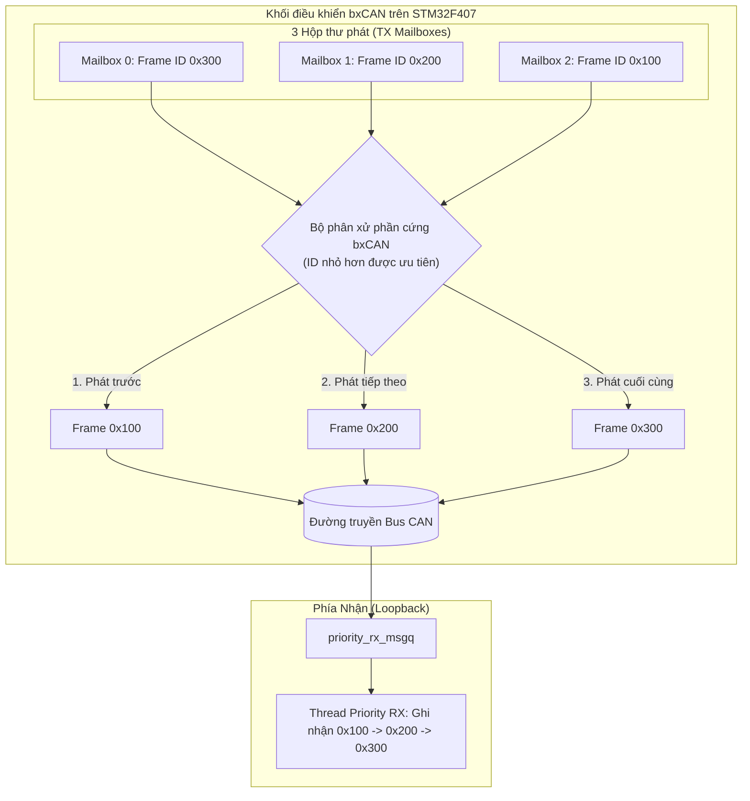

# BKIT ARM4 - Lab 3 - Bài 3: Lọc phần cứng và Độ ưu tiên truyền trên CAN Loopback

Tài liệu hướng dẫn chi tiết về **Lý thuyết cốt lõi**, **Trình tự đọc hiểu mã nguồn**, **Bộ lọc ID/Mask dải** và **Cơ chế phân xử ưu tiên giữa 3 TX Mailbox** của bxCAN trên Zephyr RTOS.

---

## 1. Yêu cầu đề bài & Lý thuyết cốt lõi

### 1.1. Yêu cầu đề bài & Quy định phần cứng
* **Môi trường thực thi:** Chế độ Loopback trên 1 kit BKIT ARM4.
* **3 luồng phát định kỳ:**
  * Thread 1: Phát frame ID `0x080` mỗi **100 ms** (10 frame/s).
  * Thread 2: Phát frame ID tăng vòng trong dải `0x4A0 → 0x4AF` mỗi **250 ms** (4 frame/s).
  * Thread 3: Phát frame ID `0x6F0` mỗi **1000 ms** (1 frame/s).
* **Cấu hình bộ lọc phần cứng (Chỉ dùng đúng 2 bộ lọc):**
  * Bộ lọc 1: Nhận chính xác ID `0x080` (Mask `0x7FF`).
  * Bộ lọc 2: Nhận toàn bộ dải `0x4A0 → 0x4AF` bằng Mask.
  * Frame `0x6F0` không khớp bộ lọc nào → **Bị phần cứng loại bỏ 100%**, không bao giờ xuất hiện trong thống kê.
* **Thử nghiệm ưu tiên truyền (Priority Burst Test):**
  * Mỗi **5 giây**, một thread gửi liền 3 frame có ID `0x300`, `0x200`, `0x100` bằng `can_send(..., K_NO_WAIT, tx_done_cb, NULL)` không chờ giữa các lần gọi.
  * Bộ lọc riêng đưa vào `priority_rx_msgq`. In thứ tự nhận được ra màn hình.
* **Giám sát mất gói:** Ngõ ra **Y0 (PE5)** bật sáng nếu số frame `0x080` nhận được trong cửa sổ 5 giây nằm ngoài khoảng **48–52**.

### 1.2. Khái niệm & Cơ chế áp dụng
* **Mặt nạ lọc dải (Bit Mask Filtering):**
  * Dải `0x4A0` (`0100 1010 0000_2`) đến `0x4AF` (`0100 1010 1111_2`) có 7 bit cao cố định là `0100 101_2` (`0x4A`), 4 bit thấp biến thiên từ 0 đến 15.
  * Mặt nạ Mask = 0x7F0 (`111 1111 0000_2`) kiểm tra 7 bit cao và bỏ qua 4 bit thấp → Chấp nhận toàn bộ 16 ID trong dải.
* **Cơ chế 3 Hộp thư phát (TX Mailbox 0, 1, 2) của bxCAN:**
  * Khi nhiều mailbox đồng thời sẵn sàng phát, phần cứng bxCAN thực hiện phân xử nội bộ: **Hộp thư chứa frame có ID nhỏ hơn sẽ được ưu tiên phát ra bus trước!**

### 1.3. Bảng tổng hợp API Zephyr RTOS sử dụng

| API / Macro | Ngữ cảnh | Chức năng kỹ thuật |
| :--- | :---: | :--- |
| `can_add_rx_filter_msgq(dev, &msgq, &filter)` | Thread | Gắn bộ lọc phần cứng vào hàng đợi Message Queue. |
| `can_send(dev, &f, K_NO_WAIT, cb, NULL)` | Thread | Nạp frame vào TX Mailbox ngay lập tức không chờ; nếu mailbox đầy trả về `-EAGAIN`. |
| `k_msgq_get(&msgq, &frame, timeout)` | Thread | Đọc frame từ Message Queue với timeout. |

---

## 2. Hướng dẫn trình tự đọc hiểu mã nguồn (Code Reading Guide)

Để nắm bắt toàn bộ file `src/main.c`, hãy theo dõi mã nguồn theo **5 bước tuần tự** dưới đây:

### 🔹 Bước 1: Khai báo 2 hàng đợi Message Queue riêng biệt
Tách rời luồng nhận định kỳ và luồng thử nghiệm ưu tiên:
```c
CAN_MSGQ_DEFINE(monitor_rx_msgq, 32);  /* Chứa 0x080 và 0x4A0..0x4AF */
CAN_MSGQ_DEFINE(priority_rx_msgq, 8);   /* Chứa 0x100, 0x200, 0x300 */
```

### 🔹 Bước 2: Quan sát 3 luồng phát định kỳ
Thread `tx_4ax` tăng vòng ID từ `0x4A0` đến `0x4AF`:
```c
sub_id = (sub_id + 1) & 0x0F; /* 0..15 */
struct can_frame frame = { .id = 0x4A0 + sub_id, .dlc = 2, .flags = 0 };
```

### 🔹 Bước 3: Quan sát cơ chế phát dồn 3 frame trong `thread_priority_tx`
Nạp liên tiếp 3 frame vào 3 mailbox của bxCAN bằng `K_NO_WAIT`:
```c
can_send(can_dev, &f300, K_NO_WAIT, tx_done_cb, NULL);
can_send(can_dev, &f200, K_NO_WAIT, tx_done_cb, NULL);
can_send(can_dev, &f100, K_NO_WAIT, tx_done_cb, NULL);
```

### 🔹 Bước 4: Kiểm tra thứ tự nhận và in thống kê trong `thread_monitor_rx`
Kiểm tra số frame `0x080` trong 5 giây có nằm trong khoảng 48..52 hay không:
```c
uint32_t delta_080 = cnt_080 - last_5s_cnt_080;
if (delta_080 >= 48 && delta_080 <= 52) {
    gpio_pin_set_dt(&y0, 0); /* Đạt chuẩn: Tắt Y0 */
} else {
    gpio_pin_set_dt(&y0, 1); /* BẬT Y0 cảnh báo mất frame! */
}
```

### 🔹 Bước 5: Cấu hình bộ lọc phần cứng trong hàm `main()`
```c
int main(void)
{
    can_set_mode(can_dev, CAN_MODE_LOOPBACK);

    /* Bộ lọc 1: Nhận chính xác 0x080 */
    const struct can_filter f_080 = {.id = 0x080, .mask = 0x7FF, .flags = 0};
    can_add_rx_filter_msgq(can_dev, &monitor_rx_msgq, &f_080);

    /* Bộ lọc 2: Nhận toàn bộ dải 0x4A0..0x4AF */
    const struct can_filter f_4ax = {.id = 0x4A0, .mask = 0x7F0, .flags = 0};
    can_add_rx_filter_msgq(can_dev, &monitor_rx_msgq, &f_4ax);

    can_start(can_dev);
    return 0;
}
```

---

## 3. Cơ chế hoạt động & Sơ đồ tương tác (Mermaid)

### 3.1. Sơ đồ phân xử 3 Mailbox của bxCAN



### 3.2. Dòng thời gian diễn biến (Timeline Tracing)

| Thời điểm | Luồng phát | Hành động & ID | Thứ tự nhận tại `priority_rx_msgq` |
| :---: | :--- | :--- | :---: |
| **5000 ms** | `thread_priority_tx` | Nạp `0x300` vào Mailbox 0 | — |
| **5000 ms** | `thread_priority_tx` | Nạp `0x200` vào Mailbox 1 | — |
| **5000 ms** | `thread_priority_tx` | Nạp `0x100` vào Mailbox 2 | — |
| **5001 ms** | Phần cứng bxCAN | Phân xử: `0x100 < 0x200 < 0x300` | **Nhận Frame 0x100 đầu tiên** |
| **5002 ms** | Phần cứng bxCAN | Phát tiếp `0x200` | **Nhận Frame 0x200 thứ hai** |
| **5003 ms** | Phần cứng bxCAN | Phát cuối cùng `0x300` | **Nhận Frame 0x300 thứ ba** |

---

## 4. Nếu KHÔNG CÓ cơ chế này thì sao? (Phân tích Failure Modes)

| Cơ chế kỹ thuật | Nếu KHÔNG CÓ cơ chế này | Hậu quả thực tế trên hệ thống |
| :--- | :--- | :--- |
| **Lọc bằng phần cứng bxCAN** | Không dùng bộ lọc, nhận tất cả rồi dùng `if (frame.id == ...)` trong phần mềm. | Mọi frame rác (`0x6F0`, gói chẩn đoán, telemetry) đều gây ngắt ISR, đánh thức CPU và làm nghẽn Message Queue, làm tăng độ trễ hệ thống. |
| **Phân xử ưu tiên theo ID** | CAN truyền theo thứ tự FIFO (First-In First-Out) như UART. | Gói tin phanh khẩn cấp bị xếp sau gói tin đo áp suất lốp, xe không thể phanh kịp thời khi gặp chướng ngại vật. |

---

## 5. Đáp án câu hỏi bài tập (Q&A)

### ❓ Câu (a): Bạn dùng ID/mask nào cho dải 0x4A0–0x4AF? Chứng minh 0x6F0 và 0x4B0 bị loại.
* **Cặp ID/Mask cho dải `0x4A0 → 0x4AF`:** **Filter ID = `0x4A0`, Mask = `0x7F0`**.
* **Chứng minh `0x6F0` bị loại:**
  ```text
Received_ID & Mask = 0x6F0 & 0x7F0 = 0x6F0 != 0x4A0  --> BỊ PHẦN CỨNG LOẠI BỎ NGAY LẬP TỨC
```
* **Chứng minh `0x4B0` bị loại:**
  ```text
Received_ID & Mask = 0x4B0 & 0x7F0 = 0x4B0 != 0x4A0  --> BỊ PHẦN CỨNG LOẠI BỎ NGAY LẬP TỨC
```

### ❓ Câu (b): Thứ tự nhận ba frame của thử nghiệm ưu tiên là gì? Giải thích bằng cơ chế ba hộp thư TX của bxCAN và quy tắc "ID nhỏ hơn được ưu tiên". Vì sao frame đầu tiên có thể không phải là 0x100?
* **Thứ tự nhận được:** **`0x100` → `0x200` → `0x300`** (hoặc `0x300` → `0x100` → `0x200`).
* **Giải thích:** bxCAN trên STM32 có 3 hộp thư truyền (TX Mailbox 0, 1, 2). Khi cả 3 mailbox đều đang chờ phát, bộ điều khiển phần cứng so sánh trường ID của 3 frame và tự động phát frame có **ID nhỏ nhất ra bus trước** (`0x100` ưu tiên hơn `0x200`, `0x200` ưu tiên hơn `0x300`).
* **Vì sao frame đầu tiên có thể là `0x300`?** Vì hàm `can_send` được CPU gọi tuần tự trong mã C. Nếu tại thời điểm gọi `can_send(0x300)`, đường bus đang hoàn toàn rảnh rỗi, phần cứng bxCAN có thể kích hoạt phát frame `0x300` ngay lập tức trước khi CPU kịp thực thi hai lệnh nạp `0x200` và `0x100` vào mailbox 1 và 2. Khi đó `0x300` đã đang truyền, hai frame còn lại sẽ được phân xử nội bộ: `0x100` đi trước rồi đến `0x200`.

### ❓ Câu (c): Lợi ích của lọc bằng phần cứng so với nhận tất cả rồi lọc bằng if trong phần mềm là gì?
1. **Tiết kiệm 100% tài nguyên CPU:** bxCAN tự động so khớp và loại bỏ frame rác ngay ở tầng ngoại vi silicon. CPU không bị đánh thức, không tốn chu kỳ lệnh.
2. **Không phát sinh ngắt vô ích:** Giảm tải số lần ngắt ISR cho hệ điều hành.
3. **Tiết kiệm RAM và chống tràn Queue:** Message Queue không bị quá tải bởi các frame không liên quan.
4. **Bảo đảm tính thời gian thực (Determinism):** Độ trễ của các gói tin quan trọng không bị ảnh hưởng bởi lưu lượng frame rác trên mạng.
