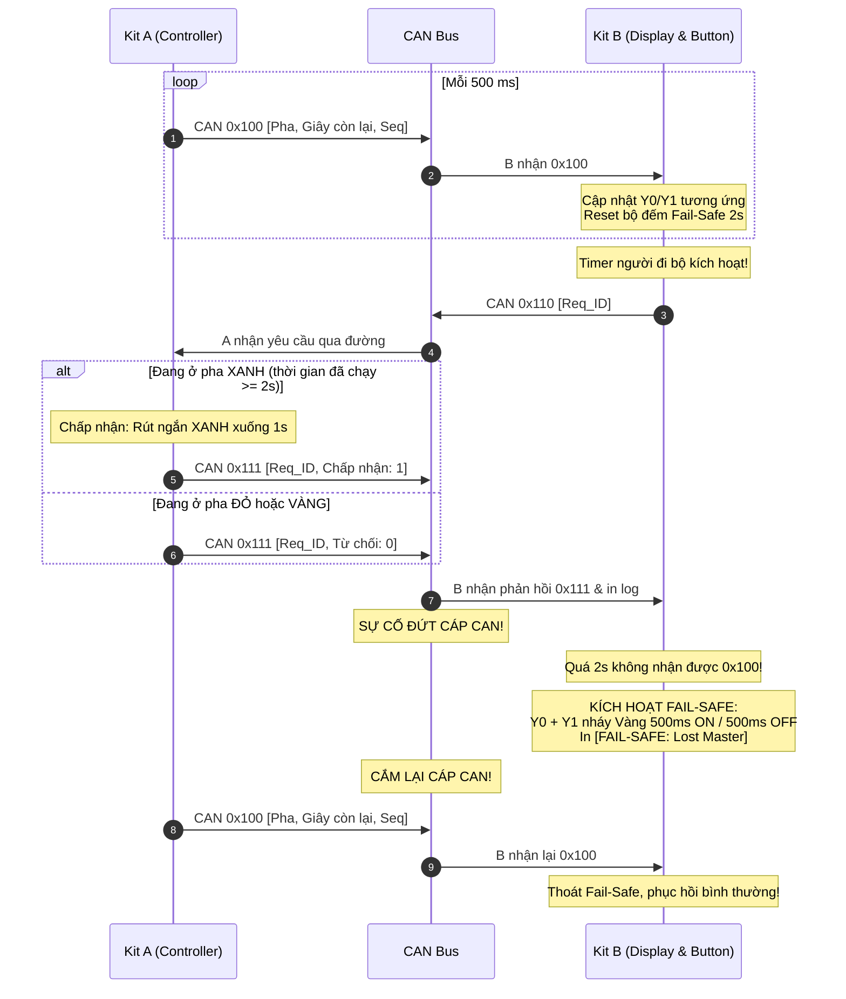

# BKIT ARM4 - Lab 3 - Bài 5: Hệ thống Đèn Giao thông Phân tán qua CAN (Bài Tổng hợp)

Tài liệu hướng dẫn chi tiết về **Lý thuyết cốt lõi**, **Trình tự đọc hiểu mã nguồn**, **Kiến trúc phân tán Master - Slave**, **Tương tác yêu cầu qua đường** và **Cơ chế Bảo an Fail-Safe khi đứt đường truyền** trên Zephyr RTOS.

---

## 1. Yêu cầu đề bài & Lý thuyết cốt lõi

### 1.1. Yêu cầu đề bài & Quy định phần cứng
* **Môi trường thực thi:** Mạng CAN 2 kit nối thành bus thật (hỗ trợ `DUAL_ROLE_LOOPBACK` để test 1 kit).
* **Kiến trúc phân tán Master - Slave:**
  * **Kit A (Controller - Master):**
    * Chạy máy trạng thái FSM đèn giao thông: **ĐỎ (7s) → XANH (5s) → VÀNG (2s)**.
    * Pha XANH có thời gian tối thiểu **2 giây**; rút ngắn xuống 1 giây nếu có người đi bộ xin qua đường.
    * Kit A không tự điều khiển đèn trên kit mình mà broadcast định kỳ mỗi **500 ms VÀ mỗi khi đổi pha** frame `0x100`: `data[0] = pha` (0: Đỏ, 1: Xanh, 2: Vàng), `data[1] = giây còn lại`, `data[2] = seq`.
  * **Kit B (Display - Slave):**
    * Nhận frame `0x100`, điều khiển trực tiếp các ngõ ra công suất:
      * **ĐỎ:** `Y0 = 1, Y1 = 0` (PE5 sáng).
      * **XANH:** `Y0 = 0, Y1 = 1` (PE6 sáng).
      * **VÀNG:** `Y0 = 1, Y1 = 1` (Cả PE5 và PE6 cùng sáng).
    * In pha và số giây còn lại ra Serial Monitor.
* **Tương tác xin qua đường từ xa (Pedestrian Request):**
  * Nút bấm người đi bộ ở Kit B được mô phỏng định kỳ (lần đầu ở giây 10, sau đó 14s, 8s, 17s...) gửi frame yêu cầu `0x110` (`data[0] = req_seq`).
  * Kit A tiếp nhận: Nếu đang ở pha Xanh (và đã chạy ≥ 2s) → Chấp nhận rút ngắn Xanh; nếu đang Đỏ hoặc Vàng → Bỏ qua.
  * Kit A phản hồi frame `0x111`: `data[0] = req_seq`, `data[1] = 1 (chấp nhận) / 0 (bỏ qua)`. Kit B in kết quả.
* **Cơ chế Bảo an Fail-Safe (Kit B):**
  * Nếu **quá 2 giây** không nhận được frame `0x100` từ Kit A → Chuyển sang chế độ **VÀNG NHẤP NHÁY** (`Y0` và `Y1` cùng nháy chu kỳ 500ms ON / 500ms OFF) và in cảnh báo `[FAIL-SAFE]`.
  * Tự động phục hồi ngay khi nhận lại được frame `0x100`.
* **Heartbeat:** Cả hai kit nhấp nháy đèn **LED3 (PE4)** mỗi giây 1 lần làm nhịp tim.

### 1.2. Khái niệm & Cơ chế áp dụng
* **Mô hình Broadcast định kỳ kết hợp sự kiện:**
  * Vừa phát định kỳ 500ms (để đóng vai trò nhịp tim cho Slave), vừa phát ngay lập tức khi chuyển pha (để đồng bộ màu đèn không bị trễ thời gian thực).
* **Cơ chế Fail-Safe trong điều khiển giao thông:**
  * Khi bộ điều khiển trung tâm gặp sự cố hoặc đứt đường cáp CAN, hệ thống đèn tại ngã tư không được phép tắt ngấm hoặc giữ nguyên một màu bất biến (dễ gây tai nạn giao thông thảm khốc).
  * Chế độ Fail-Safe tự động chuyển các trụ đèn sang đèn Vàng nhấp nháy để cảnh báo các phương tiện giảm tốc độ và nhường đường.

### 1.3. Bảng tổng hợp API Zephyr RTOS sử dụng

| API / Macro | Ngữ cảnh | Chức năng kỹ thuật |
| :--- | :---: | :--- |
| `can_send(..., K_MSEC(100), tx_cb, NULL)` | Thread | Gửi broadcast trạng thái đèn bất đồng bộ an toàn. |
| `k_msgq_get(&traffic_rx_msgq, &f, K_FOREVER)` | Thread | Nhận các frame `0x100`, `0x110`, `0x111` từ hàng đợi. |
| `atomic_set(&last_rx_uptime, now)` | Thread | Cập nhật mốc thời gian nhận gói tin phục vụ Watchdog 2s. |

---

## 2. Hướng dẫn trình tự đọc hiểu mã nguồn (Code Reading Guide)

Để nắm bắt toàn bộ file `src/main.c`, hãy theo dõi mã nguồn theo **5 bước tuần tự** dưới đây:

### 🔹 Bước 1: Khai báo cấu hình vai trò Node
```c
#define ROLE_KIT_A 1  /* Controller (Master) */
#define ROLE_KIT_B 2  /* Display (Slave) */

#define DUAL_ROLE_LOOPBACK 0  /* Đặt = 1 nếu muốn test cả 2 vai trò trên 1 kit */
#define NODE_ROLE          ROLE_KIT_A /* Đổi thành ROLE_KIT_B khi nạp Kit B */

#define CAN_ID_TRAFFIC_STATE   0x100
#define CAN_ID_PED_REQ         0x110
#define CAN_ID_PED_RESP        0x111
```

### 🔹 Bước 2: Quan sát FSM Đèn giao thông trên Kit A (`thread_traffic_fsm`)
Quản lý chu kỳ ĐỎ (7s) → XANH (5s) → VÀNG (2s) và rút ngắn Xanh khi có yêu cầu:
```c
/* Rút ngắn thời gian Xanh nếu có người xin qua đường */
if (current_phase == PHASE_GREEN && elapsed_sec >= 2 && atomic_get(&ped_request_flag) == 1) {
    atomic_set(&ped_request_flag, 0);
    remaining_sec = 1; /* Ép thời gian xanh còn lại về 1s để chuyển Vàng */
    send_ped_response(req_seq, 1); /* Chấp nhận */
}
```

### 🔹 Bước 3: Quan sát cơ chế gửi Broadcast `0x100` mỗi 500ms
```c
static void broadcast_traffic_state(uint8_t phase, uint8_t remaining, uint8_t seq)
{
    struct can_frame f = { .id = CAN_ID_TRAFFIC_STATE, .dlc = 3, .flags = 0 };
    f.data[0] = phase;
    f.data[1] = remaining;
    f.data[2] = seq;
    can_send(can_dev, &f, K_MSEC(100), tx_done_cb, NULL);
}
```

### 🔹 Bước 4: Quan sát cơ chế hiển thị và Fail-Safe trên Kit B
Kit B kiểm tra thời gian trôi qua từ lần cuối nhận `0x100`. Nếu > 2000 ms → Bật Vàng nhấp nháy:
```c
if (now - last_rx > 2000) {
    /* KÍCH HOẠT FAIL-SAFE: Vàng nhấp nháy 500ms ON / 500ms OFF */
    atomic_set(&fail_safe_active, 1);
    gpio_pin_toggle_dt(&y0);
    gpio_pin_set_dt(&y1, gpio_pin_get_dt(&y0));
    printf("[FAIL-SAFE] Mat ket noi voi Kit A qua 2 giay! Nhay Vang an toan\n");
}
```

### 🔹 Bước 5: Cấu hình bộ lọc phần cứng trong hàm `main()`
```c
int main(void)
{
    can_set_mode(can_dev, DUAL_ROLE_LOOPBACK ? CAN_MODE_LOOPBACK : CAN_MODE_NORMAL);

    /* Cài 3 bộ lọc cho 0x100, 0x110 và 0x111 */
    can_add_rx_filter_msgq(can_dev, &traffic_rx_msgq, &f_state);
    can_add_rx_filter_msgq(can_dev, &traffic_rx_msgq, &f_ped_req);
    can_add_rx_filter_msgq(can_dev, &traffic_rx_msgq, &f_ped_resp);

    can_start(can_dev);
    return 0;
}
```

---

## 3. Cơ chế hoạt động & Sơ đồ tương tác (Mermaid)

### 3.1. Sơ đồ tuần tự Hệ thống Đèn giao thông Phân tán



### 3.2. Dòng thời gian diễn biến (Timeline Tracing)

| Mốc thời gian | Trạng thái Kit A (Master) | Trạng thái Kit B (Slave) | Đèn hiển thị trên Kit B |
| :---: | :--- | :--- | :---: |
| **0s → 7s** | Pha ĐỎ (đếm ngược 7 → 1) | Nhận `0x100` [ĐỎ] | **Y0 BẬT, Y1 TẮT (ĐỎ)** |
| **7s → 12s** | Pha XANH (đếm ngược 5 → 1) | Nhận `0x100` [XANH] | **Y0 TẮT, Y1 BẬT (XANH)** |
| **10s** | Nhận yêu cầu `0x110` lúc Xanh ≥ 2s → Chấp nhận! | Gửi `0x110`, nhận `0x111 [OK]` | Xanh rút ngắn, chuẩn bị sang Vàng |
| **12s → 14s** | Pha VÀNG (đếm ngược 2 → 1) | Nhận `0x100` [VÀNG] | **CẢ Y0 VÀ Y1 BẬT (VÀNG)** |
| **Khi đứt cáp CAN** | Gửi không có ACK → Báo lỗi truyền | Quá 2 giây không có `0x100` | **Y0 + Y1 NHÁY VÀNG (FAIL-SAFE)** |

---

## 4. Nếu KHÔNG CÓ cơ chế này thì sao? (Phân tích Failure Modes)

| Cơ chế kỹ thuật | Nếu KHÔNG CÓ cơ chế này | Hậu quả thực tế trên hệ thống |
| :--- | :--- | :--- |
| **Chế độ Bảo an Fail-Safe** | Kit B không có bộ định thời giám sát mất kết nối. | Khi Kit A bị đứt cáp hoặc mất nguồn, đèn trên Kit B giữ nguyên trạng thái cuối cùng (ví dụ đèn Xanh mãi mãi) → Gây tai nạn thảm khốc tại ngã tư. |
| **Broadcast định kỳ 500 ms** | Kit A chỉ gửi frame khi đổi màu đèn (cách nhau 2s đến 7s). | Kit B không thể phân biệt được Kit A đang đếm giây bình thường hay đã bị cháy/mất nguồn trong suốt 7 giây của đèn Đỏ. |
| **Phản hồi xác nhận `0x111`** | Kit A không trả lời yêu cầu xin qua đường. | Người đi bộ bấm nút nhưng không biết hệ thống đã ghi nhận hay chưa, gây sốt ruột và có thể cố tình băng qua đường nguy hiểm. |

---

## 5. Đáp án câu hỏi bài tập (Q&A)

### ❓ Câu (a): Vì sao Kit A gửi 0x100 định kỳ mỗi 500 ms thay vì chỉ gửi khi đổi pha? Liên hệ với cơ chế Fail-Safe.
* Các pha đèn kéo dài từ 2s đến 7s. Nếu chỉ gửi khi đổi pha, trong suốt 7 giây của đèn Đỏ, Kit B hoàn toàn không nhận được bất kỳ tín hiệu nào từ Kit A.
* Kit B sẽ **hoàn toàn không thể phân biệt được** Kit A đang đếm giây bình thường hay Kit A đã bị đứt cáp, rơi vào Bus-Off, hoặc mất nguồn.
* Việc phát định kỳ mỗi 500 ms đóng vai trò như một **dòng nhịp tim liên tục (Heartbeat Stream)**. Nhờ đó, Kit B có thể thiết lập cơ chế giám sát an toàn: Chỉ cần mất 4 frame liên tiếp (quá 2 giây) là Kit B phát hiện đứt kết nối tức thì và chuyển ngay sang chế độ phòng vệ an toàn Fail-Safe (Vàng nhấp nháy).

### ❓ Câu (b): Nếu trên bus còn một node khác thường xuyên gửi frame ID 0x050, trạng thái đèn của bạn có bị trễ không? Muốn lệnh đèn luôn được ưu tiên thì chọn ID thế nào?
* **Có bị trễ!** Vì `0x050 < 0x100`, theo nguyên tắc phân xử trọng số của CAN, frame `0x050` có độ ưu tiên cao hơn và sẽ luôn giành chiến thắng để chiếm bus trước frame `0x100`. Nếu node đó phát frame liên tục với mật độ dày đặc, frame điều khiển đèn `0x100` sẽ bị đẩy lùi, không thể phát đúng chu kỳ 500ms và gây trễ nhịp thời gian thực.
* **Giải pháp:** Để lệnh điều khiển đèn luôn được ưu tiên tuyệt đối trên bus, ta phải chọn ID cho frame đèn nhỏ hơn `0x050`, ví dụ như chọn ID trong dải `0x010` – `0x04F`.

### ❓ Câu (c): Rút dây CANH khi đèn đang Xanh: Mô tả theo thời gian điều gì xảy ra ở Kit A và Kit B (dựa trên log).
1. **Tại thời điểm t = 0s:** Rút dây `CANH`. Tín hiệu vi sai bị ngắt hoàn toàn.
2. **Tại t = 500 ms:** Kit A gửi frame `0x100` nhưng không thấy bit ACK từ Kit B → Kit A báo lỗi truyền (`can_send that bai`), bộ đếm lỗi TEC tăng dần và Kit A chuyển dần sang `ERROR-PASSIVE`.
3. **Tại Kit B:** Kit B không nhận được frame `0x100` nào nữa. Biến mốc thời gian `last_rx_state_uptime` không được cập nhật.
4. **Tại t = 2.0s:** Bộ đếm thời gian giám sát trên Kit B vượt quá ngưỡng 2000 ms → Kit B kích hoạt chế độ **FAIL-SAFE**: Ngắt trạng thái đèn Xanh, chuyển sang chớp nháy đồng thời cả Y0 và Y1 chu kỳ 500ms ON / 500ms OFF (đèn Vàng cảnh báo ngã tư) và in dòng log `[FAIL-SAFE] Mat ket noi voi Kit A qua 2 giay! Nhay Vang an toan`.
5. **Khi cắm lại dây:** Frame `0x100` tiếp theo được Kit B nhận thành công → Kit B in `[RECOVERED]`, lập tức thoát Fail-Safe và phục hồi ngay về đúng màu đèn cùng số giây thực tế mà Kit A đang điều khiển.
