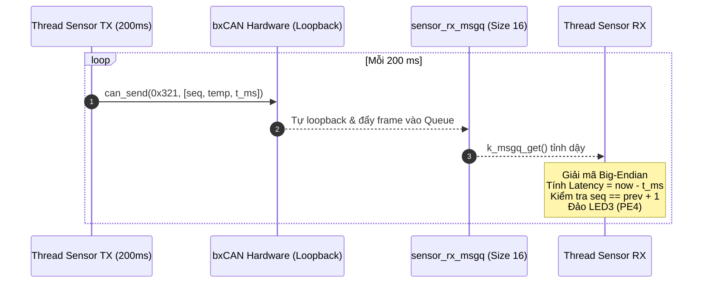

# BKIT ARM4 - Lab 3 - Bài 1: Truyền dữ liệu cảm biến giả lập trên CAN Loopback

Tài liệu hướng dẫn chi tiết về **Lý thuyết cốt lõi**, **Trình tự đọc hiểu mã nguồn**, **Kỹ thuật đóng gói Big-Endian** và **Cơ chế phát hiện mất frame** trên Zephyr RTOS.

---

## 1. Yêu cầu đề bài & Lý thuyết cốt lõi

### 1.1. Yêu cầu đề bài & Quy định phần cứng
* **Môi trường thực thi:** Chạy trên 1 kit ở chế độ Loopback (`CAN_MODE_LOOPBACK`).
* **Quy cách gói tin cảm biến (ID chuẩn `0x321`, DLC = 8 byte, đóng gói Big-Endian):**
  * **Byte 0–1:** `seq` (uint16_t) — Bộ đếm số thứ tự frame, tăng 1 sau mỗi lần gửi.
  * **Byte 2–3:** `temp_x10` (uint16_t) — Nhiệt độ $\times 10$ (giả lập tăng dần từ 250 đến 300 rồi quay về 250, tương ứng $25.0^{\circ}\text{C} $\rightarrow$ 30.0^{\circ}\text{C}$).
  * **Byte 4–7:** `t_ms` (uint32_t) — Mốc thời gian gửi lấy bằng `k_uptime_get_32()`.
* **Luồng phát (`thread_sensor_tx`):** Chu kỳ gửi định kỳ đúng **200 ms** (5 frame/giây).
* **Luồng nhận (`thread_sensor_rx`):**
  * Nhận qua `can_add_rx_filter_msgq()` với bộ lọc chỉ nhận đúng ID `0x321`.
  * Giải mã Big-Endian 3 trường dữ liệu, in ra màn hình dạng `25.3 C` và độ trễ $\text{Latency} = k_uptime_get_32() - t_{\text{ms}}$.
  * Kiểm tra tính liên tục của `seq`: Nếu `seq != expected_seq` thì tăng biến đếm `gap_count` và bật ngõ ra `Y0` (PE5).
  * Đảo trạng thái đèn **LED3 (PE4)** mỗi khi nhận thành công một frame.
* **Luồng thống kê (`thread_stats`):** Mỗi **5 giây** in một dòng thống kê: số frame đã gửi, đã nhận và `gap_count`.

### 1.2. Khái niệm & Cơ chế áp dụng
* **Quy chuẩn thứ tự byte Big-Endian (Most Significant Byte First):**
  * Byte có trọng số cao nhất (MSB) được lưu ở địa chỉ byte nhỏ nhất (`data[0]`).
  * Trong mạng truyền thông công nghiệp (CAN, TCP/IP, Modbus), Big-Endian được sử dụng làm chuẩn giao thức mạng (*Network Byte Order*) để các vi điều khiển khác kiến trúc phần cứng (ARM, x86, PIC) có thể hiểu nhau một cách thống nhất.
* **Phát hiện mất gói tin qua Sequence Number (`seq`):**
  * Bên nhận duy trì biến `expected_seq = (prev_seq + 1)`.
  * Nếu `current_seq != expected_seq`, bên nhận phát hiện ngay lập tức có sự cố mất frame do nghẽn buffer hoặc lỗi truyền.

### 1.3. Bảng tổng hợp API Zephyr RTOS sử dụng

| API / Macro | Ngữ cảnh | Chức năng kỹ thuật |
| :--- | :---: | :--- |
| `can_set_mode(dev, CAN_MODE_LOOPBACK)` | Thread | Cấu hình bxCAN chạy vòng lặp nội bộ, tự sinh ACK. |
| `can_add_rx_filter_msgq(dev, &msgq, &filter)` | Thread | Đăng ký bộ lọc phần cứng đẩy frame trực tiếp vào Message Queue. |
| `can_send(dev, &frame, timeout, NULL, NULL)` | Thread | Gửi frame 8 byte vào TX Mailbox. |
| `k_msgq_get(&msgq, &frame, timeout)` | Thread | Lấy frame từ hàng đợi nhận; block luồng nếu hàng đợi rỗng. |
| `k_uptime_get_32()` | Thread / ISR | Đọc thời gian hệ thống tính bằng mili-giây (32-bit). |

---

## 2. Hướng dẫn trình tự đọc hiểu mã nguồn (Code Reading Guide)

Để nắm bắt toàn bộ file `src/main.c`, hãy theo dõi mã nguồn theo **5 bước tuần tự** dưới đây:

### 🔹 Bước 1: Khai báo cấu hình phần cứng và Hàng đợi nhận
```c
#define SENSOR_CAN_ID 0x321

static const struct device *const can_dev = DEVICE_DT_GET(DT_CHOSEN(zephyr_canbus));
static const struct gpio_dt_spec led3 = GPIO_DT_SPEC_GET(DT_ALIAS(led0), gpios); /* PE4 */
static const struct gpio_dt_spec y0   = GPIO_DT_SPEC_GET(DT_ALIAS(led1), gpios); /* PE5 */

/* Hàng đợi chứa frame CAN nhận được */
CAN_MSGQ_DEFINE(sensor_rx_msgq, 16);
```

### 🔹 Bước 2: Quan sát kỹ thuật đóng gói Big-Endian trong `thread_sensor_tx`
Quan sát phép dịch bit đưa byte cao vào chỉ số mảng thấp:
```c
/* Byte 0-1: seq (uint16_t) */
frame.data[0] = (uint8_t)((seq >> 8) & 0xFF);
frame.data[1] = (uint8_t)(seq & 0xFF);

/* Byte 2-3: temp_x10 (uint16_t) */
frame.data[2] = (uint8_t)((temp_x10 >> 8) & 0xFF);
frame.data[3] = (uint8_t)(temp_x10 & 0xFF);

/* Byte 4-7: Timestamp 32-bit (t_ms) */
frame.data[4] = (uint8_t)((t_ms >> 24) & 0xFF);
frame.data[5] = (uint8_t)((t_ms >> 16) & 0xFF);
frame.data[6] = (uint8_t)((t_ms >> 8) & 0xFF);
frame.data[7] = (uint8_t)(t_ms & 0xFF);
```

### 🔹 Bước 3: Quan sát kỹ thuật giải mã Big-Endian trong `thread_sensor_rx`
Ghép các byte lại theo đúng thứ tự trọng số:
```c
uint16_t seq      = ((uint16_t)frame.data[0] << 8) | frame.data[1];
uint16_t temp_x10 = ((uint16_t)frame.data[2] << 8) | frame.data[3];
uint32_t t_ms     = ((uint32_t)frame.data[4] << 24) |
                    ((uint32_t)frame.data[5] << 16) |
                    ((uint32_t)frame.data[6] << 8)  |
                    frame.data[7];

uint32_t latency = k_uptime_get_32() - t_ms;
```

### 🔹 Bước 4: Kiểm tra tính liên tục của `seq` và cảnh báo đèn Y0
```c
if (expected_seq != -1 && seq != (uint16_t)expected_seq) {
    atomic_inc(&gap_count);
    gpio_pin_set_dt(&y0, 1); /* BẬT Y0 cảnh báo đứt gãy frame */
}
expected_seq = (seq + 1) & 0xFFFF;
gpio_pin_toggle_dt(&led3); /* Đảo trạng thái LED3 */
```

### 🔹 Bước 5: Hàm `main()` — Thiết lập bộ lọc và khởi động
```c
int main(void)
{
    const struct can_filter filter = {
        .id = SENSOR_CAN_ID,
        .mask = CAN_STD_ID_MASK, // 0x7FF
        .flags = 0,
    };
    can_set_mode(can_dev, CAN_MODE_LOOPBACK);
    can_add_rx_filter_msgq(can_dev, &sensor_rx_msgq, &filter);
    can_start(can_dev);
    return 0;
}
```

---

## 3. Cơ chế hoạt động & Sơ đồ tương tác (Mermaid)

### 3.1. Sơ đồ tuần tự truyền nhận dữ liệu



### 3.2. Dòng thời gian diễn biến (Timeline Tracing)

| Thời gian (ms) | Thực thể | Dữ liệu Payload (Big-Endian) | Hành động & Trạng thái |
| :---: | :--- | :--- | :--- |
| **$500\\,\text{ms}$** | `thread_sensor_tx` | `seq=0, temp=250 (25.0°C), t=500` | Gửi frame 0x321 vào CAN loopback. |
| **$500\\,\text{ms}$** | `thread_sensor_rx` | Nhận frame `seq=0` | Đảo LED3, `Latency = 0ms`, `gap_count = 0`. |
| **$700\\,\text{ms}$** | `thread_sensor_tx` | `seq=1, temp=251 (25.1°C), t=700` | Gửi frame tiếp theo sau 200 ms. |
| **$700\\,\text{ms}$** | `thread_sensor_rx` | Nhận frame `seq=1` | `seq == expected (1)` $$\rightarrow$$ Bình thường, đảo LED3. |
| **$5500\\,\text{ms}$**| `thread_stats` | Đọc thống kê | In: `[THONG KE 5S] Da gui: 25 | Da nhan: 25 | n_gap: 0`. |

---

## 4. Nếu KHÔNG CÓ cơ chế này thì sao? (Phân tích Failure Modes)

| Cơ chế kỹ thuật | Nếu KHÔNG CÓ cơ chế này | Hậu quả thực tế trên hệ thống |
| :--- | :--- | :--- |
| **Đồng bộ hóa Big-Endian** | Bên gửi đóng gói Big-Endian nhưng bên nhận tự ý đọc Little-Endian. | Giá trị `0x0102` (258) bị đọc nhầm thành `0x0201` (513). Nhiệt độ cảm biến sai lệch nghiêm trọng, hệ thống điều khiển đưa ra quyết định sai lầm. |
| **Bộ đếm `seq` kiểm tra Gap** | Frame chỉ chứa nhiệt độ mà không có số thứ tự tuần tự. | Khi mạng bị nghẽn hoặc tràn hàng đợi, frame bị rơi mất mà bên nhận **hoàn toàn không biết**, tiếp tục sử dụng dữ liệu cũ đã lỗi thời. |
| **Bộ lọc phần cứng `0x7FF`** | Mở mask `0x000` (nhận toàn bộ). | Mọi gói tin khác trên mạng đều bị đẩy vào hàng đợi, gây tràn buffer `sensor_rx_msgq` và làm chậm thời gian giải mã. |

---

## 5. Đáp án câu hỏi bài tập (Q&A)

### ❓ Câu (a): Viết đoạn code đóng gói `seq` và `t_ms` theo Big-Endian. Nếu bên nhận giải mã theo Little-Endian thì `seq = 0x0102` sẽ bị đọc thành bao nhiêu?
* **Đoạn code đóng gói Big-Endian:**
  ```c
  frame.data[0] = (uint8_t)((seq >> 8) & 0xFF); // Byte cao trước
  frame.data[1] = (uint8_t)(seq & 0xFF);        // Byte thấp sau
  frame.data[4] = (uint8_t)((t_ms >> 24) & 0xFF);
  frame.data[5] = (uint8_t)((t_ms >> 16) & 0xFF);
  frame.data[6] = (uint8_t)((t_ms >> 8) & 0xFF);
  frame.data[7] = (uint8_t)(t_ms & 0xFF);
  ```
* **Giải mã nhầm theo Little-Endian:**
  * Bên gửi đóng gói `seq = 0x0102` $$\rightarrow$$ `data[0] = 0x01`, `data[1] = 0x02`.
  * Bên nhận đọc Little-Endian (byte thấp đứng trước):
    $$\text{Value} = \text{data}[0] \mid (\text{data}[1] \ll 8) = 0x01 \mid (0x02 \ll 8) = 0x0201 = 513\\,\text{(thập phân)}$$

### ❓ Câu (b): Một frame 8 byte dài khoảng 111 bit. Ở 500 kbit/s, mất bao lâu để gửi? Bus tải tối đa bao nhiêu frame/s? Bài này chiếm bao nhiêu % tải bus?
* **Thời gian truyền một frame:**
  $$t_{\text{frame}} = \frac{111\\,\text{bit}}{500.000\\,\text{bit/s}} = 0,222\\,\text{ms} = 222\\,\mu\text{s}$$
* **Tải tối đa của đường bus:**
  $$\text{Max Frame Rate} = \frac{1}{0,000222\\,\text{s}} \approx 4504,5\\,\text{frame/giây}$$
* **Tỷ lệ tải chiếm dụng của Bài 1:**
  * Chu kỳ phát là 200 ms $$\rightarrow$$ Tần số phát $f = 5\\,\text{frame/s}$.
  * Tải bus chiếm dụng là:
    $$%\text{Bus Load} = \frac{5}{4504,5} \times 100% \approx 0,111%$$

### ❓ Câu (c): Vì sao ở chế độ loopback không cần node nào khác gửi ACK?
* Ở chế độ Loopback, khối điều khiển bxCAN bên trong STM32 tự động ngắt kết nối với chân vật lý bên ngoài và tự nối đường truyền TX nội bộ vào đường nhận RX. Đồng thời, **phần cứng bxCAN tự động sinh bit Dominant (0) vào khe ACK** cho chính frame nó phát ra, do đó không cần bất kỳ node nào khác gửi ACK.
