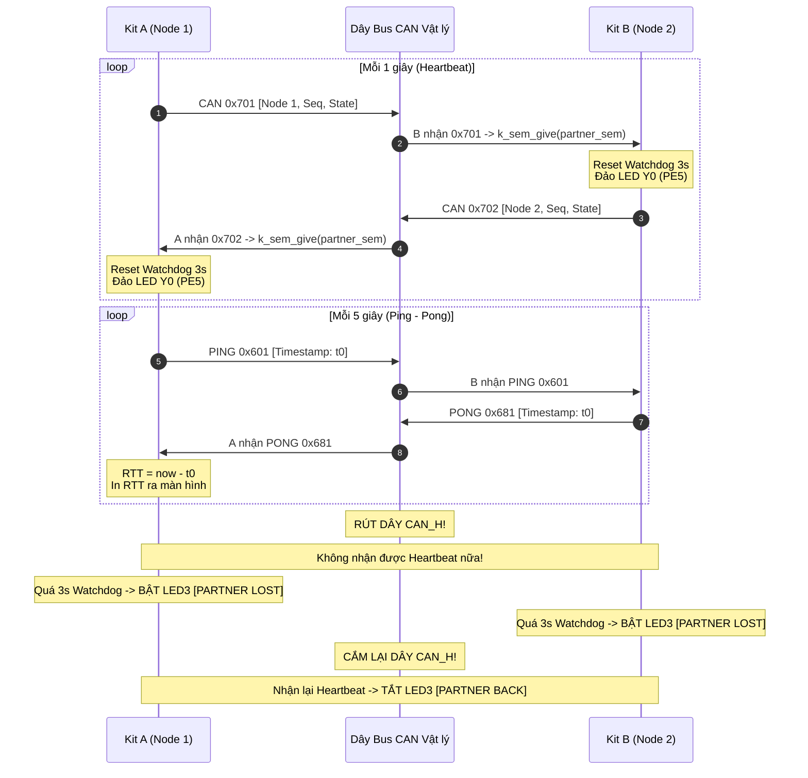

# BKIT ARM4 - Lab 3 - Bài 4: Heartbeat, Ping và Giám sát Node trên Mạng CAN

Tài liệu hướng dẫn chi tiết về **Lý thuyết cốt lõi**, **Trình tự đọc hiểu mã nguồn**, **Cơ chế Heartbeat & Watchdog Semaphore**, **Giao thức Ping-Pong đo RTT** và **Giám sát trạng thái lỗi Bus CAN** trên Zephyr RTOS.

---

## 1. Yêu cầu đề bài & Lý thuyết cốt lõi

### 1.1. Yêu cầu đề bài & Quy định phần cứng
* **Môi trường thực thi:** Mạng CAN 2 node vật lý thật (Kit A và Kit B):
  * Kit A: `#define NODE_ID 1`.
  * Kit B: `#define NODE_ID 2`.
  * Nối `CANH - CANH`, `CANL - CANL`, `GND - GND`, gạt công tắc `SW13 = ON` trên cả 2 bo mạch.
* **Cơ chế Heartbeat định kỳ (Mỗi 1 giây):**
  * Mỗi node phát Heartbeat mang ID `0x700 + NODE_ID`, `DLC = 3`: `data[0] = NODE_ID`, `data[1] = seq`, `data[2] = can_state`.
  * Mỗi lần nhận được Heartbeat của đối tác: Gọi `k_sem_give(&partner_sem)` và đảo trạng thái ngõ ra **Y0 (PE5)**.
* **Luồng Watchdog giám sát (`thread_watchdog`):**
  * Chờ semaphore: `k_sem_take(&partner_sem, K_SECONDS(3))`.
  * Nếu hết hạn 3 giây mà không có nhịp tim $$\rightarrow$$ In `!!! PARTNER LOST !!!` và **BẬT LED3 (PE4)**.
  * Khi nhận lại được nhịp tim $$\rightarrow$$ In `>>> PARTNER BACK <<<` và **TẮT LED3**.
* **Giao thức Ping-Pong đo RTT (Mỗi 5 giây):**
  * Node gửi gói PING `0x600 + NODE_ID` chứa mốc thời gian 32-bit `k_uptime_get_32()`.
  * Node đối tác nhận được lập tức trả PONG `0x680 + NODE_ID_người_ping` mang nguyên vẹn 4 byte đó.
  * Node ping nhận lại PONG và tính thời gian khứ hồi: $\text{RTT} = k_uptime_get_32() - t_{\text{send}}$.
  * **Mọi hàm `can_send` bắt buộc dùng callback và timeout 100 ms.**
* **Giám sát trạng thái bus:** Đăng ký `can_set_state_change_callback()` ghi log khi có chuyển dịch trạng thái vật lý (Error-Active, Warning, Error-Passive, Bus-Off) và đọc bộ đếm lỗi TEC/REC.
* **Thực nghiệm bắt buộc:**
  1. Rút dây `CANH` trong ~10 giây rồi cắm lại.
  2. Tắt nguồn Kit B trong ~10 giây rồi bật lại.

### 1.2. Khái niệm & Cơ chế áp dụng
* **Watchdog bằng Semaphore có Timeout:**
  * Semaphore ban đầu bằng 0. Luồng Watchdog chờ với `K_SECONDS(3)`.
  * Cứ mỗi 1 giây có Heartbeat tới $$\rightarrow$$ Semaphore được give $$\rightarrow$$ Watchdog thức dậy, thấy không bị timeout nên tiếp tục đi ngủ 3 giây tiếp theo.
  * Nếu mất tín hiệu quá 3 giây $$\rightarrow$$ `k_sem_take` trả về mã lỗi `-EAGAIN` $$\rightarrow$$ Kích hoạt báo động mất đối tác.
* **Gửi bất đồng bộ an toàn (Asynchronous Non-blocking TX):**
  * Trên bus thật, việc node đối tác bị tắt nguồn hoặc đứt dây là điều thường xuyên xảy ra.
  * Dùng `can_send(..., K_MSEC(100), tx_done_cb, NULL)` đảm bảo hàm gửi luôn nhả quyền điều khiển sau tối đa 100ms, không bao giờ làm treo luồng.

### 1.3. Bảng tổng hợp API Zephyr RTOS sử dụng

| API / Macro | Ngữ cảnh | Chức năng kỹ thuật |
| :--- | :---: | :--- |
| `k_sem_take(&partner_sem, K_SECONDS(3))` | Thread | Chờ nhịp tim với thời hạn 3 giây. Hết hạn trả về `-EAGAIN`. |
| `k_sem_give(&partner_sem)` | Thread | Đánh thức luồng Watchdog khi nhận được frame Heartbeat. |
| `can_set_state_change_callback()` | Thread | Đăng ký lắng nghe biến đổi trạng thái bus CAN vật lý. |
| `can_get_state(dev, &state, &err)` | Thread | Đọc trạng thái bus và giá trị hai bộ đếm lỗi TEC và REC. |

---

## 2. Hướng dẫn trình tự đọc hiểu mã nguồn (Code Reading Guide)

Để nắm bắt toàn bộ file `src/main.c`, hãy theo dõi mã nguồn theo **5 bước tuần tự** dưới đây:

### 🔹 Bước 1: Khai báo cấu hình `NODE_ID` và `PARTNER_ID`
Cùng 1 mã nguồn, phân biệt Kit A và Kit B bằng macro:
```c
#define NODE_ID   1  /* Đổi thành 2 khi nạp Kit B */
#define SELF_TEST 0  /* 0 = Bus thật 2 kit, 1 = Loopback 1 kit */

#define PARTNER_ID ((NODE_ID == 1) ? 2 : 1)

#define HB_BASE_TX   (0x700 + NODE_ID)
#define HB_BASE_RX   (0x700 + PARTNER_ID)
#define PING_BASE_TX (0x600 + NODE_ID)
#define PING_BASE_RX (0x600 + PARTNER_ID)
#define PONG_BASE_TX (0x680 + PARTNER_ID)
#define PONG_BASE_RX (0x680 + NODE_ID)
```

### 🔹 Bước 2: Quan sát Thread phát Heartbeat mỗi 1 giây
Gửi ID `0x700 + NODE_ID` kèm trạng thái hiện tại của bus:
```c
can_get_state(can_dev, &state, &err);
f.data[0] = NODE_ID;
f.data[1] = seq++;
f.data[2] = (uint8_t)state;

can_send(can_dev, &f, K_MSEC(100), tx_done_cb, NULL);
k_msleep(1000);
```

### 🔹 Bước 3: Quan sát cơ chế PING và trả lời PONG trong `thread_rx_dispatcher`
Khi nhận được PING, sao chép nguyên vẹn timestamp và phản hồi PONG:
```c
/* Nhận PING từ Node đối tác -> Gửi trả PONG */
else if (f.id == PING_BASE_RX) {
    struct can_frame pong = { .id = PONG_BASE_TX, .dlc = 4, .flags = 0 };
    for (int i = 0; i < 4; i++) pong.data[i] = f.data[i];
    can_send(can_dev, &pong, K_MSEC(100), tx_done_cb, NULL);
}
/* Nhận PONG trả lời -> Tính RTT */
else if (f.id == PONG_BASE_RX) {
    uint32_t t_send = (f.data[0] << 24) | (f.data[1] << 16) | (f.data[2] << 8) | f.data[3];
    uint32_t rtt = k_uptime_get_32() - t_send;
    printf("[PING-PONG THANH CONG] RTT voi Node %d = %u ms\n", PARTNER_ID, rtt);
}
```

### 🔹 Bước 4: Quan sát cơ chế Watchdog bằng Semaphore 3 giây
```c
int ret = k_sem_take(&partner_sem, K_SECONDS(3));
if (ret == 0) {
    /* Nhận nhịp tim tốt */
    if (!partner_alive) {
        partner_alive = true;
        gpio_pin_set_dt(&led3, 0); /* TẮT LED3 */
        printf(">>> PARTNER BACK <<< (Node %d da hoat dong tro lai!)\n", PARTNER_ID);
    }
} else {
    /* Hết hạn 3 giây */
    if (partner_alive) {
        partner_alive = false;
        gpio_pin_set_dt(&led3, 1); /* BẬT LED3 báo động */
        printf("!!! PARTNER LOST !!! (Khong co tin hieu tu Node %d)\n", PARTNER_ID);
    }
}
```

### 🔹 Bước 5: Đăng ký giám sát trạng thái bus trong hàm `main()`
```c
can_set_mode(can_dev, CAN_MODE_NORMAL);
can_set_state_change_callback(can_dev, state_change_cb, NULL);

/* Thêm bộ lọc cho Heartbeat, PING và PONG */
can_add_rx_filter_msgq(can_dev, &can_rx_msgq, &f_hb);
can_add_rx_filter_msgq(can_dev, &can_rx_msgq, &f_ping);
can_add_rx_filter_msgq(can_dev, &can_rx_msgq, &f_pong);

can_start(can_dev);
```

---

## 3. Cơ chế hoạt động & Sơ đồ tương tác (Mermaid)

### 3.1. Sơ đồ tương tác Heartbeat và Ping-Pong trên Bus thật



### 3.2. Dòng thời gian diễn biến (Timeline Tracing)

| Mốc thời gian | Sự kiện trên bus | Trạng thái Kit A | Trạng thái Kit B |
| :---: | :--- | :--- | :--- |
| **$1000\\,\text{ms}$** | Phát Heartbeat 0x701 & 0x702 | Nhận 0x702 $$\rightarrow$$ Đảo Y0 | Nhận 0x701 $$\rightarrow$$ Đảo Y0 |
| **$5000\\,\text{ms}$** | Kit A gửi PING 0x601 | Nhận PONG 0x681 $$\rightarrow$$ In `RTT = 2 ms` | Phản hồi PONG 0x681 |
| **$10000\\,\text{ms}$**| **Rút dây CANH** | Phát 0x701 không có ACK $$\rightarrow$$ Lỗi | Không nhận được frame |
| **$13000\\,\text{ms}$**| **Hết hạn Watchdog 3s** | BẬT LED3, In `PARTNER LOST` | BẬT LED3, In `PARTNER LOST` |
| **$20000\\,\text{ms}$**| **Cắm lại dây CANH** | Nhận 0x702 $$\rightarrow$$ TẮT LED3, `BACK` | Nhận 0x701 $$\rightarrow$$ TẮT LED3, `BACK` |

---

## 4. Nếu KHÔNG CÓ cơ chế này thì sao? (Phân tích Failure Modes)

| Cơ chế kỹ thuật | Nếu KHÔNG CÓ cơ chế này | Hậu quả thực tế trên hệ thống |
| :--- | :--- | :--- |
| **`can_send` có Timeout 100ms** | Dùng `can_send(..., K_FOREVER, NULL, NULL)`. | Khi rút dây CANH, không có node nào gửi ACK $$\rightarrow$$ Hàm gửi bị **treo vĩnh viễn**, luồng bị khóa chết hoàn toàn. |
| **Heartbeat & Watchdog Semaphore** | Không có cơ chế giám sát nhịp tim định kỳ. | Một vi điều khiển bị sập nguồn hoặc đứt cáp truyền thông, các node còn lại không hề hay biết, tiếp tục vận hành sai lệch. |
| **Điện trở kết cuối $120\\,\Omega$ (SW13)** | Để công tắc SW13 = OFF trên cả 2 bo mạch. | Sóng phản xạ tần số cao làm biến dạng sườn xung bit $$\rightarrow$$ Liên tục xuất hiện lỗi CRC hoặc Bit Error trên bus. |

---

## 5. Đáp án câu hỏi bài tập (Q&A)

### ❓ Câu (a): RTT đo được là bao nhiêu? Phần lớn thời gian đó nằm ở đâu? Tính thời gian truyền lý thuyết của 2 frame 4 byte ở 500 kbit/s để so sánh.
* **RTT đo được thực tế:** Dao động trong khoảng **$1\\,\text{ms} $\rightarrow$ 3\\,\text{ms}$**.
* **Thời gian truyền lý thuyết của 2 frame 4 byte:**
  * Một frame dữ liệu 4 byte có độ dài danh định khoảng 79 bit (chưa tính bit nhồi).
  * Ở tốc độ $500\\,\text{kbit/s}$, thời gian phát 1 frame là:
    $$t_{\text{1 frame}} = \frac{79\\,\text{bit}}{500.000\\,\text{bit/s}} = 0,158\\,\text{ms} = 158\\,\mu\text{s}$$
  * Tổng thời gian truyền vật lý trên dây cho cả lượt đi (PING) và lượt về (PONG) là:
    $$t_{\text{phy}} = 2 \times 158\\,\mu\text{s} = 316\\,\mu\text{s} \approx 0,316\\,\text{ms}$$
* **Phần lớn thời gian nằm ở đâu?**
  * Thời gian lan truyền sóng trên dây cáp là cực nhỏ ($< 1\\,\mu\text{s}$). 
  * Phần lớn thời gian nằm ở **độ trễ phần mềm (Software Overhead)**: Thời gian xử lý ngắt ISR, thời gian đưa dữ liệu qua Message Queue, và đặc biệt là **chu kỳ lập lịch (Context Switch / Scheduling latency)** giữa các luồng trong hệ điều hành Zephyr RTOS.

### ❓ Câu (b): Trong thí nghiệm (1), Kit A đi qua những trạng thái bus nào, với TEC bao nhiêu? Vì sao node chỉ dừng ở ERROR-PASSIVE mà không vào BUS-OFF?
* **Các trạng thái bus Kit A đi qua:**
  * Khi rút dây CANH, Kit A phát frame nhưng không nhận được ACK từ Kit B $$\rightarrow$$ Xảy ra lỗi ACK Error liên tục.
  * Bộ đếm lỗi phát TEC tăng mỗi lần phát lỗi $+8$: $0 $\rightarrow$ 8 $\rightarrow$ 16 $\rightarrow$ \dots $\rightarrow$ 128$.
  * Kit A chuyển dịch trạng thái: **`ERROR-ACTIVE`** ($TEC < 96$) $$\rightarrow$$ **`ERROR-WARNING`** ($TEC \ge 96$) $$\rightarrow$$ **`ERROR-PASSIVE`** ($TEC = 128$).
* **Vì sao không vào BUS-OFF?**
  * Theo chuẩn CAN quốc tế ISO 11898: **Khi một node đã ở trạng thái Error-Passive, lỗi thiếu ACK (No ACK Error) sẽ KHÔNG làm tăng bộ đếm TEC nữa**.
  * Quy tắc này được thiết kế để bảo vệ node: Không để một node khỏe mạnh tự cô lập mình khỏi mạng (Bus-Off) chỉ vì các node khác tạm thời vắng mặt hoặc bị mất nguồn. Do đó, TEC dừng lại ở 128 và không bao giờ vượt qua ngưỡng 255.

### ❓ Câu (c): Nếu cả hai kit đặt cùng `NODE_ID = 1`, điều gì xảy ra trên bus?
* Nếu cả hai kit cùng đặt `NODE_ID = 1`, cả hai kit sẽ cùng phát frame có cùng ID (`0x701` hoặc `0x601`) tại cùng một thời điểm.
* Trong giai đoạn phân xử Arbitration Field: Vì các bit ID giống hệt nhau, không node nào thua phân xử.
* Khi đến trường dữ liệu (Data Field): Do dữ liệu bên trong khác nhau (khác nhau về giá trị timestamp `t_ms` hoặc bộ đếm `seq`), khi một kit phát bit `1` (Recessive) mà kit kia phát bit `0` (Dominant), kit phát bit `1` đọc lại thấy bit `0` sẽ phát hiện **Bit Error** $$\rightarrow$$ Lập tức phát Error Flag để phá hỏng frame. Cả hai kit liên tục đụng độ lỗi và đẩy bộ đếm lỗi lên cao.
